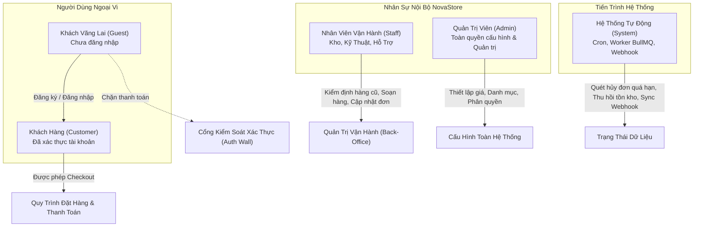

# Bảng Phân Quyền & Vai Trò Tác Nhân (Actors & Roles Specification)

| Thuộc tính              | Chi tiết                                                                        |
| :---------------------- | :------------------------------------------------------------------------------ |
| **Mã tài liệu**         | `DOC-BIZ-ACTORS`                                                                |
| **Tên tài liệu**        | Đặc tả Vai trò và Phân quyền Tác nhân Nghiệp vụ NovaStore                       |
| **Phiên bản**           | `1.0.0`                                                                         |
| **Trạng thái tài liệu** | `BASELINE REVIEW READY`                                                         |
| **Phạm vi**             | Toàn bộ các đối tượng tương tác trực tiếp hoặc gián tiếp với hệ thống NovaStore |
| **Ngôn ngữ**            | Tiếng Việt (kèm thuật ngữ chuyên ngành tiếng Anh)                               |
| **Ngày cập nhật**       | 14/11/2026                                                                      |

---

## 1. Tổng Quan Về Các Tác Nhân Nghiệp Vụ (Actors Overview)

Hệ thống NovaStore phân định ranh giới rõ ràng giữa 5 nhóm tác nhân nghiệp vụ:

1. **Khách Vãng Lai (Guest)**: Người dùng chưa thực hiện định danh hoặc chưa đăng nhập vào hệ thống.
2. **Khách Hàng (Customer)**: Người tiêu dùng đã đăng ký tài khoản hợp lệ và đã đăng nhập thành công.
3. **Nhân Viên Vận Hành (Staff)**: Đội ngũ nhân sự nội bộ trực tiếp tham gia chuỗi vận hành (Kỹ thuật viên phòng Lab kiểm định, Nhân viên kho, Nhân viên chăm sóc khách hàng).
4. **Quản Trị Viên (Admin)**: Cấp quản lý cấp cao có toàn quyền cấu hình chính sách, quản lý người dùng, thiết lập giá và giám sát toàn diện hoạt động kinh doanh.
5. **Hệ Thống Tự Động (System / Background Worker)**: Các tiến trình nền, hàng đợi BullMQ, trình lập lịch tự động và bộ lắng nghe sự kiện (Webhook Handler).

---

## 2. Chi Tiết Từng Tác Nhân Nghiệp Vụ

### 2.1 Khách Vãng Lai (Guest)

- **Mô tả**: Bất kỳ người dùng nào truy cập vào trang web NovaStore thông qua trình duyệt web mà chưa đăng nhập.
- **Yêu cầu xác thực**: Không yêu cầu đăng nhập. Hệ thống nhận diện qua phiên trình duyệt (Client Browser Session) và lưu dữ liệu cục bộ trên máy người dùng (`localStorage`).
- **Trách nhiệm & Hành vi**:
  - Tự do tra cứu, xem danh mục sản phẩm, sử dụng bộ lọc tìm kiếm nâng cao.
  - Xem chi tiết sản phẩm (PDP), xem ảnh thực tế, thông số kỹ thuật và biên bản kiểm định hàng cũ.
  - Sử dụng toàn diện 3 bộ cấu hình tương tác: **PC Builder**, **Full Setup Builder**, **Product Customizer (Bàn phím cơ)**.
  - Thêm sản phẩm đơn lẻ, đơn vị hàng cũ, hoặc bộ cấu hình tùy biến vào **Giỏ hàng Khách vãng lai (Guest Cart)**.
  - Chỉnh sửa số lượng, cấu hình lại bộ linh kiện hoặc xóa sản phẩm trong Giỏ hàng cục bộ.
- **Quyền hạn nghiệp vụ (Business Permissions)**:
  - `PERM_PUBLIC_VIEW`: Xem toàn bộ thông tin sản phẩm có trạng thái `Published`.
  - `PERM_CONFIGURATOR_USE`: Sử dụng các công cụ tính toán và kiểm tra tương thích.
  - `PERM_GUEST_CART_MANAGE`: Thêm/sửa/xóa giỏ hàng trên thiết bị cá nhân.
- **Hạn chế phân quyền cốt lõi (Important Restrictions)**:
  - ❌ **TUYỆT ĐỐI KHÔNG ĐƯỢC THANH TOÁN (Guest Checkout is DISABLED)**: Khi Guest nhấn nút "Tiến Hành Thanh Toán" (Proceed to Checkout) hoặc "Mua Ngay" (Buy Now), hệ thống lập tức chặn lại và chuyển hướng (redirect) bắt buộc sang màn hình Đăng Nhập / Đăng Ký tài khoản.
  - ❌ Không thể xem các sản phẩm ở trạng thái `Draft` hoặc `Archived`.
  - ❌ Không thể lưu cấu hình PC lâu dài trên máy chủ (chỉ lưu tạm thời trên trình duyệt).
  - ❌ Không có quyền gửi đánh giá, bình luận sản phẩm hoặc gửi yêu cầu bảo hành.

---

### 2.2 Khách Hàng (Customer)

- **Mô tả**: Người tiêu dùng đã đăng ký tài khoản người dùng tại NovaStore, xác thực email/số điện thoại và đã đăng nhập thành công.
- **Yêu cầu xác thực**: Bắt buộc đăng nhập bằng Email/Mật khẩu hoặc phương thức đăng nhập mạng xã hội (SSO) được hỗ trợ. Phiên đăng nhập được quản lý bằng chuẩn JWT an toàn (Access Token ngắn hạn + Refresh Token dài hạn).
- **Trách nhiệm & Hành vi**:
  - Sở hữu **Giỏ hàng Khách hàng (Customer Cart)** được lưu trữ bền vững tại cơ sở dữ liệu máy chủ.
  - Kế thừa và đồng bộ Giỏ hàng Guest sau khi đăng nhập thành công thông qua quy trình Gộp giỏ hàng an toàn (Cart Merge).
  - Quản lý sổ địa chỉ giao hàng cá nhân (Address Book), chọn địa chỉ mặc định.
  - Thực hiện toàn bộ quy trình **Thanh toán (Checkout)**: lựa chọn phương thức thanh toán, áp dụng mã giảm giá, kiểm tra xác nhận chênh lệch giá (nếu có), tiến hành thanh toán trực tuyến hoặc xác nhận đơn COD.
  - Theo dõi trạng thái đơn hàng theo thời gian thực (Đã thanh toán, Đang đóng gói, Đang giao hàng, Đã nhận hàng).
  - Tra cứu lịch sử đơn hàng, xem lại cấu hình dàn máy PC đã mua kèm số serial vật lý chính xác của từng linh kiện.
  - Khởi tạo yêu cầu bảo hành, đổi trả sản phẩm trực tiếp từ đơn hàng đã hoàn tất.
- **Quyền hạn nghiệp vụ (Business Permissions)**:
  - Toàn bộ quyền của `Guest`.
  - `PERM_CUSTOMER_CART_SYNC`: Lưu trữ và đồng bộ giỏ hàng nhiều thiết bị.
  - `PERM_ORDER_CREATE`: Khởi tạo và thanh toán đơn hàng.
  - `PERM_ORDER_VIEW_OWN`: Xem thông tin và lịch sử các đơn hàng do chính mình tạo ra.
  - `PERM_PROFILE_MANAGE`: Cập nhật thông tin cá nhân, mật khẩu, danh sách địa chỉ nhận hàng.
  - `PERM_WARRANTY_REQUEST`: Gửi yêu cầu hỗ trợ kỹ thuật và bảo hành.
- **Hạn chế phân quyền cốt lõi (Important Restrictions)**:
  - ❌ Tuyệt đối không thể xem hoặc chỉnh sửa đơn hàng, thông tin cá nhân, địa chỉ của khách hàng khác.
  - ❌ Không thể tự ý can thiệp thay đổi giá bán, chiết khấu hoặc ghi đè tồn kho hệ thống.
  - ❌ Không thể truy cập bất kỳ giao diện quản trị nội bộ nào (Admin/Staff Portal).

---

### 2.3 Nhân Viên Vận Hành (Staff)

- **Mô tả**: Nhân sự nội bộ của NovaStore làm việc tại các bộ phận: Kho hàng, Phòng Lab kỹ thuật kiểm định, và Chăm sóc khách hàng.
- **Yêu cầu xác thực**: Đăng nhập bằng tài khoản nội bộ cấp bởi Quản trị viên, bắt buộc kích hoạt xác thực hai yếu tố (2FA / MFA).
- **Trách nhiệm & Hành vi theo từng phân vai**:
  1. **Nhân viên Kỹ thuật (Technician / Hardware Specialist)**:
     - Tiếp nhận linh kiện thu mua cũ, tiến hành vệ sinh, tra keo tản nhiệt.
     - Chạy quy trình kiểm thử tải nặng (FurMark, Prime95, MemTest86, CrystalDiskInfo).
     - Đánh giá phân loại ngoại quan (`LIKE_NEW`, `GOOD`, `FAIR`), chụp ảnh thật khuyết tật.
     - Nhập số Serial vật lý, lập biên bản kiểm định điện tử vào hệ thống để đưa đơn vị hàng (Stock Unit) vào trạng thái khả dụng.
     - Lắp ráp thùng máy hoàn chỉnh theo đơn đặt hàng PC Builder, cài đặt hệ điều hành và kiểm tra burn-in trước khi chuyển qua bộ phận kho.
  2. **Nhân viên Kho (Warehouse Staff)**:
     - Nhập kho các lô hàng mới từ nhà cung cấp, quét mã lô và cập nhật số lượng tồn kho.
     - Soạn hàng (picking), kiểm tra đối chiếu số serial thực tế với phiếu xuất kho điện tử.
     - Đóng gói (packing) theo quy chuẩn chống sốc, niêm phong tem vỡ và dán mã vận đơn.
     - Bàn giao kiện hàng cho đơn vị vận chuyển đối tác.
  3. **Nhân viên Chăm sóc Khách hàng (Support Staff)**:
     - Tiếp nhận và xử lý yêu cầu thay đổi địa chỉ (khi đơn chưa xuất kho).
     - Hỗ trợ giải đáp thắc mắc về kỹ thuật, tư vấn cấu hình tương thích.
     - Tiếp nhận sản phẩm bảo hành, tạo phiếu kiểm tra bảo hành và cập nhật tiến độ xử lý cho khách hàng.
- **Quyền hạn nghiệp vụ (Business Permissions)**:
  - `PERM_INVENTORY_VIEW`: Xem chi tiết tồn kho vật lý và danh sách serial.
  - `PERM_STOCK_UNIT_INSPECT`: Tạo biên bản kiểm định, tải ảnh thực tế, kích hoạt bán hàng cũ.
  - `PERM_ORDER_FULFILL`: Cập nhật trạng thái chuẩn bị hàng, nhập mã vận đơn giao hàng.
  - `PERM_WARRANTY_PROCESS`: Cập nhật trạng thái phiếu tiếp nhận bảo hành.
- **Hạn chế phân quyền cốt lõi (Important Restrictions)**:
  - ❌ Không có quyền xóa dữ liệu đơn hàng hoặc lịch sử giao dịch.
  - ❌ Không có quyền thay đổi giá bán niêm yết (Pricing Policy) hoặc tạo chiến dịch khuyến mãi toàn hệ thống.
  - ❌ Không thể phân quyền hoặc tạo mới tài khoản nhân viên khác.

---

### 2.4 Quản Trị Viên (Admin)

- **Mô tả**: Lãnh đạo điều hành, Giám đốc kỹ thuật hoặc Trưởng bộ phận vận hành của NovaStore.
- **Yêu cầu xác thực**: Tài khoản đặc quyền cao cấp nhất, bắt buộc xác thực 2FA qua ứng dụng bảo mật phần cứng hoặc phần mềm (TOTP). Có phân định nhật ký kiểm toán (Audit Trail) ghi nhận mọi hành động nhạy cảm.
- **Trách nhiệm & Hành vi**:
  - Quản trị toàn bộ danh mục sản phẩm (thêm/sửa/xóa/ẩn/hiện các danh mục và mẫu sản phẩm).
  - Phê duyệt bảng giá niêm yết và các chương trình khuyến mãi, voucher giảm giá.
  - Quản lý tài khoản người dùng: tạo tài khoản nhân viên, cấp phát vai trò, khóa tài khoản vi phạm.
  - Cấu hình động cơ tương thích (Compatibility Engine): cập nhật các quy tắc socket mới, chuẩn RAM mới, kích thước card đồ họa mới.
  - Xem báo cáo phân tích doanh thu, tỷ lệ chuyển đổi, tồn kho cảnh báo cạn, và tỷ lệ lỗi bảo hành linh kiện cũ.
  - Xử lý các tình huống khiếu nại tranh chấp đặc biệt hoặc duyệt hoàn tiền đơn hàng giá trị cao.
- **Quyền hạn nghiệp vụ (Business Permissions)**:
  - `PERM_ADMIN_ALL`: Toàn quyền quản trị và can thiệp ở cấp độ cao nhất.
  - `PERM_CATALOG_MANAGE`: Quản lý danh mục và thuộc tính sản phẩm.
  - `PERM_PRICE_MANAGE`: Phê duyệt bảng giá niêm yết và chiết khấu.
  - `PERM_STAFF_MANAGE`: Cấp quyền, kích hoạt hoặc thu hồi tài khoản nhân viên.
  - `PERM_REFUND_APPROVE`: Phê duyệt các lệnh hoàn tiền qua cổng thanh toán.

---

### 2.5 Hệ Thống Tự Động (System / Background Worker)

- **Mô tả**: Tác nhân phi con người (non-human actor), bao gồm các máy chủ tiến trình nền, các tác vụ định kỳ (Cron jobs), hàng đợi tin nhắn BullMQ và bộ lắng nghe sự kiện Webhook từ cổng thanh toán/đơn vị vận chuyển.
- **Yêu cầu xác thực**: Sử dụng chữ ký số nội bộ (Internal Service API Keys), mTLS hoặc mã hóa HMAC bí mật cho các kết nối Webhook công khai.
- **Trách nhiệm & Hành vi**:
  - **Quản lý hết hạn giữ hàng (Reservation Expiry Job)**: Quét các đơn hàng chờ thanh toán quá hạn (ví dụ: sau 15-30 phút không hoàn tất giao dịch trực tuyến), tự động chuyển đơn sang trạng thái `CANCELLED` và hoàn trả số lượng tồn kho/giải phóng Stock Unit đã khóa.
  - **Đồng bộ thanh toán (Payment Webhook Handler)**: Tiếp nhận thông báo tức thời từ các cổng VNPAY/MoMo/Ngân hàng, giải mã xác minh chữ ký số hợp lệ (HMAC SHA512), kiểm tra đối soát số tiền khớp 100% với giá trị đơn hàng, sau đó chuyển trạng thái thanh toán sang `PAID` và trạng thái đơn sang `PROCESSING`.
  - **Cập nhật hành trình vận chuyển (Carrier Webhook Handler)**: Tiếp nhận tọa độ và trạng thái giao hàng từ đơn vị vận chuyển đối tác, cập nhật trạng thái đơn thành `SHIPPED` hoặc `DELIVERED`.
  - **Quét cảnh báo tồn kho (Inventory Low-Stock Alert Job)**: Quét các linh kiện có số lượng tồn kho khả dụng dưới ngưỡng an toàn để gửi thông báo cho bộ phận thu mua.
- **Quyền hạn nghiệp vụ (Business Permissions)**:
  - `PERM_SYSTEM_AUTO_CANCEL`: Tự động hủy đơn quá hạn và hoàn trả tồn kho.
  - `PERM_SYSTEM_PAYMENT_UPDATE`: Tự động ghi nhận trạng thái thanh toán từ Webhook.
  - `PERM_SYSTEM_FULFILL_SYNC`: Đồng bộ trạng thái vận chuyển từ đối tác giao vận.

---

## 3. Ma Trận Quyền Hạn Nghiệp Vụ (Business Permissions Matrix)

| Hành động nghiệp vụ                 | Khách Vãng Lai (Guest) | Khách Hàng (Customer) | Nhân Viên (Staff) | Quản Trị Viên (Admin) | Hệ Thống Tự Động (System) |
| :---------------------------------- | :--------------------: | :-------------------: | :---------------: | :-------------------: | :-----------------------: |
| **Xem sản phẩm Published**          |      ✅ Cho phép       |      ✅ Cho phép      |    ✅ Cho phép    |      ✅ Cho phép      |        ✅ Cho phép        |
| **Xem sản phẩm Draft/Archived**     |        ❌ Chặn         |        ❌ Chặn        |    ✅ Cho phép    |      ✅ Cho phép      |        ✅ Cho phép        |
| **Sử dụng PC & Setup Builder**      |      ✅ Cho phép       |      ✅ Cho phép      |    ✅ Cho phép    |      ✅ Cho phép      |            N/A            |
| **Thêm vào Giỏ hàng**               |  ✅ Cho phép (Local)   |  ✅ Cho phép (Cloud)  |        N/A        |          N/A          |            N/A            |
| **Tiến hành Thanh toán (Checkout)** | ❌ **CHẶN HOÀN TOÀN**  |    ✅ **BẮT BUỘC**    |        N/A        |          N/A          |            N/A            |
| **Xem đơn hàng cá nhân**            |          N/A           |      ✅ Cho phép      |        N/A        |          N/A          |            N/A            |
| **Xem toàn bộ đơn hàng**            |        ❌ Chặn         |        ❌ Chặn        |    ✅ Cho phép    |      ✅ Cho phép      |   ✅ (Truy vấn tự động)   |
| **Hủy đơn hàng**                    |          N/A           |   ✅ (Khi Pending)    |    ✅ Cho phép    |      ✅ Cho phép      |     ✅ (Khi hết hạn)      |
| **Nhập kho & Đăng kiểm hàng cũ**    |        ❌ Chặn         |        ❌ Chặn        |    ✅ Cho phép    |      ✅ Cho phép      |            N/A            |
| **Điều chỉnh giá niêm yết (VNĐ)**   |        ❌ Chặn         |        ❌ Chặn        |      ❌ Chặn      |      ✅ Cho phép      |            N/A            |
| **Xác nhận thanh toán thủ công**    |        ❌ Chặn         |        ❌ Chặn        |      ❌ Chặn      |      ✅ Cho phép      |     ✅ (Qua Webhook)      |
| **Đóng gói & Bàn giao vận chuyển**  |        ❌ Chặn         |        ❌ Chặn        |    ✅ Cho phép    |      ✅ Cho phép      |            N/A            |
| **Cấu hình Quy tắc Tương thích**    |        ❌ Chặn         |        ❌ Chặn        |      ❌ Chặn      |      ✅ Cho phép      |            N/A            |

---

## 4. Tài Liệu Tham Chiếu

- [Tổng quan nghiệp vụ NovaStore](./business-overview.md)
- [Quy trình nghiệp vụ giỏ hàng](./workflows/cart-management-workflow.md)
- [Quy trình nghiệp vụ thanh toán](./workflows/checkout-payment-workflow.md)
- [Bảng quy tắc nghiệp vụ tập trung](./business-rules-catalog.md)
- [Danh mục yêu cầu chức năng](./functional-requirements.md)
