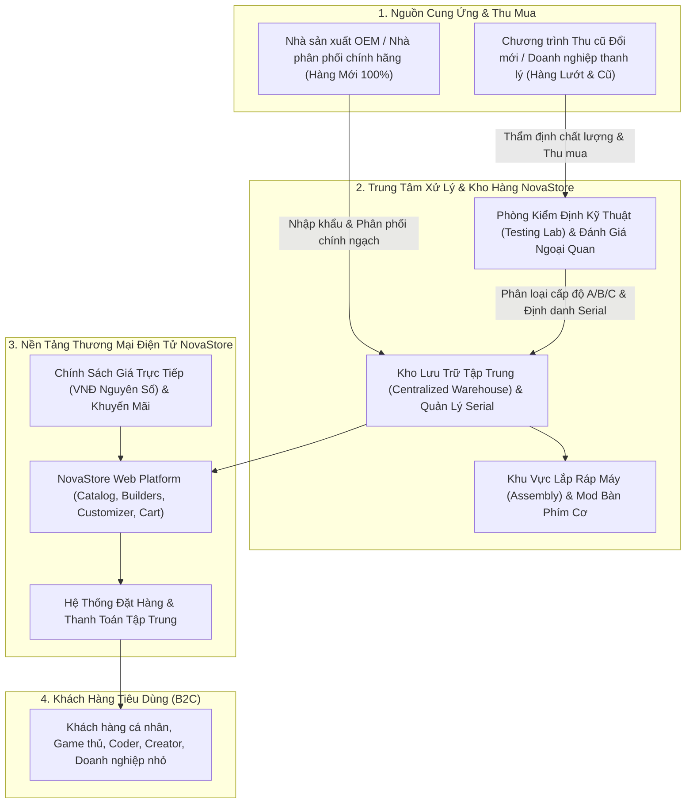
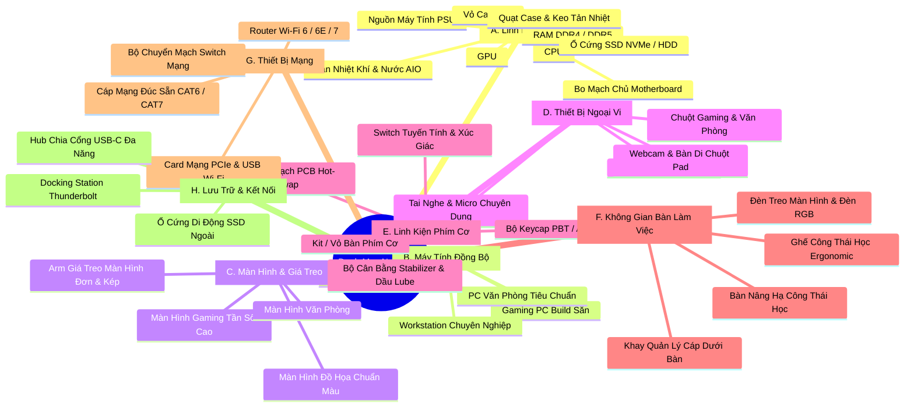
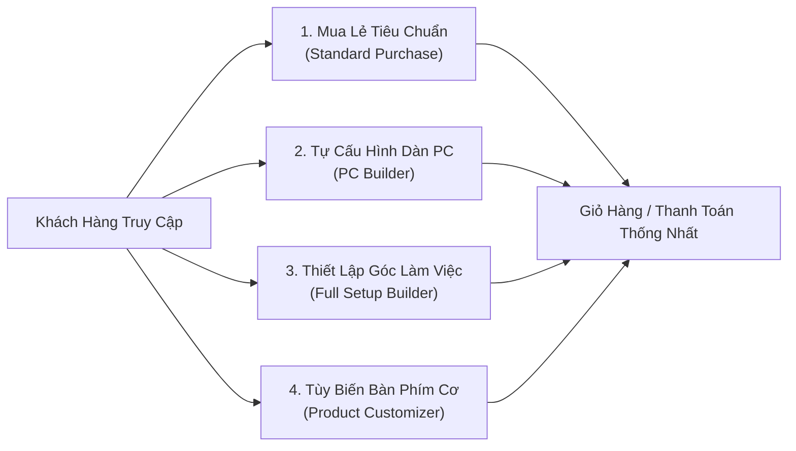

# Tổng Quan Nghiệp Vụ NovaStore (NovaStore Business Overview)

| Thuộc tính              | Chi tiết                                                                                    |
| :---------------------- | :------------------------------------------------------------------------------------------ |
| **Mã tài liệu**         | `DOC-BIZ-OVERVIEW`                                                                          |
| **Tên tài liệu**        | Tổng Quan Nghiệp Vụ NovaStore – PC & Gaming Setup Customization Commerce Platform           |
| **Phiên bản**           | `1.0.0`                                                                                     |
| **Trạng thái tài liệu** | `BASELINE REVIEW READY`                                                                     |
| **Phạm vi**             | Toàn bộ mô hình kinh doanh, danh mục sản phẩm, trải nghiệm khách hàng và ranh giới hệ thống |
| **Ngôn ngữ**            | Tiếng Việt (kèm thuật ngữ chuyên ngành tiếng Anh)                                           |
| **Ngày cập nhật**       | 14/11/2026                                                                                  |

---

## 1. Mục Đích & Tầm Nhìn Doanh Nghiệp (Business Purpose & Vision)

**NovaStore** được định vị là nền tảng thương mại điện tử chuyên sâu và hiện đại hàng đầu tại thị trường Việt Nam trong lĩnh vực **linh kiện máy tính (PC components), máy tính đồng bộ/chuyên dụng (prebuilt PCs), thiết lập góc làm việc & chơi game (gaming & workstation setups), bàn phím cơ tùy biến (custom mechanical keyboards)** cùng các thiết bị ngoại vi, mạng và phụ kiện liên quan.

Khác biệt với các website bán lẻ điện máy truyền thống hoặc các trang builder rời rạc, NovaStore giải quyết triệt để các bài toán cốt lõi của người dùng phần cứng công nghệ:

1. **Tính tương thích phức tạp của phần cứng**: Giúp khách hàng tự tin cấu hình hệ thống từ linh kiện rời rạc thông qua công cụ kiểm tra tương thích tự động (PC Builder).
2. **Thiết kế không gian làm việc công thái học toàn diện**: Không chỉ dừng lại ở thùng máy (case PC), mà mở rộng ra toàn bộ bàn làm việc, màn hình kép, tay đỡ màn hình (monitor arm), ghế công thái học, ánh sáng và quản lý dây cáp (Full Setup Builder).
3. **Cá nhân hóa sâu cho cộng đồng bàn phím cơ**: Cung cấp công cụ tùy biến bàn phím cơ từng tầng linh kiện (layout, case, switch, keycap, PCB, plate, lube/film) với kiểm soát tương thích chặt chẽ (Product Customizer).
4. **Minh bạch tuyệt đối cho thị trường linh kiện đã qua sử dụng (Used Hardware)**: Chuẩn hóa việc bán hàng đã qua sử dụng theo từng đơn vị vật lý duy nhất (Physical Stock Unit), đi kèm ảnh chụp thực tế, biên bản kiểm định kỹ thuật (stress test logs), công khai khuyết tật (defect disclosure) và chế độ bảo hành cửa hàng (NovaStore Store Warranty).
5. **Định hướng trợ lý mua sắm AI (AI Shopping Assistant - Tương lai)**: Chuẩn bị nền tảng kiến trúc để tích hợp trợ lý AI đóng vai trò chuyên viên tư vấn bán hàng, truy vấn kho hàng thực tế và kiểm tra tương thích thông qua Tool Calling có kiểm soát chặt chẽ.

---

## 2. Mô Hình Vận Hành: Bán Lẻ Sở Hữu Kho Hàng (Model A: Retailer-Owned Inventory)

NovaStore áp dụng **Mô hình A: Retailer-Owned Inventory / Store-Owned Retail Business** (Doanh nghiệp bán lẻ sở hữu và trực tiếp quản lý toàn bộ kho hàng).

NovaStore là đơn vị bán hàng duy nhất, là đối tác pháp lý và kỹ thuật trực tiếp chịu trách nhiệm trước người tiêu dùng:

### 2.1 Trách Nhiệm Trực Tiếp Của NovaStore

- **Quản lý tồn kho vật lý**: Lưu trữ trực tiếp tại hệ thống kho của NovaStore, kiểm soát tồn kho theo thời gian thực (real-time stock availability), gán nhãn mã vạch/serial cho từng đơn vị hàng cũ.
- **Quyết định giá bán**: Tự chủ thiết lập giá bán niêm yết bằng số nguyên Đồng Việt Nam (VNĐ), áp dụng định giá phân tầng theo tình trạng hàng cũ.
- **Kiểm định chất lượng 100%**: Tất cả linh kiện đã qua sử dụng đều trải qua quy trình kiểm tra tải nặng (stress test) trước khi nhập kho niêm yết.
- **Bảo hành và hậu mãi**: Chịu trách nhiệm tiếp nhận và bảo hành chính hãng đối với hàng Mới; trực tiếp bảo hành 1 đổi 1 hoặc sửa chữa/hoàn tiền đối với hàng Đã qua sử dụng theo chính sách của NovaStore.
- **Xử lý đơn hàng thống nhất**: Tiếp nhận thanh toán qua một cổng duy nhất, đóng gói đồng bộ, xuất hóa đơn tài chính trực tiếp từ NovaStore.

### 2.2 Ranh Giới Loại Trừ Tuyệt Đối (Explicit Exclusions: Không Phải Sàn Thương Mại Điện Tử)

Để đảm bảo chất lượng kỹ thuật đồng nhất và độ tin cậy tuyệt đối về mặt tương thích phần cứng, NovaStore **KHÔNG** phát triển theo mô hình sàn giao dịch đa người bán (Marketplace):

- ❌ **Không có đăng ký tài khoản người bán thứ ba (No 3rd-party seller registration)**.
- ❌ **Không có cổng quản trị dành riêng cho đối tác bán hàng (No vendor portals / merchant dashboards)**.
- ❌ **Không có danh mục sản phẩm do đối tác tự đăng (No seller-owned listings)**.
- ❌ **Không có cơ chế tính hoa hồng bán hàng (No marketplace commission calculation)**.
- ❌ **Không có quy trình tách đơn hàng theo nhiều nhà cung cấp (No multi-vendor order splitting)**.
- ❌ **Không có mô hình Dropshipping từ bên thứ ba (No third-party inventory fulfillment abstractions)**.

---

## 3. Khách Hàng Mục Tiêu (Target Customers)

NovaStore phục vụ 5 phân khúc khách hàng cốt lõi:

| Phân khúc                                | Đặc điểm & Nhu cầu                                                                                                                                       | Trải nghiệm NovaStore phục vụ                                                          |
| :--------------------------------------- | :------------------------------------------------------------------------------------------------------------------------------------------------------- | :------------------------------------------------------------------------------------- |
| **Gamer & Streamer**                     | Nhu cầu cấu hình đồ họa cao, tản nhiệt tốt, tính thẩm mỹ (RGB), màn hình tần số quét cao, âm thanh vòm và phụ kiện độ trễ thấp.                          | PC Builder, Full Gaming Setup Builder, Mua lẻ Gaming Peripherals.                      |
| **PC Hardware Enthusiast**               | Người am hiểu phần cứng, thích ép xung (overclock), tìm kiếm linh kiện cao cấp, hoặc săn linh kiện đã qua sử dụng hiệu năng cao với giá tối ưu.          | PC Builder (tùy chọn linh kiện cao cấp & hàng Used kèm ảnh chi tiết, stress test log). |
| **Content Creator / Engineer / AI Dev**  | Đòi hỏi độ ổn định tuyệt đối, dung lượng RAM lớn (64GB - 128GB+), CPU đa nhân, GPU VRAM lớn phục vụ render, tính toán mô hình AI cục bộ.                 | Prebuilt Workstation, PC Builder cấu hình cao, Màn hình chuẩn màu, Ổ cứng tốc độ cao.  |
| **Dân Văn Phòng & WFH (Work From Home)** | Quan tâm sâu sắc đến công thái học (ergonomics), tư thế ngồi, giảm mỏi mắt, bàn nâng hạ, ghế công thái học, không gian gọn gàng không dây rợ.            | Full Setup Builder (Setup công thái học), Màn hình văn phòng, Bàn/Ghế công thái học.   |
| **Custom Mechanical Keyboard Hobbyist**  | Người chơi phím cơ đam mê trải nghiệm gõ, âm thanh (thock/clack), chất liệu plate, độ nảy của switch, thẩm mỹ keycap và khả năng lập trình phím QMK/VIA. | Product Customizer (Custom Bàn Phím Cơ), Mua lẻ kit/switch/keycap.                     |

---

## 4. Phạm Vi Danh Mục Sản Phẩm (8 Nhóm Ngành Hàng Cốt Lõi)

Danh mục sản phẩm của NovaStore bao phủ toàn diện 8 nhóm ngành hàng kỹ thuật (Ký hiệu A đến H):

---

## 5. Mô Hình Song Hành Hàng Mới & Hàng Đã Qua Sử Dụng (New & Used Model)

Một năng lực cạnh tranh cốt lõi của NovaStore là cung cấp song song **Sản phẩm Mới 100% (Brand-New)** và **Sản phẩm Đã Qua Sử Dụng (Used / Pre-Owned)** trong cùng một giao diện nhất quán.

### 5.1 Cấu Trúc Định Danh 3 Tầng (3-Tier Catalog vs Inventory Model)

1. **Catalog Product (Mẫu Sản Phẩm Danh Mục)**: Đại diện cho thông tin mẫu mã chung (ví dụ: _Card Màn Hình ASUS TUF Gaming GeForce RTX 4070 Ti SUPER 16GB_). Chứa thông số kỹ thuật tiêu chuẩn, cổng kết nối, kích thước, ảnh đại diện marketing.
2. **Product Variant (Biến Thể Sản Phẩm)**: Phân tách theo phiên bản màu sắc, dung lượng hoặc trạng thái tổng quát (_Phiên bản Mới 100%_ vs _Phiên bản Đã Qua Sử Dụng_).
3. **Physical Stock Unit (Đơn Vị Hàng Vật Lý Cụ Thể - Dành Riêng Cho Hàng Cũ)**:
   - Với **Hàng Mới**: Quản lý theo số lượng tồn kho tổng hợp (Aggregate Quantity) thuộc lô hàng (Lot/Batch).
   - Với **Hàng Cũ**: Mỗi sản phẩm là **MỘT ĐƠN VỊ VẬT LÝ DUY NHẤT (Số lượng = 1)**, có Mã định danh đơn vị (Unit ID), Số Serial thực tế, Tình trạng ngoại quan cụ thể (`LIKE_NEW`, `GOOD`, `FAIR`), Thư viện ảnh chụp thật từng góc cạnh, Biên bản kiểm định phần cứng (stress test log), Công khai khuyết tật cụ thể và Gói bảo hành NovaStore riêng biệt.
   - **Quy tắc bất biến**: Không gộp chung hàng cũ thành một nhóm hàng hóa hoán đổi được (non-interchangeable). Khi khách hàng chọn một Stock Unit cũ, họ sở hữu chính xác món hàng vật lý đó.

### 5.2 Bảng Phân Tầng Tình Trạng Hàng (Condition Grades)

- **`NEW`**: Mới 100%, nguyên hộp nguyên niêm phong nhà máy (factory sealed), bảo hành chính hãng đầy đủ (12 - 36 tháng).
- **`LIKE_NEW` (Grade A)**: Hàng lướt / unbox / dùng cực ít, ngoại quan 99% không trầy xước nhìn thấy được, hoạt động 100% hoàn hảo qua bài test tải nặng, bảo hành cửa hàng 6 - 12 tháng.
- **`GOOD` (Grade B)**: Đã qua sử dụng, có vết xước dăm nhẹ trên vỏ kim loại/backplate không ảnh hưởng hiệu năng, nhiệt độ ổn định, phụ kiện cơ bản đầy đủ, bảo hành cửa hàng 3 - 6 tháng.
- **`FAIR` (Grade C)**: Trầy xước nhìn rõ, mất hộp nguyên bản hoặc thiếu phụ kiện thứ yếu (được ghi chú rõ ràng), hiệu năng và độ ổn định bo mạch được kiểm định 100%, giá tối ưu ngân sách, bảo hành cửa hàng 1 - 3 tháng.

---

## 6. Bốn Trải Nghiệm Mua Sắm Khách Hàng (Customer Purchase Experiences)

NovaStore thiết kế 4 hành trình mua sắm chuyên biệt:

1. **Mua Lẻ Sản Phẩm Tiêu Chuẩn (Standard Individual Product Purchase)**: Tìm kiếm, lọc, xem chi tiết và mua trực tiếp một sản phẩm (Mới hoặc một Đơn vị hàng Cũ cụ thể) như một sàn thương mại điện tử tiêu chuẩn.
2. **Bộ Cấu Hình PC Tương Tác (PC Builder)**: Lắp ráp một thùng máy PC hoàn chỉnh từ linh kiện rời rạc. Động cơ tương thích (Compatibility Engine) liên tục kiểm tra theo thời gian thực: socket CPU - bo mạch chủ, chuẩn RAM DDR4/DDR5, kích thước GPU so với chiều dài case, chiều cao tản nhiệt khí, kích thước rad tản nước và công suất nguồn PSU an toàn.
3. **Bộ Quy Hoạch Góc Gaming & Setup (Full Gaming Setup Builder)**: Xây dựng toàn bộ không gian làm việc bao gồm: Thùng PC (hoặc Laptop/Dock), Hệ thống màn hình hiển thị kép, Giá treo chịu tải (monitor arm payload), Chuột/Phím/Tai nghe/Mic, Bàn nâng hạ theo chiều rộng phòng, Ghế công thái học và giải pháp quản lý điện năng/dây cáp.
4. **Bộ Tùy Biến Bàn Phím Cơ (Product Customizer)**: Trải nghiệm dựng bàn phím cơ từng tầng: Chọn Case (vật liệu nhôm/polycarbonate), Mạch PCB (hot-swap/hàn), Switch (linear/tactile, 3-pin/5-pin), Keycap (profile, chất liệu), Plate (nhôm, FR4, đồng), Bộ cân bằng Stabilizer và dịch vụ lube switch theo yêu cầu.

---

## 7. Mô Hình Doanh Thu (High-Level Revenue Model)

NovaStore tạo ra dòng tiền thông qua 4 nguồn doanh thu trực tiếp từ hoạt động bán lẻ:

1. **Biên lợi nhuận bán lẻ hàng mới (New Hardware Retail Margin)**: Chênh lệch giữa giá bán lẻ niêm yết và giá nhập sỉ từ các nhà phân phối linh kiện chính thức.
2. **Biên lợi nhuận hàng tân trang & đã qua sử dụng (Pre-Owned / Refurbished Margin)**: Giá trị gia tăng từ việc thu mua linh kiện cũ, tiến hành vệ sinh, thay keo tản nhiệt cao cấp, kiểm định chất lượng, đóng gói bảo chuẩn và bán ra thị trường kèm gói bảo hành uy tín của NovaStore.
3. **Phí dịch vụ kỹ thuật & lắp ráp (Assembly & Customization Service Fees)**:
   - Phí lắp ráp trọn gói dàn PC chuyên nghiệp, đi dây giấu cáp thẩm mỹ cao, cài đặt hệ điều hành và kiểm tra benchmark trước khi bàn giao.
   - Phí dịch vụ độ bàn phím cơ thủ công (Hand-lubing switch, cân chỉnh wire stabilizer, dán tape mod, dán foam tiêu âm).
4. **Gói bảo hành mở rộng (Extended Store Warranty Packages)**: Doanh thu từ việc khách hàng mua thêm thời gian bảo hành đổi mới tại NovaStore cho các sản phẩm linh kiện cũ (ví dụ: mở rộng từ gói tiêu chuẩn 3 tháng lên 12 tháng).

---

## 8. Ranh Giới Phạm Vi Hệ Thống (Scope Boundaries)

### 8.1 Trong Phạm Vi Nghiệp Vụ Cốt Lõi (In-Scope Baseline)

- Catalog sản phẩm đa tầng, quản lý thông số kỹ thuật mở rộng.
- Quản lý hàng mới theo số lượng và hàng cũ theo từng đơn vị vật lý số serial.
- 4 trải nghiệm cấu hình và mua sắm (Standard, PC Builder, Full Setup Builder, Keyboard Customizer).
- Quản lý Giỏ hàng Guest (lưu tại trình duyệt) và Giỏ hàng Customer (lưu tại cơ sở dữ liệu), quy tắc gộp giỏ hàng (Cart Merge) an toàn.
- Bắt buộc đăng nhập khi Thanh toán (Guest Checkout bị tắt hoàn toàn).
- Đánh giá lại giá bán và tồn kho tại thời điểm Thanh toán (Price & Stock Revalidation).
- Quy trình Đặt hàng, Khởi tạo Thanh toán trực tuyến (VNPAY, MoMo, Ngân hàng) và COD có điều kiện.
- Vòng đời đơn hàng tách bạch 4 trạng thái: Trạng thái Đơn hàng, Thanh toán, Vận chuyển, Giữ hàng kho.

### 8.2 Phạm Vi Tương Lai (Future Scope)

- **Trợ Lý Mua Sắm AI (AI Shopping Assistant)**: Giao diện hội thoại tự nhiên, tư vấn cấu hình, tra cứu kho hàng và tự động thao tác giỏ hàng thông qua cơ chế Tool Calling có xác thực và phê duyệt của khách hàng.
- **Chương trình Khách hàng thân thiết (Loyalty Program)**: Tích điểm đổi quà, phân hạng thành viên (Silver, Gold, Platinum).

### 8.3 Loại Trừ Tuyệt Đối (Explicitly Out-of-Scope)

- Sàn thương mại điện tử đa người bán (Third-party marketplace).
- Tính năng người bán tự đăng sản phẩm, biểu phí hoa hồng, phân tách đơn hàng đa nhà cung cấp.
- Đấu giá linh kiện trực tuyến (Bidding/Auction system).
- Tiền ảo hoặc thanh toán phân số nhỏ hơn 1 VNĐ.

---

## 9. Định Dạng Tiền Tệ Cố Định (Fixed Currency Format)

- Toàn bộ hoạt động tài chính, định giá sản phẩm, phụ phí, giảm giá và thanh toán trên NovaStore áp dụng duy nhất đơn vị tiền tệ: **Đồng Việt Nam (VNĐ)**.
- **Số nguyên tuyệt đối (Integer VNĐ)**: Không sử dụng số thập phân hoặc đơn vị xu/cents (ví dụ: `15.500.000 VNĐ`, tuyệt đối không lưu trữ dạng `15500000.00` hay thực hiện phép chia 100 kiểu tiền tệ USD).

---

## 10. Tài Liệu Liên Quan

- [Mô hình kinh doanh sở hữu kho hàng](./business-model.md)
- [Bảng phân quyền và vai trò tác nhân](./actors-and-roles.md)
- [Danh mục ngành hàng và kiến trúc thuộc tính](./product-catalog.md)
- [Tiêu chuẩn đánh giá tình trạng hàng và bảo hành](./product-condition-and-warranty.md)
- [Bốn trải nghiệm cấu hình và mua sắm](./customer-experiences.md)
- [Quy trình nghiệp vụ khám phá sản phẩm](./workflows/product-discovery-workflow.md)
- [Quy trình nghiệp vụ chi tiết sản phẩm](./workflows/product-detail-workflow.md)
- [Quy trình nghiệp vụ giỏ hàng](./workflows/cart-management-workflow.md)
- [Quy trình nghiệp vụ thanh toán](./workflows/checkout-payment-workflow.md)
- [Vòng đời đơn hàng](./order-lifecycle.md)
- [Bảng quy tắc nghiệp vụ tập trung](./business-rules-catalog.md)
- [Danh mục yêu cầu chức năng](./functional-requirements.md)
- [Thuật ngữ nghiệp vụ](./glossary.md)
- [Lộ trình phát triển và phạm vi phát hành](./scope-and-roadmap.md)
