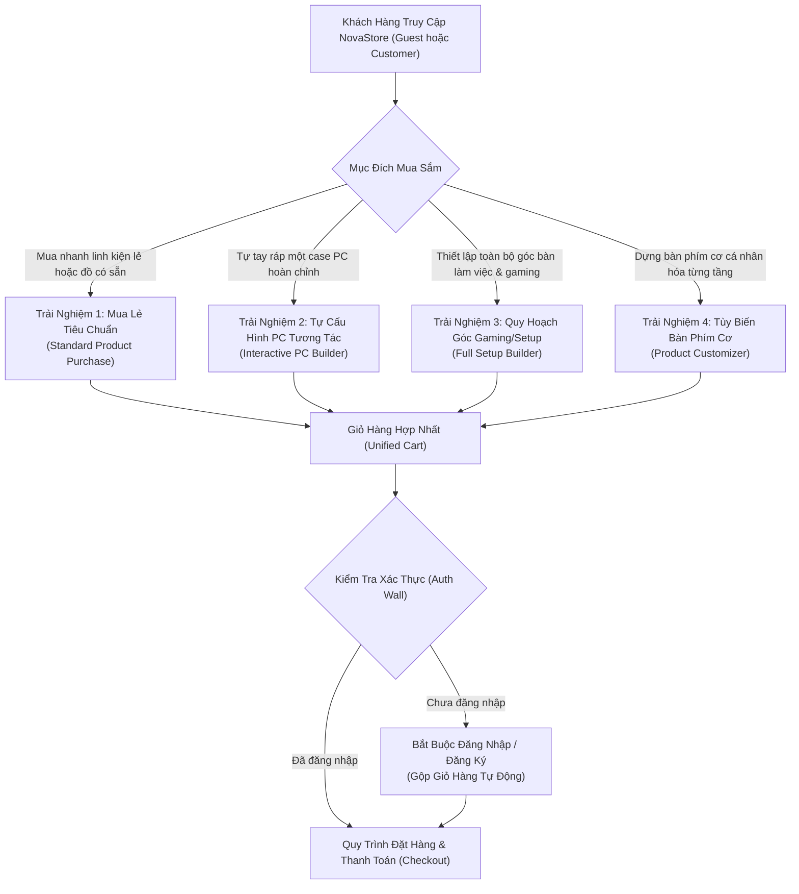
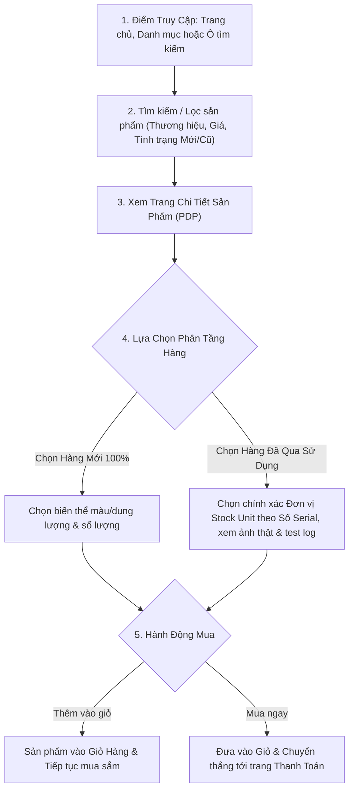
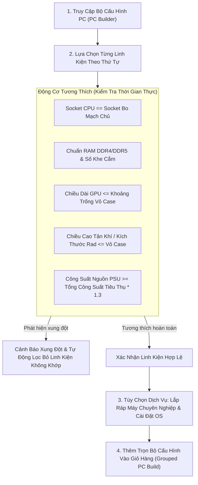
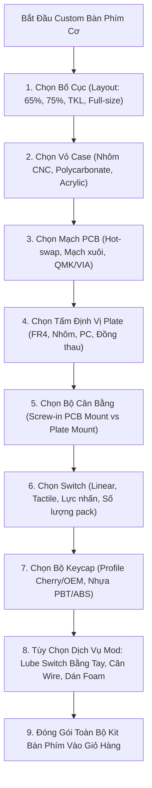

# Bốn Trải Nghiệm Mua Sắm Khách Hàng (Customer Purchase Experiences)

| Thuộc tính              | Chi tiết                                                                                                |
| :---------------------- | :------------------------------------------------------------------------------------------------------ |
| **Mã tài liệu**         | `DOC-BIZ-EXPERIENCES`                                                                                   |
| **Tên tài liệu**        | Đặc tả 4 Hành trình Mua sắm Cốt lõi của Khách hàng trên NovaStore                                       |
| **Phiên bản**           | `1.0.0`                                                                                                 |
| **Trạng thái tài liệu** | `BASELINE REVIEW READY`                                                                                 |
| **Phạm vi**             | Chi tiết 4 hành trình mua sắm từ điểm truy cập, tương tác, kiểm tra tương thích đến chuyển vào giỏ hàng |
| **Ngôn ngữ**            | Tiếng Việt (kèm thuật ngữ chuyên ngành tiếng Anh)                                                       |
| **Ngày cập nhật**       | 14/11/2026                                                                                              |

---

## 1. Bản Đồ Tổng Thể 4 Trải Nghiệm Mua Sắm (Experiences Overview)

NovaStore phục vụ khách hàng thông qua 4 hành trình mua sắm chuyên biệt, đáp ứng từ nhu cầu mua sắm linh kiện nhanh chóng đến các bài toán phối ghép kỹ thuật phức tạp:

---

## 2. Trải Nghiệm 1: Mua Lẻ Sản Phẩm Tiêu Chuẩn (Standard Individual Product Purchase)

Hành trình phục vụ khách hàng có nhu cầu mua một hoặc nhiều linh kiện, phụ kiện cụ thể mà không cần công cụ cấu hình phức tạp.

### Chi Tiết Hành Trình:

- **Điểm truy cập (Entry Point)**: Trang chủ, Danh mục ngành hàng, Thanh tìm kiếm hoặc đường dẫn trực tiếp (PDP URL).
- **Hành vi người dùng**:
  - Tìm kiếm sản phẩm theo tên, mã SKU hoặc bộ lọc chuyên sâu (theo chipset, chuẩn socket, kích thước).
  - Lọc theo Tình trạng: "Chỉ hiển thị hàng Mới" hoặc "Xem danh sách hàng Đã qua sử dụng".
  - Trên trang chi tiết sản phẩm:
    - Nếu chọn Hàng Mới: Chọn biến thể (màu sắc, dung lượng) và điều chỉnh số lượng mua mong muốn.
    - Nếu chọn Hàng Cũ: Duyệt danh sách các Đơn vị tồn kho vật lý (Stock Units), xem ảnh chụp vết xước thực tế, xem kết quả stress test FurMark/Prime95, xem thời hạn bảo hành cửa hàng và số Serial cụ thể. Số lượng mặc định cố định bằng 1.
  - Nhấp nút "Thêm vào giỏ hàng" (Add to Cart) hoặc "Mua ngay" (Buy Now).
- **Phản hồi của hệ thống**:
  - Kiểm tra trạng thái xuất bản `Published` và kiểm tra tồn kho khả dụng theo thời gian thực.
  - Cập nhật Giỏ hàng (Guest Cart trên trình duyệt hoặc Customer Cart trên máy chủ).
  - Hiển thị thông báo Toast xác nhận thành công và cập nhật số lượng trên biểu tượng Giỏ hàng thanh điều hướng.
- **Quy tắc kiểm tra (Validation Rules)**:
  - Nếu sản phẩm Hết hàng (`OUT_OF_STOCK`): Khóa nút thêm vào giỏ, hiển thị nhãn "Tạm Hết Hàng".
  - Với Đơn vị hàng Cũ: Kiểm tra đơn vị Serial đó chưa bị khóa bởi phiên thanh toán khác. Nếu khách hàng cố tình thêm một Stock Unit cũ đã có trong giỏ hàng, hệ thống cảnh báo "Mỗi sản phẩm cũ chỉ có duy nhất 1 chiếc vật lý" và không tăng số lượng.
- **Kết quả thành công**: Mặt hàng xuất hiện chính xác trong Giỏ hàng với đúng đơn giá niêm yết hiện thời.
- **Kịch bản ngoại lệ / Lỗi**:
  - Đơn vị hàng cũ vừa bị người khác mua mất trong tích tắc: Hệ thống báo lỗi "Sản phẩm vật lý này vừa có người đặt mua, vui lòng chọn số Serial khác".

---

## 3. Trải Nghiệm 2: Tự Cấu Hình Dàn PC Tương Tác (Interactive PC Builder)

Hành trình chuyên sâu giúp khách hàng tự tay lựa chọn từng linh kiện để dựng thành một thùng máy PC hoàn chỉnh, với sự giám sát chặt chẽ của **Động Cơ Tương Thích Phần Cứng (Hardware Compatibility Engine)**.

### Danh Mục 10 Linh Kiện Cấu Thành Dàn PC:

1. Vi xử lý (CPU)
2. Bo mạch chủ (Motherboard / Mainboard)
3. Bộ nhớ trong (RAM)
4. Ổ cứng lưu trữ chính & phụ (SSD NVMe M.2 / HDD)
5. Card màn hình (GPU / VGA)
6. Bộ nguồn máy tính (PSU)
7. Vỏ máy tính (Chassis / Case)
8. Tản nhiệt CPU (Tản khí hoặc Tản nước AIO)
9. Quạt tản nhiệt vỏ case & Phụ kiện tản nhiệt
10. Dịch vụ lắp ráp máy trọn gói & Cài đặt hệ điều hành (Tùy chọn)

### Các Quy Tắc Tương Thích Cốt Lõi (Compatibility Rules):

1. **Khớp Chân Cắm CPU - Bo Mạch Chủ (Socket Matching)**:
   - Vi xử lý chuẩn chân cắm nào chỉ được phép kết hợp với Bo mạch chủ có cùng chuẩn chân cắm (Ví dụ: CPU AMD Ryzen 7000/9000 Socket AM5 bắt buộc đi với Bo mạch chủ AM5 B650/X670; CPU Intel Core 14th Gen Socket LGA1700 bắt buộc đi với Bo mạch chủ B760/Z790).
2. **Khớp Chuẩn Thế Hệ Bộ Nhớ (RAM Generation Matching)**:
   - Bo mạch chủ hỗ trợ chuẩn DDR4 chỉ cho phép chọn RAM DDR4; Bo mạch chủ DDR5 chỉ cho phép chọn RAM DDR5.
   - Tổng số thanh RAM chọn không được vượt quá số khe cắm vật lý trên bo mạch (tối đa 2 hoặc 4 thanh).
3. **Khoảng Trống Chiều Dài Card Màn Hình (GPU Length Clearance)**:
   - Chiều dài vật lý của GPU (mm) phải nhỏ hơn hoặc bằng chiều dài tối đa hỗ trợ của Vỏ Case (có trừ hao không gian nếu người dùng lắp quạt/két nước tản nhiệt ở mặt trước case).
4. **Khoảng Trống Tản Nhiệt CPU (Cooler Height & Radiator Clearance)**:
   - Đối với tản khí: Chiều cao tản nhiệt (mm) phải nhỏ hơn chiều cao tối đa hỗ trợ của vỏ case.
   - Đối với tản nước AIO: Kích thước két làm mát (240mm, 280mm, 360mm) phải được vỏ case hỗ trợ lắp đặt ở nóc (Top) hoặc mặt trước (Front).
5. **Hệ Số An Toàn Công Suất Nguồn (PSU Wattage Overhead)**:
   - Hệ thống tự động tính toán tổng công suất tiêu thụ ước tính theo công thức:
     $$\text{Tổng công suất ước tính} = (\text{TDP CPU} + \text{TGP GPU} + 75\text{W cho Bo mạch/RAM/Fan/SSD}) \times 1.3\text{ (Hệ số an toàn 30\%)}$$
   - Bộ nguồn PSU được chọn bắt buộc phải có công suất định danh lớn hơn hoặc bằng mức công suất ước tính này.

### Đóng Gói Vào Giỏ Hàng:

- Khi hoàn tất, toàn bộ dàn máy được đưa vào giỏ hàng dưới dạng **Một Mục Cấu Hình Nhóm (Grouped Configuration Cart Item)**.
- Mục này lưu giữ bản chụp tức thời (Snapshot) của toàn bộ các linh kiện thành phần, tổng giá tiền trọn gói, và phí dịch vụ lắp ráp.
- Nếu khách hàng muốn sửa đổi bất kỳ linh kiện nào, hệ thống bắt buộc mở lại giao diện PC Builder để Động cơ tương thích kiểm tra lại toàn diện trước khi lưu thay đổi.

---

## 4. Trải Nghiệm 3: Quy Hoạch Toàn Diện Góc Làm Việc & Chơi Game (Full Gaming & Workstation Setup Builder)

Trải nghiệm này mở rộng ranh giới ra ngoài thùng máy PC, hướng tới việc **thiết lập một không gian làm việc hoặc chiến game hoàn chỉnh chuẩn công thái học và thẩm mỹ**.

```mermaid
flowchart LR
    subgraph Layer1 ["1. Trọng Tâm Máy Tính"]
        PC["Thùng PC Hoặc Laptop Workstation kèm Docking"]
    end
    subgraph Layer2 ["2. Hệ Thống Hiển Thị"]
        Monitors["Màn hình Gaming / Màn hình Đồ họa Kép"]
        Arms["Giá Treo Màn Hình (Arm Trợ Lực Khí Nén)"]
    end
    subgraph Layer3 ["3. Ngoại Vi & Âm Thanh"]
        Peripherals["Bàn phím cơ, Chuột, Lót chuột lớn, Tai nghe, Mic"]
    end
    subgraph Layer4 ["4. Nội Thất Công Thái Học"]
        Desk["Bàn Nâng Hạ Điện Tử"]
        Chair["Ghế Công Thái Học"]
    end
    subgraph Layer5 ["5. Ánh Sáng & Dây Cáp"]
        Lighting["Đèn treo màn hình chống mỏi mắt, Đèn LED hắt tường"]
        Cable["Máng đi dây giấu gầm bàn"]
    end

    Layer1 --> Layer2 --> Layer3 --> Layer4 --> Layer5 --> SetupSummary["Tổng Thể Góc Setup Đưa Vào Giỏ Hàng"]
```

### Các Quy Tắc Kiểm Tra Quy Hoạch Setup (Setup Validation Rules):

1. **Băng Thông Xuất Hình Màn Hình (Display Output Bandwidth)**:
   - Hệ thống kiểm tra số lượng cổng xuất hình (HDMI 2.1 / DisplayPort 1.4/2.1) trên Card đồ họa hoặc Docking Station được chọn có đáp ứng đủ số lượng màn hình trong góc setup hay không.
2. **Tải Trọng Tay Đỡ Màn Hình (Monitor Arm Payload Capacity)**:
   - Trọng lượng của màn hình (trừ chân đế) phải nằm trong dải tải trọng chịu lực cho phép của từng tay arm (Ví dụ: Màn hình 34-inch nặng 8.5kg bắt buộc phải dùng Arm chịu lực hạng nặng 2 - 15kg; nếu chọn arm phổ thông 2 - 9kg hệ thống sẽ phát cảnh báo nguy cơ sụp màn hình).
   - Chuẩn ngàm ốc sau lưng màn hình (VESA 75x75 hoặc 100x100) phải tương thích với tấm ngàm của arm.
3. **Kích Thước Bàn So Với Thiết Bị (Desk Dimensions vs Equipment Footprint)**:
   - Chiều rộng mặt bàn nâng hạ (ví dụ: 1m2, 1m4, 1m6, 1m8) được đối chiếu với kích thước vật lý của 2 màn hình đặt cạnh nhau để cảnh báo nếu màn hình bị chìa ra ngoài mép bàn.
4. **Hạ Tầng Điện & Cổng Kết Nối Phụ Trợ (Power & USB Connectivity)**:
   - Tính toán số lượng thiết bị cần cắm nguồn điện trực tiếp và số lượng cổng USB để đề xuất bổ sung ổ cắm lọc sét hoặc hub mở rộng USB chuyên dụng.

---

## 5. Trải Nghiệm 4: Tùy Biến Bàn Phím Cơ Từng Tầng (Modular Product Customizer)

Dành riêng cho cộng đồng đam mê bàn phím cơ, cho phép người dùng tùy chọn từng linh kiện cấu thành với độ chi tiết tối đa.

### Các Quy Tắc Tương Thích Bàn Phím Cơ (Keyboard Customizer Rules):

1. **Khớp Bố Cục (Layout Compatibility)**:
   - Tấm định vị (Plate) và Mạch phím (PCB) bắt buộc phải có cùng kích thước và bố cục layout với Vỏ Case (Ví dụ: PCB layout 75% không thể gắn vào Case 65%).
2. **Khớp Chân Cắm Switch (Switch Pin Compatibility)**:
   - Switch 5-pin (có 2 chân nhựa định vị phụ) chỉ gắn trực tiếp được trên mạch PCB hỗ trợ 5-pin; nếu mạch PCB chỉ hỗ trợ 3-pin, hệ thống sẽ cảnh báo người dùng cần cắt chân nhựa hoặc đổi loại switch/PCB.
3. **Độ Dày Mạch & Ngàm Stabilizer (PCB Thickness vs Stabilizers)**:
   - Mạch PCB siêu mỏng độ dày 1.2mm yêu cầu sử dụng đệm chêm (shims) chuyên dụng khi bắt stabilizer bắt ốc PCB; hệ thống tự động bổ sung đệm chêm vào danh mục phụ kiện đi kèm.
4. **Hướng Đèn Mạch Tránh Cấn Keycap (South-facing vs North-facing)**:
   - Nếu khách hàng chọn Keycap profile Cherry kết hợp với mạch LED ngược (North-facing), hệ thống hiển thị khuyến cáo nguy cơ cấn viền keycap ở hàng phím R3 dẫn đến cảm giác gõ không đều.

---

## 6. Tính Nhất Quán Giữa Các Trải Nghiệm & Giỏ Hàng

Mọi sản phẩm từ 4 trải nghiệm trên khi đưa vào giỏ hàng đều tuân thủ các nguyên tắc nhất quán:

1. **Giá Bán Là Giá Hiện Thời**: Thêm vào giỏ không khóa giá sản phẩm; giá bán và tình trạng tồn kho sẽ được kiểm tra lại đầy đủ tại bước Thanh toán (Checkout).
2. **Tính Bất Biến Của Bộ Cấu Hình**: Các bộ PC Build, Full Setup hay Bàn phím custom được biểu diễn dưới dạng các nhóm mục (Grouped Items). Khách hàng không thể xóa tùy tiện một linh kiện bắt buộc (như xóa CPU khỏi bộ PC) ngay trong giỏ hàng; mọi thao tác chỉnh sửa linh kiện bắt buộc phải bấm nút "Sửa Cấu Hình" (Edit in Builder) để Động cơ tương thích kiểm tra lại từ đầu.
3. **Không Tự Động Thay Thế Linh Kiện**: Nếu một linh kiện trong bộ cấu hình bị hết hàng trong lúc chờ thanh toán, hệ thống sẽ hiển thị cảnh báo rõ ràng và hướng dẫn khách hàng quay lại Builder để chọn linh kiện thay thế hợp lệ, tuyệt đối không âm thầm tráo đổi linh kiện khác.

---

## 7. Tài Liệu Tham Chiếu

- [Tổng quan nghiệp vụ NovaStore](./business-overview.md)
- [Danh mục ngành hàng và thuộc tính kỹ thuật](./product-catalog.md)
- [Quy chuẩn tình trạng hàng và bảo hành](./product-condition-and-warranty.md)
- [Quy trình nghiệp vụ giỏ hàng](./workflows/cart-management-workflow.md)
- [Bảng quy tắc nghiệp vụ tập trung](./business-rules-catalog.md)
- [Danh mục yêu cầu chức năng](./functional-requirements.md)
- [Quyết định kiến trúc ADR 0005: Ba động cơ cấu hình phần cứng](../../docs/adr/0005-three-distinct-configuration-experiences.md)
