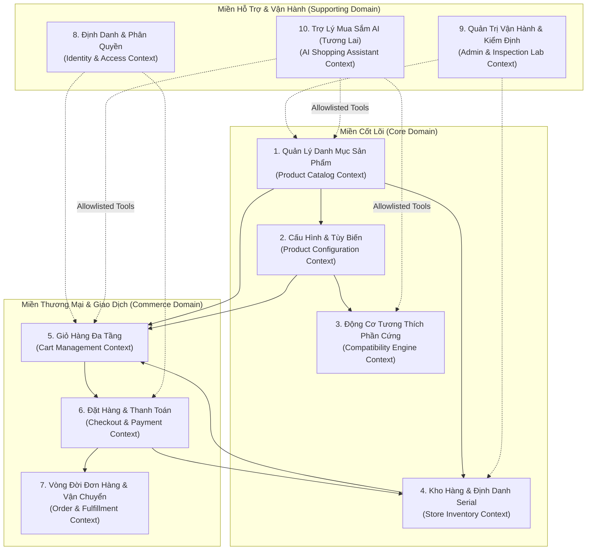

# Mô Hình Miền Nghiệp Vụ NovaStore (Domain-Driven Design Model)

| Thuộc tính              | Chi tiết                                                                                       |
| :---------------------- | :--------------------------------------------------------------------------------------------- |
| **Mã tài liệu**         | `DOC-BIZ-DOMAIN`                                                                               |
| **Tên tài liệu**        | Mô Hình Miền Nghiệp Vụ và Các Ngữ Cảnh Giới Hạn (Bounded Contexts) NovaStore                   |
| **Phiên bản**           | `1.0.0`                                                                                        |
| **Trạng thái tài liệu** | `BASELINE REVIEW READY`                                                                        |
| **Phạm vi**             | Kiến trúc miền nghiệp vụ, ranh giới phân tách Bounded Contexts và ánh xạ sang Modular Monolith |
| **Ngôn ngữ**            | Tiếng Việt (kèm thuật ngữ chuyên ngành tiếng Anh)                                              |
| **Ngày cập nhật**       | 14/11/2026                                                                                     |

---

## 1. Kiến Trúc Miền Nghiệp Vụ Tổng Thể (Domain Architecture Overview)

NovaStore được thiết kế dựa trên các nguyên lý **Thiết kế hướng miền (Domain-Driven Design - DDD)** nhằm phục vụ cho kiến trúc nguyên khối mô-đun hóa (**Modular Monolith**). Toàn bộ hệ thống được chia thành 10 Ngữ cảnh Giới hạn (Bounded Contexts) độc lập về mặt nghiệp vụ, tương tác thông qua các giao diện công khai (Public Interfaces / Facades) và sự kiện miền nội bộ (In-Memory Domain Events).

---

## 2. Chi Tiết Các Ngữ Cảnh Giới Hạn (Bounded Contexts)

### 2.1 Ngữ Cảnh Danh Mục Sản Phẩm (Product Catalog Context)

- **Mã mô-đun kỹ thuật**: `apps/api/src/modules/catalog/`
- **Trách nhiệm cốt lõi**:
  - Quản lý danh mục 8 ngành hàng (A đến H) và cây phân loại đa cấp.
  - Quản lý thông tin Mẫu sản phẩm danh mục (Catalog Product Model): tiêu đề, slug, thương hiệu, mô tả kỹ thuật, ảnh đại diện marketing.
  - Quản lý các biến thể sản phẩm (Product Variants): màu sắc, dung lượng, phiên bản New hoặc Used.
  - Lưu trữ bộ thuộc tính kỹ thuật linh hoạt (JSON / EAV) phục vụ tìm kiếm, lọc và kiểm tra tương thích.
  - Quản lý vòng đời trạng thái xuất bản: `Draft` -> `Published` -> `Archived`.
- **Thực thể chính (Entities & Aggregates)**: `Product`, `Category`, `ProductVariant`, `ProductSpecification`, `Brand`.

### 2.2 Ngữ Cảnh Cấu Hình & Tùy Biến (Product Configuration Context)

- **Mã mô-đun kỹ thuật**: `apps/api/src/modules/configuration/`
- **Trách nhiệm cốt lõi**:
  - Quản lý cấu trúc bộ PC Builder (CPU, Main, RAM, GPU, PSU, Case, Cooler, Fans, Storage).
  - Quản lý cấu trúc bộ Full Setup Builder (PC Core, Displays, Monitor Arm, Desk, Chair, Peripherals, Lighting).
  - Quản lý cấu trúc bộ Product Customizer (Keyboard Layout, Case, PCB, Plate, Switch, Keycap, Stabilizer).
  - Tạo bản chụp tức thời (Configuration Snapshot) đóng gói danh sách linh kiện thành phần và tổng giá trị cấu hình.
- **Thực thể chính**: `PcBuildConfiguration`, `SetupConfiguration`, `KeyboardConfiguration`, `ConfigurationItemSnapshot`.

### 2.3 Ngữ Cảnh Động Cơ Tương Thích (Compatibility Engine Context)

- **Mã mô-đun kỹ thuật**: `apps/api/src/modules/compatibility/`
- **Trách nhiệm cốt lõi**:
  - Đóng vai trò là động cơ tính toán thuần túy (Pure Calculation Engine), không phụ thuộc vào trạng thái kho hàng.
  - Kiểm tra tính hợp lệ về mặt vật lý, điện năng và giao thức giữa các linh kiện:
    - Khớp Socket CPU & Socket Bo mạch chủ.
    - Khớp thế hệ RAM DDR4/DDR5 và số lượng khe cắm.
    - Đối chiếu chiều dài GPU với khoảng trống Vỏ Case.
    - Đối chiếu chiều cao tản khí và kích thước két tản nước AIO với Vỏ Case.
    - Tính toán tổng công suất tiêu thụ điện (TDP/TGP) kèm hệ số an toàn 1.3 đối chiếu công suất nguồn PSU.
    - Kiểm tra tải trọng tay treo màn hình (Monitor Arm Payload).
    - Kiểm tra chuẩn chân cắm switch (3-pin/5-pin) với bảng mạch PCB bàn phím cơ.
- **Dịch vụ chính**: `PcCompatibilityService`, `SetupCompatibilityService`, `KeyboardCompatibilityService`.

### 2.4 Ngữ Cảnh Kho Hàng & Định Danh Serial (Store Inventory Context)

- **Mã mô-đun kỹ thuật**: `apps/api/src/modules/inventory/`
- **Trách nhiệm cốt lõi**:
  - Quản lý tồn kho số lượng tổng hợp (Aggregate Stock Quantity) đối với Hàng Mới 100%.
  - Quản lý tồn kho định danh vật lý (Serialized Stock Units) đối với Hàng Đã Qua Sử Dụng:
    - Lưu trữ Số Serial thực tế, Tình trạng ngoại quan (`LIKE_NEW`, `GOOD`, `FAIR`).
    - Lưu trữ biên bản kiểm định kỹ thuật (stress test logs, nhiệt độ FurMark/Prime95, chỉ số sức khỏe ổ cứng).
    - Lưu trữ ảnh chụp thực tế khuyết tật và danh sách phụ kiện đi kèm.
  - Quản lý quy trình Giữ chỗ tồn kho (Inventory Reservation) trong phiên thanh toán và Thu hồi tồn kho (Inventory Release) khi quá hạn thanh toán.
- **Thực thể chính**: `StockBatch` (Hàng mới), `StockUnit` (Hàng cũ), `InventoryReservation`, `InspectionReport`.

### 2.5 Ngữ Cảnh Quản Lý Giỏ Hàng (Cart Management Context)

- **Mã mô-đun kỹ thuật**: `apps/api/src/modules/cart/`
- **Trách nhiệm cốt lõi**:
  - Hỗ trợ Giỏ hàng Khách vãng lai (Guest Cart) lưu trữ cục bộ phía trình duyệt (`localStorage`).
  - Quản lý Giỏ hàng Khách hàng (Customer Cart) lưu trữ bền vững tại cơ sở dữ liệu máy chủ.
  - Xử lý 3 loại mục giỏ hàng: Sản phẩm tiêu chuẩn (Standard Item), Đơn vị hàng cũ (Used Stock Unit), và Bộ cấu hình nhóm (Grouped Configuration Item).
  - Thực thi quy trình Gộp giỏ hàng an toàn (Cart Merge) khi Khách vãng lai đăng nhập thành công.
  - Hiển thị giá niêm yết hiện thời và đánh dấu cảnh báo mặt hàng đã hết hàng hoặc thay đổi giá.
- **Thực thể chính**: `Cart`, `CartItem`, `CartConfigurationItem`.

### 2.6 Ngữ Cảnh Đặt Hàng & Thanh Toán (Checkout & Payment Context)

- **Mã mô-đun kỹ thuật**: `apps/api/src/modules/checkout/`, `apps/api/src/modules/payments/`
- **Trách nhiệm cốt lõi**:
  - Thực hiện chốt chặn kiểm tra xác thực (Chặn Guest Checkout, bắt buộc đăng nhập).
  - Tái thẩm định giá bán và tồn kho khả dụng ngay tại bước thanh toán (Price & Stock Revalidation).
  - Quản lý phiên giữ chỗ tồn kho (khóa số lượng hàng mới và khóa Serial hàng cũ).
  - Tích hợp các cổng thanh toán trực tuyến nội địa (VNPAY, MoMo, Chuyển khoản QR ngân hàng) và xử lý COD.
  - Xử lý Webhook thanh toán an toàn, xác thực chữ ký số HMAC, đảm bảo tính bất biến và chống trùng lặp (Idempotency).
- **Thực thể chính**: `CheckoutSession`, `PaymentTransaction`, `PaymentWebhookLog`.

### 2.7 Ngữ Cảnh Vòng Đời Đơn Hàng & Vận Chuyển (Order & Fulfillment Context)

- **Mã mô-đun kỹ thuật**: `apps/api/src/modules/orders/`, `apps/api/src/modules/shipping/`
- **Trách nhiệm cốt lõi**:
  - Quản lý bản ghi đơn hàng bất biến (Immutable Order Snapshot) sau khi đặt hàng thành công.
  - Ghi nhận chính xác số Serial vật lý của từng linh kiện thành phần trong đơn hàng để phục vụ tra cứu bảo hành.
  - Tách bạch 4 chiều trạng thái: Trạng thái Đơn hàng, Trạng thái Thanh toán, Trạng thái Vận chuyển, Trạng thái Giữ hàng kho.
  - Quản lý quy trình soạn hàng, đóng gói, bàn giao vận chuyển và xác nhận hoàn tất giao hàng.
- **Thực thể chính**: `Order`, `OrderItem`, `OrderComponentSerialSnapshot`, `Shipment`.

### 2.8 Ngữ Cảnh Định Danh & Phân Quyền (Identity & Access Context)

- **Mã mô-đun kỹ thuật**: `apps/api/src/modules/auth/`, `apps/api/src/modules/users/`
- **Trách nhiệm cốt lõi**:
  - Đăng ký, xác thực tài khoản người dùng bằng Email/Mật khẩu hoặc mạng xã hội.
  - Cấp phát và làm mới mã thông báo bảo mật JWT (Access Token & Refresh Token).
  - Quản lý sổ địa chỉ giao hàng và thông tin cá nhân của khách hàng.
  - Phân quyền theo vai trò người dùng (`CUSTOMER`, `STAFF`, `ADMIN`) và kiểm soát quyền truy cập API bằng Guards.
- **Thực thể chính**: `User`, `UserCredential`, `CustomerAddress`, `Role`, `Permission`.

### 2.9 Ngữ Cảnh Quản Trị Vận Hành & Phòng Lab (Admin & Inspection Context)

- **Mã mô-đun kỹ thuật**: `apps/api/src/modules/admin/`
- **Trách nhiệm cốt lõi**:
  - Giao diện hậu cần cho nhân viên kỹ thuật lập biên bản kiểm định, nhập thông số FurMark/Prime95 và ảnh chụp thực tế cho từng linh kiện cũ.
  - Quản lý quy trình tiếp nhận và xử lý bảo hành (RMA, đổi 1-1 trong 15 ngày, hoàn tiền).
  - Phê duyệt bảng giá niêm yết và theo dõi báo cáo doanh thu, tồn kho.
- **Thực thể chính**: `InspectionLog`, `WarrantyClaim`, `AdminAuditLog`.

### 2.10 Ngữ Cảnh Trợ Lý Mua Sắm AI (AI Shopping Assistant Context - Phạm Vi Tương Lai)

- **Mã mô-đun kỹ thuật**: `apps/api/src/modules/ai-assistant/` (Đã có tài liệu kiến trúc, chưa triển khai code)
- **Trách nhiệm cốt lõi**:
  - Tiếp nhận truy vấn hội thoại tự nhiên của khách hàng (ngân sách, mục đích sử dụng, sở thích màu sắc).
  - Điều phối thông qua danh mục công cụ an toàn được cấp phép (Allowlisted Tool Calling): tra cứu sản phẩm, kiểm tra tồn kho, kiểm tra tương thích PC/Setup, tính toán cấu hình.
  - Yêu cầu xác nhận tường minh từ khách hàng trước khi gọi API giỏ hàng. Tuyệt đối không truy cập trực tiếp cơ sở dữ liệu hay thực thi SQL tùy ý.
- **Thực thể chính**: `AiChatSession`, `AiChatMessage`, `ToolCallAuditLog`.

---

## 3. Bản Đồ Tương Tác Giữa Các Ngữ Cảnh (Context Mapping)

Các ngữ cảnh giao tiếp với nhau tuân thủ nguyên tắc lỏng lẻo (loose coupling):

1. **Catalog Context** đóng vai trò là nhà cung cấp dữ liệu chung (Upstream / Supplier) cho các ngữ cảnh **Configuration**, **Inventory** và **Cart**.
2. **Compatibility Engine** hoạt động độc lập như một thư viện tính toán logic miền không lưu trạng thái (Stateless Domain Service).
3. **Cart Context** phụ thuộc vào **Catalog** và **Inventory** để kiểm tra tính hợp lệ của sản phẩm và tình trạng còn hàng.
4. **Checkout Context** điều phối giao dịch nghiệp vụ quan trọng nhất: Khóa giữ chỗ tồn kho tại **Inventory Context**, khởi tạo giao dịch tại **Payment**, và khi thanh toán thành công sẽ tạo bản ghi bất biến tại **Order Context**.

---

## 4. Tài Liệu Tham Chiếu

- [Tổng quan nghiệp vụ NovaStore](./business-overview.md)
- [Bảng phân quyền và vai trò tác nhân](./actors-and-roles.md)
- [Bảng quy tắc nghiệp vụ tập trung](./business-rules-catalog.md)
- [Danh mục yêu cầu chức năng](./functional-requirements.md)
- [Tài liệu Kiến trúc Mô-đun Hệ Thống](../../docs/architecture/domain-modules.md)
- [Quyết định kiến trúc ADR 0002: Modular Monolith NestJS](../../docs/adr/0002-modular-monolith.md)
