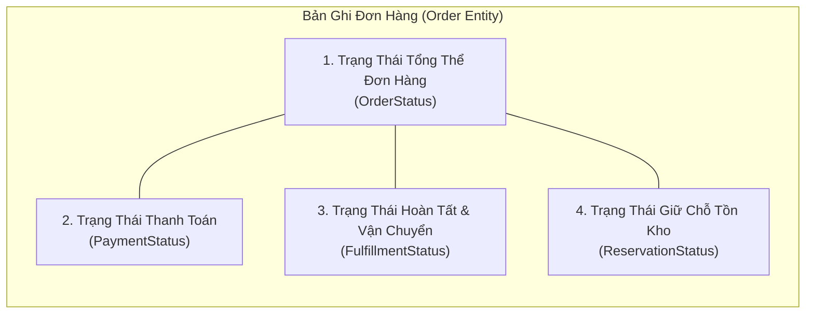
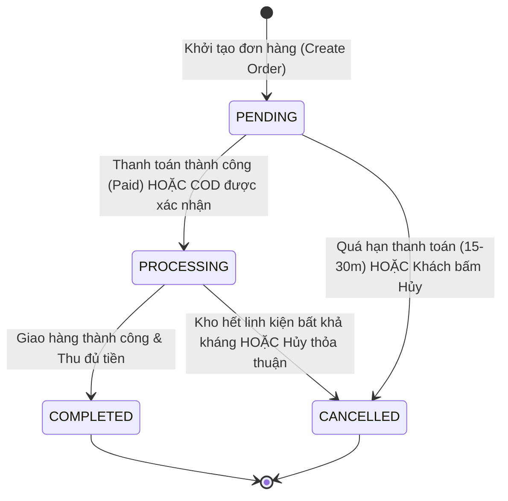
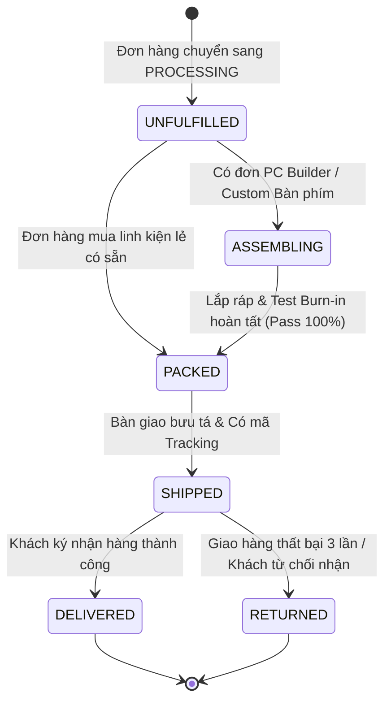

# Đặc Tả Vòng Đời Đơn Hàng & Ma Trận Trạng Thái (Order Lifecycle Specification)

| Thuộc tính              | Chi tiết                                                                                                 |
| :---------------------- | :------------------------------------------------------------------------------------------------------- |
| **Mã tài liệu**         | `DOC-BIZ-ORDER-LIFECYCLE`                                                                                |
| **Tên tài liệu**        | Đặc tả Vòng Đời Đơn Hàng, 4 Chiều Trạng Thái Độc Lập & Ma Trận Chuyển Đổi Trạng Thái NovaStore           |
| **Phiên bản**           | `1.0.0`                                                                                                  |
| **Trạng thái tài liệu** | `BASELINE REVIEW READY`                                                                                  |
| **Phạm vi**             | Toàn bộ vòng đời đơn hàng từ khởi tạo, thanh toán, xử lý kho, vận chuyển, hoàn tất đến hủy đơn/hoàn tiền |
| **Ngôn ngữ**            | Tiếng Việt (kèm thuật ngữ chuyên ngành tiếng Anh)                                                        |
| **Ngày cập nhật**       | 14/11/2026                                                                                               |

---

## 1. Triết Lý Thiết Kế: Phân Tách 4 Chiều Trạng Thái Độc Lập

Một lỗi kiến trúc phổ biến trong các hệ thống thương mại điện tử cũ là gộp toàn bộ tiến trình của một đơn hàng vào một cột trạng thái đơn lẻ duy nhất (ví dụ: `status = 'PENDING' | 'PAID' | 'SHIPPED' | 'COMPLETED'`). Cách tiếp cận này gây ra sự mơ hồ nghiêm trọng:

- Đơn hàng đã thanh toán nhưng kho chưa có hàng thì trạng thái là gì?
- Đơn hàng COD đã giao cho bưu tá nhưng chưa thu được tiền mặt thì trạng thái thanh toán ra sao?
- Đơn hàng bị hoàn một phần tiền nhưng hàng vẫn giao thì thể hiện thế nào?

Để loại bỏ hoàn toàn sự mập mờ này, NovaStore áp dụng **Mô hình 4 Chiều Trạng Thái Độc Lập (4 Orthogonal Status Dimensions)**:

1. **Trạng Thái Đơn Hàng (`OrderStatus`)**: Phản ánh vòng đời cấp cao của hợp đồng mua bán giữa Khách hàng và NovaStore (Chờ xử lý, Đang thực hiện, Hoàn tất thành công, Đã hủy).
2. **Trạng Thái Thanh Toán (`PaymentStatus`)**: Phản ánh luồng dịch chuyển dòng tiền (Chờ thanh toán, Đã thanh toán đầy đủ, Đã hoàn tiền một phần, Đã hoàn tiền toàn bộ, Thất bại).
3. **Trạng Thái Vận Chuyển & Soạn Hàng (`FulfillmentStatus`)**: Phản ánh tiến độ vật lý của hàng hóa tại kho và trên đường giao (Chưa xử lý, Đang lắp ráp máy, Đã đóng gói, Đã bàn giao bưu tá, Đã giao thành công, Trả hàng).
4. **Trạng Thái Giữ Chỗ Tồn Kho (`ReservationStatus`)**: Phản ánh quyền khóa hàng trong kho (Đang giữ chỗ tạm thời, Đã khấu trừ xuất kho vĩnh viễn, Đã giải phóng hoàn trả kho).

---

## 2. Định Nghĩa Chi Tiết Từng Chiều Trạng Thái

### 2.1 Trạng Thái Tổng Thể Đơn Hàng (`OrderStatus`)

- **`PENDING` (Chờ xử lý)**: Đơn hàng vừa được khởi tạo, đang chờ thanh toán trực tuyến hoặc chờ xác nhận điện thoại đối với đơn COD.
- **`PROCESSING` (Đang xử lý)**: Đơn hàng đã đủ điều kiện thực hiện (đã thanh toán hoặc COD đã xác nhận), đang được bộ phận kỹ thuật lắp ráp máy hoặc kho soạn hàng.
- **`COMPLETED` (Hoàn tất)**: Khách hàng đã nhận đủ hàng, thanh toán đầy đủ, hết thời hạn khiếu nại đổi trả ban đầu. Đơn hàng chuyển sang giai đoạn lưu trữ phục vụ bảo hành.
- **`CANCELLED` (Đã hủy)**: Đơn hàng bị chấm dứt do hết hạn thanh toán, khách hàng yêu cầu hủy, hoặc hai bên thỏa thuận hủy đơn.

### 2.2 Trạng Thái Thanh Toán (`PaymentStatus`)

- **`PENDING` (Chờ thanh toán)**: Khách hàng chưa hoàn tất thanh toán qua cổng trực tuyến hoặc đơn hàng lựa chọn hình thức thu tiền tận nơi (COD).
- **`AUTHORIZED` (Đã phong tỏa hạn mức)**: Số tiền đã được phong tỏa trên thẻ tín dụng khách hàng (dành cho các cổng quốc tế hỗ trợ Authorize & Capture - Giai đoạn sau).
- **`PAID` (Đã thanh toán)**: 100% số tiền đơn hàng đã vào tài khoản NovaStore, được đối soát qua Webhook cổng thanh toán hoặc ngân hàng.
- **`PARTIALLY_REFUNDED` (Hoàn tiền một phần)**: Đã hoàn lại một phần tiền cho khách (ví dụ: hoàn tiền 1 món phụ kiện thiếu trong bộ setup).
- **`REFUNDED` (Đã hoàn tiền toàn bộ)**: 100% số tiền đã được hoàn trả lại cho phương thức thanh toán gốc của khách hàng.
- **`FAILED` (Thanh toán thất bại)**: Giao dịch bị ngân hàng từ chối hoặc khách hàng hủy thao tác tại cổng.

### 2.3 Trạng Thái Vận Chuyển & Xử Lý Kho (`FulfillmentStatus`)

- **`UNFULFILLED` (Chưa thực hiện)**: Hàng hóa vẫn nằm trên kệ kho, chưa có thao tác đóng gói.
- **`ASSEMBLING` (Đang lắp ráp & Kiểm định)**: Trạng thái đặc thù dành cho đơn hàng có bộ **PC Builder** hoặc **Keyboard Customizer**. Kỹ thuật viên đang tiến hành lắp máy, tra keo, đi dây giấu cáp và chạy bài test burn-in 2 giờ trước khi đóng gói.
- **`PACKED` (Đã đóng gói)**: Toàn bộ linh kiện đã được đóng gói chống sốc chuẩn công nghiệp, dán tem vỡ niêm phong và in mã vận đơn.
- **`SHIPPED` (Đang giao hàng)**: Kiện hàng đã được bàn giao cho đối tác vận chuyển (GHTK/Viettel Post) và đang trên đường giao tới khách hàng.
- **`DELIVERED` (Đã giao hàng thành công)**: Khách hàng đã ký nhận kiện hàng nguyên vẹn từ nhân viên giao hàng.
- **`RETURNED` (Đã hoàn hàng về kho)**: Kiện hàng bị chuyển hoàn về kho NovaStore do không liên lạc được với khách hoặc khách từ chối nhận theo quy định.

### 2.4 Trạng Thái Giữ Chỗ Tồn Kho (`ReservationStatus`)

- **`RESERVED` (Đang giữ chỗ)**: Tồn kho hàng mới bị trừ khỏi khả dụng; đơn vị Serial hàng cũ bị khóa trạng thái `RESERVED` gắn với phiên checkout (thời hạn 15 - 30 phút).
- **`DEDUCTED` (Đã khấu trừ xuất kho)**: Đơn hàng thanh toán thành công, số lượng hàng mới chính thức trừ khỏi sổ kho, đơn vị hàng cũ chuyển thành `SOLD` vĩnh viễn.
- **`RELEASED` (Đã giải phóng)**: Đơn hàng bị hủy hoặc hết hạn, toàn bộ tồn kho giữ chỗ được hoàn trả nguyên trạng về kho khả dụng cho khách hàng khác mua.

---

## 3. Biểu Đồ Chuyển Đổi Trạng Thái (State Diagrams)

### 3.1 Vòng Đời Tổng Thể Đơn Hàng (OrderStatus Transition)

### 3.2 Vòng Đời Vận Chuyển & Soạn Hàng (FulfillmentStatus Transition)

---

## 4. Ma Trận Chuyển Đổi Trạng Thái (State Transition Matrix)

Bảng dưới đây quy định chi tiết từng bước chuyển trạng thái, tác nhân chịu trách nhiệm, điều kiện tiên quyết và tính chất quyết định:

| Trạng thái hiện tại                             | Sự kiện / Trigger kích hoạt                    | Trạng thái tiếp theo                                                     | Tác nhân thực hiện                      | Điều kiện tiên quyết (Preconditions)                                                                             | Kết quả ngoại lệ / Thất bại                                                            | Trạng thái quyết định |
| :---------------------------------------------- | :--------------------------------------------- | :----------------------------------------------------------------------- | :-------------------------------------- | :--------------------------------------------------------------------------------------------------------------- | :------------------------------------------------------------------------------------- | :-------------------: |
| _(Bắt đầu)_                                     | Khách hàng bấm "Xác Nhận Đặt Hàng"             | `OS: PENDING` `PS: PENDING` `FS: UNFULFILLED` `RS: RESERVED` | `Customer` / `System`                   | - Đã đăng nhập (`BR-AUTH-02`). - Toàn bộ linh kiện khả dụng. - Đã chọn địa chỉ & phương thức thanh toán. | Tồn kho không đủ: Báo lỗi và dừng quy trình tạo đơn.                                   |    **`CONFIRMED`**    |
| `OS: PENDING` `PS: PENDING`                 | Webhook cổng thanh toán báo thành công         | `OS: PROCESSING` `PS: PAID` `RS: DEDUCTED`                       | `System` (Webhook Handler)              | - Chữ ký số HMAC SHA512 hợp lệ. - Số tiền khớp 100% giá trị đơn. - Đơn hàng chưa bị hủy.                 | Chữ ký sai hoặc số tiền không khớp: Ghi log cảnh báo gian lận, giữ nguyên đơn.         |    **`CONFIRMED`**    |
| `OS: PENDING` `PS: PENDING`                 | Hết hạn giữ chỗ (15 - 30 phút) không trả tiền  | `OS: CANCELLED` `RS: RELEASED`                                       | `System` (BullMQ Worker)                | - Thời gian hiện tại > `ExpiresAt`. - Chưa nhận được Webhook thanh toán.                                     | Nếu Webhook về trễ đúng thời điểm quét: Ưu tiên xử lý thanh toán và phục hồi đơn.      |    **`CONFIRMED`**    |
| `OS: PENDING` `PS: PENDING`                 | Khách hàng chủ động bấm "Hủy Đơn Hàng"         | `OS: CANCELLED` `RS: RELEASED`                                       | `Customer`                              | - Đơn hàng chưa thanh toán. - Trạng thái vẫn là `PENDING`.                                                   | Đơn đã thanh toán: Khóa nút hủy, hướng dẫn liên hệ chăm sóc khách hàng.                |    **`CONFIRMED`**    |
| `OS: PENDING` (Đơn COD)                     | Nhân viên gọi điện xác nhận đơn thành công     | `OS: PROCESSING` `PS: PENDING` `RS: RESERVED`                    | `Staff` (CSKH)                          | - Khách hàng xác nhận nhận hàng qua điện thoại. - Đơn thỏa mãn điều kiện COD (< 10tr VNĐ).                   | Không liên lạc được sau 3 lần gọi trong 24h: Chuyển đơn sang `CANCELLED`.              |      `PROPOSED`       |
| `OS: PROCESSING` `FS: UNFULFILLED`          | Đơn hàng có yêu cầu ráp máy hoặc mod phím      | `FS: ASSEMBLING`                                                         | `Staff` (Kỹ thuật)                      | - Đơn đã sang trạng thái `PROCESSING`. - Đầy đủ linh kiện thành phần tại phòng kỹ thuật.                     | Phát hiện linh kiện lỗi lúc ráp: Đổi linh kiện tương đương cùng kho.                   |      `PROPOSED`       |
| `OS: PROCESSING` `FS: ASSEMBLING`           | Hoàn tất lắp ráp và test burn-in 2 giờ         | `FS: PACKED`                                                             | `Staff` (Kỹ thuật)                      | - Đi dây thẩm mỹ đạt chuẩn. - Nhiệt độ test FurMark/Prime95 đạt chuẩn. - Ký biên bản xuất xưởng.         | Máy lỗi sập nguồn khi test: Kỹ thuật kiểm tra lại linh kiện, không xuất xưởng máy lỗi. |      `PROPOSED`       |
| `OS: PROCESSING` `FS: UNFULFILLED` (Đơn lẻ) | Soạn đủ hàng và đóng thùng chống sốc           | `FS: PACKED`                                                             | `Staff` (Kho)                           | - Quét đúng số Serial vật lý của từng linh kiện khớp với đơn hàng.                                               | Quét sai Serial: Hệ thống chặn in phiếu xuất kho.                                      |    **`CONFIRMED`**    |
| `OS: PROCESSING` `FS: PACKED`               | Bàn giao bưu tá và nhập mã vận đơn             | `FS: SHIPPED`                                                            | `Staff` (Kho)                           | - Có mã Tracking hợp lệ từ đơn vị vận chuyển. - Bưu tá đã ký nhận bàn giao.                                  | Đơn vị vận chuyển từ chối nhận do quá tải: Giữ ở trạng thái `PACKED`.                  |      `PROPOSED`       |
| `OS: PROCESSING` `FS: SHIPPED`              | Bưu tá phát hàng thành công, khách ký nhận     | `OS: COMPLETED` `FS: DELIVERED` `PS: PAID` (nếu COD)             | `System` (Webhook vận chuyển) / `Staff` | - Biên bản giao hàng thành công từ đối tác. - Đối với COD: Bưu tá đã thu đủ 100% tiền mặt.                   | Khách không nhận hàng: Bưu tá lưu kho giao lại lần 2 và 3.                             |      `PROPOSED`       |
| `OS: PROCESSING` `FS: SHIPPED`              | Khách bom hàng / Không liên lạc được sau 3 lần | `OS: CANCELLED` `FS: RETURNED` `RS: RELEASED`                    | `Staff` (Kho)                           | - Kiện hàng vật lý đã quay trở về kho NovaStore. - Kỹ thuật kiểm tra niêm phong tem vỡ còn nguyên vẹn.       | Kiện hàng bị thất lạc trên đường hoàn: Khiếu nại bảo hiểm bưu chính.                   |      `PROPOSED`       |
| `OS: PROCESSING` `PS: PAID`                 | Khách thỏa thuận hủy đơn trước khi giao hàng   | `OS: CANCELLED` `PS: REFUNDED` `RS: RELEASED`                    | `Admin`                                 | - Kiện hàng chưa bàn giao cho bưu tá (`FS != SHIPPED`). - Đã được Quản trị viên duyệt lệnh hoàn tiền.        | Lệnh hoàn tiền cổng thất bại: Kỹ thuật viên đối soát thủ công qua ngân hàng.           |      `PROPOSED`       |

---

## 5. Bản Chụp Bất Biến Của Đơn Hàng (Immutable Order Snapshot Architecture)

Để bảo vệ quyền lợi pháp lý của cả khách hàng và NovaStore, đồng thời phục vụ cho quy trình bảo hành kéo dài từ 1 tháng đến 36 tháng:

1. **Tính Bất Biến Sau Khi Tạo Đơn (`BR-ORDER-01`)**:
   - Sau khi đơn hàng được tạo, toàn bộ thông tin sản phẩm được "đóng băng" (Frozen Snapshot).
   - Nếu sau này giá sản phẩm trên website thay đổi, hoặc sản phẩm bị sửa tên, sửa mô tả, hoặc bị chuyển trạng thái sang `Archived`: **Thông tin hiển thị trên Đơn hàng của khách hàng vẫn giữ nguyên 100% như tại thời điểm bấm đặt hàng**.
2. **Lưu Trữ Chính Xác Số Serial Vật Lý Của Từng Linh Kiện (`BR-ORDER-02`)**:
   - Đối với Đơn vị hàng cũ (Used Stock Unit): Ghi nhận chính xác `StockUnitId` và `SerialNumber` ngay từ lúc đặt hàng.
   - Đối với Dàn máy PC Builder / Setup Builder: Khi nhân viên kho soạn hàng hoặc kỹ thuật viên lắp ráp, họ bắt buộc phải dùng máy quét mã vạch để quét Số Serial của từng linh kiện thành phần (Serial CPU, Serial Mainboard, Serial RAM, Serial GPU, Serial Nguồn). Toàn bộ danh sách Serial này được gắn vĩnh viễn vào bản ghi Đơn hàng `OrderComponentSerialSnapshot`.
   - Khách hàng có thể tra cứu hạn bảo hành điện tử chính xác của từng linh kiện trong dàn máy chỉ bằng cách nhập mã đơn hàng hoặc số serial linh kiện trên trang Tra Cứu Bảo Hành của NovaStore.

---

## 6. Tài Liệu Tham Chiếu

- [Quy trình Đặt Hàng & Thanh Toán (WF-CHK-01)](./workflows/checkout-payment-workflow.md)
- [Tiêu chuẩn đánh giá tình trạng hàng và bảo hành](./product-condition-and-warranty.md)
- [Bảng quy tắc nghiệp vụ tập trung](./business-rules-catalog.md)
- [Danh mục yêu cầu chức năng](./functional-requirements.md)
- [Thuật ngữ nghiệp vụ](./glossary.md)
