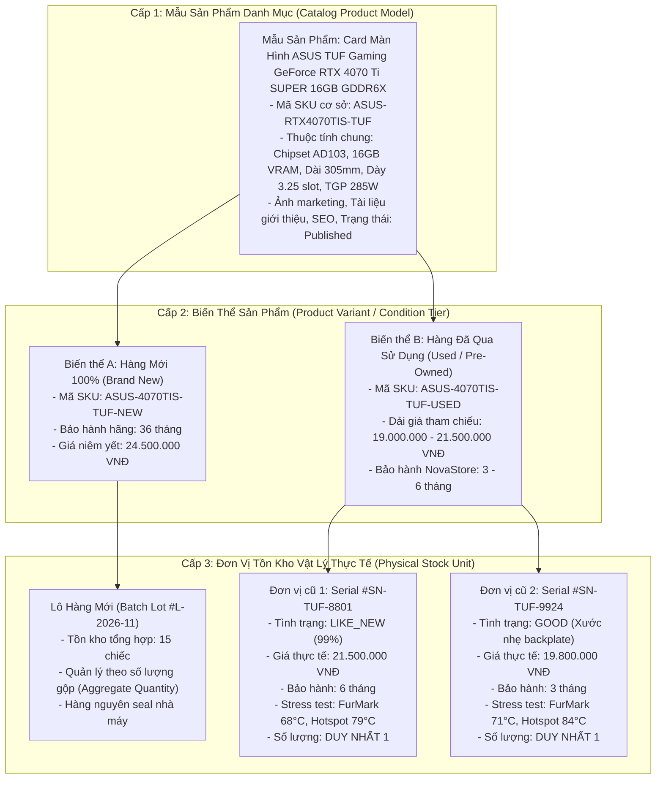

# Danh Mục Sản Phẩm & Mô Hình Tồn Kho (Product Catalog & Inventory Taxonomy)

| Thuộc tính              | Chi tiết                                                                                         |
| :---------------------- | :----------------------------------------------------------------------------------------------- |
| **Mã tài liệu**         | `DOC-BIZ-CATALOG`                                                                                |
| **Tên tài liệu**        | Danh mục Sản phẩm, Thuộc tính Kỹ thuật & Cấu trúc Phân tầng Hàng hóa NovaStore                   |
| **Phiên bản**           | `1.0.0`                                                                                          |
| **Trạng thái tài liệu** | `BASELINE REVIEW READY`                                                                          |
| **Phạm vi**             | Toàn bộ 8 nhóm ngành hàng, cấu trúc thuộc tính kỹ thuật và mô hình phân tách Danh mục - Kho hàng |
| **Ngôn ngữ**            | Tiếng Việt (kèm thuật ngữ chuyên ngành tiếng Anh)                                                |
| **Ngày cập nhật**       | 14/11/2026                                                                                       |

---

## 1. Cấu Trúc Phân Tầng Hàng Hóa 3 Cấp (The 3-Tier Hierarchy)

Điểm then chốt trong nghiệp vụ bán lẻ phần cứng máy tính của NovaStore là **sự phân tách hoàn toàn giữa Khái Niệm Danh Mục (Catalog Concept) và Đơn Vị Tồn Kho Vật Lý (Physical Inventory Unit)**.

### 1.1 Khái Niệm Cụ Thể Trong Từng Cấp Độ

1. **Catalog Product (Mẫu Sản Phẩm Danh Mục)**:
   - Đại diện cho mã sản phẩm của nhà sản xuất (Brand Model).
   - Chứa thông số kỹ thuật cố định không phụ thuộc vào tình trạng: Kiến trúc chip, Kích thước vật lý (dài, rộng, cao), Chuẩn kết nối (PCIe 4.0 x16, socket AM5), Cổng xuất hình (HDMI 2.1, DisplayPort 1.4a), Công suất điện tiêu thụ tiêu chuẩn.
   - Chứa thông tin tiếp thị, danh mục, thương hiệu, mô tả bài viết và thẻ từ khóa tìm kiếm (SEO).
2. **Product Variant (Biến Thể Sản Phẩm)**:
   - Phân định các nhánh tùy chọn của mẫu sản phẩm, bao gồm màu sắc (Đen/Trắng), dung lượng bộ nhớ (8GB/16GB) và đặc biệt là **Phân tầng Tình trạng Hàng (Condition Tier)**: Hàng Mới (New) hoặc Hàng Đã Qua Sử Dụng (Used).
3. **Physical Stock Unit (Đơn Vị Tồn Kho Vật Lý)**:
   - **Đối với Hàng Mới**: Được quản lý dưới dạng số lượng tồn khả dụng (Available Quantity) theo lô hàng, xuất kho theo nguyên tắc FIFO (Nhập trước xuất trước).
   - **Đối với Hàng Cũ (Used Stock Unit)**: Mỗi sản phẩm là **MỘT ĐƠN VỊ VẬT LÝ DUY NHẤT VÀ KHÔNG THỂ THAY THẾ (Non-interchangeable, Qty = 1)**. Mỗi đơn vị sở hữu một bản ghi riêng biệt gồm:
     - Số Serial vật lý thực tế được khắc trên tem linh kiện.
     - Tình trạng thẩm mỹ cụ thể (`LIKE_NEW`, `GOOD`, `FAIR`).
     - Bộ ảnh chụp thực tế sản phẩm từ nhiều góc chụp (chụp rõ các vết xước nếu có).
     - Biên bản kiểm thử kỹ thuật số (kết quả stress test tải nặng, nhiệt độ hoạt động, số giờ đã chạy).
     - Báo cáo khuyết tật và danh sách phụ kiện thực tế đi kèm.
     - Giá bán thực tế bằng số nguyên VNĐ (được định giá riêng cho từng con tem serial).
     - Thời hạn bảo hành trực tiếp tại NovaStore (Store Warranty).

---

## 2. Trạng Thái Sản Phẩm & Trạng Thái Tồn Kho (Product Status & Inventory Availability)

### 2.1 Trạng Thái Xuất Bản Sản Phẩm (Product Publication Status)

Hệ thống kiểm soát tính hiển thị của mẫu sản phẩm thông qua 3 trạng thái nghiêm ngặt:

- **`DRAFT` (Bản nháp)**: Sản phẩm mới tạo, đang trong quá trình biên tập nội dung, chụp ảnh hoặc chờ kiểm định. Chỉ Quản trị viên và Nhân viên có quyền xem trong hệ thống quản trị nội bộ. Tuyệt đối **KHÔNG** hiển thị ra ngoài website công khai cho Khách vãng lai hay Khách hàng.
- **`PUBLISHED` (Đã xuất bản)**: Sản phẩm chính thức được niêm yết công khai trên website. Người dùng có thể tìm kiếm, xem trang chi tiết và đưa vào cấu hình builder.
- **`ARCHIVED` (Lưu trữ / Ngừng kinh doanh)**: Sản phẩm đã ngừng phân phối hoặc đã hết vòng đời sản phẩm. Sản phẩm không xuất hiện trên danh mục hoặc kết quả tìm kiếm thông thường. Nếu người dùng truy cập qua đường link cũ hoặc qua đơn hàng lịch sử, hệ thống hiển thị thông báo "Sản phẩm đã ngừng kinh doanh" và khóa nút mua hàng.

### 2.2 Trạng Thái Khả Dụng Của Tồn Kho (Inventory Availability Status)

- **`IN_STOCK` (Còn hàng)**:
  - Với Hàng Mới: Số lượng tồn kho khả dụng > 0. Nút "Thêm vào giỏ" và "Mua ngay" sẵn sàng hoạt động.
  - Với Hàng Cũ: Đơn vị Stock Unit đang ở trạng thái `AVAILABLE` (chưa bị khách hàng nào giữ chỗ thanh toán hoặc mua mất).
- **`OUT_OF_STOCK` (Hết hàng)**:
  - Với Hàng Mới: Số lượng tồn kho khả dụng = 0.
  - Với Hàng Cũ: Toàn bộ các đơn vị Stock Unit của biến thể đó đã được bán hết hoặc đang bị khóa giữ chỗ trong các phiên thanh toán chưa hết hạn.
  - **Quy tắc hiển thị bất biến**: Sản phẩm hết hàng **VẪN ĐƯỢC PHÉP HIỂN THỊ** trong danh mục tìm kiếm và xem trang chi tiết (PDP) để giữ giá trị tham khảo và tối ưu SEO, nhưng **NÚT MUA HÀNG BỊ VÔ HIỆU HÓA** kèm nhãn thông báo "Tạm Hết Hàng".
- **`RESERVED` (Đang giữ chỗ)**:
  - Trạng thái hàng hóa đã được gắn vào một đơn hàng đang trong phiên thanh toán (Checkout) của khách hàng. Số lượng này bị trừ khỏi tồn kho khả dụng để tránh hiện tượng bán vượt (Overselling).

---

## 3. Phân Rã 8 Nhóm Ngành Hàng & Thuộc Tính Kỹ Thuật (The 8 Technical Domains)

Mỗi nhóm ngành hàng sở hữu bộ thuộc tính kỹ thuật chuyên biệt phục vụ cho hiển thị chi tiết và **tính toán tương thích tự động trong PC Builder, Setup Builder và Keyboard Customizer**:

### Nhóm A: Linh Kiện Máy Tính (PC Components)

Phục vụ trực tiếp cho Động cơ tương thích phần cứng:

- **Vi xử lý (CPU)**:
  - Chuẩn chân cắm (Socket): `AM4`, `AM5`, `LGA1700`, `LGA1851`.
  - Số nhân / Số luồng: Ví dụ 8 cores / 16 threads.
  - Xung nhịp cơ bản & Boost (GHz).
  - Mức tiêu thụ điện thiết kế (TDP - Watts): Quyết định yêu cầu tản nhiệt và công suất nguồn.
  - Nhân đồ họa tích hợp (iGPU): Có / Không (Hỗ trợ xuất hình không cần card rời).
  - Thế hệ RAM hỗ trợ: DDR4, DDR5 hoặc cả hai.
  - Phiên bản PCIe hỗ trợ: PCIe 4.0, PCIe 5.0.
- **Card Màn Hình (GPU)**:
  - Chipset đồ họa: NVIDIA GeForce RTX 40-series, AMD Radeon RX 7000-series.
  - Dung lượng & chuẩn VRAM: 8GB, 12GB, 16GB, 24GB GDDR6 / GDDR6X.
  - Chiều dài vật lý (GPU Length in mm): Ví dụ 305mm (Bắt buộc phải nhỏ hơn khoảng trống tối đa của Vỏ Case).
  - Độ dày vật lý (Slot thickness): 2-slot, 2.5-slot, 3.5-slot.
  - Công suất tiêu thụ tối đa (TGP - Watts): Ví dụ 285W.
  - Công suất nguồn khuyến nghị (Recommended PSU Watts): Ví dụ 750W.
  - Cổng cấp nguồn phụ: Chuẩn mới 16-pin 12V-2x6 / 12VHPWR hoặc chuẩn cũ 8-pin PCIe.
  - Cổng xuất hình: Số lượng cổng HDMI 2.1a và DisplayPort 1.4a/2.1.
- **Bo Mạch Chủ (Motherboard)**:
  - Chuẩn Socket CPU: Phải khớp tuyệt đối 100% với Socket của CPU.
  - Chipset bo mạch: B650, X670E, Z790, B760.
  - Kích thước chuẩn (Form Factor): `E-ATX`, `ATX`, `Micro-ATX` (mATX), `Mini-ITX` (ITX).
  - Chuẩn bộ nhớ RAM: DDR4 hoặc DDR5 (Không thể cắm chéo).
  - Số khe cắm RAM (DIMM Slots): 2 khe hoặc 4 khe (Tối đa 96GB hoặc 192GB).
  - Số khe cắm ổ cứng M.2 NVMe: Số khe PCIe Gen4, Gen5 kèm tản nhiệt tích hợp.
  - Chuẩn khe cắm PCIe x16 chính: PCIe 4.0 x16, PCIe 5.0 x16.
  - Tích hợp không dây: Wi-Fi 6E/7 + Bluetooth tích hợp sẵn (Có/Không).
- **Bộ Nhớ Trong (RAM)**:
  - Thế hệ: DDR4 hoặc DDR5.
  - Dung lượng kit: 16GB (2x8GB), 32GB (2x16GB), 64GB (2x32GB).
  - Tốc độ bus (Speed): 3200MHz, 6000MT/s, 6400MT/s.
  - Độ trễ danh định (CAS Latency - CL): Ví dụ CL30, CL36.
  - Chiều cao thanh RAM (mm): Phục vụ kiểm tra cấn quạt tản nhiệt khí dạng tháp đôi.
  - Hỗ trợ cấu hình ép xung: Intel XMP 3.0, AMD EXPO.
- **Ổ Cứng Lưu Trữ Trong (Internal SSD / HDD)**:
  - Chuẩn kích thước: M.2 2280, 2.5-inch SATA, 3.5-inch SATA.
  - Giao thức kết nối: PCIe Gen4 x4 NVMe, PCIe Gen5 x4 NVMe, SATA III (6Gbps).
  - Tốc độ đọc / ghi tuần tự (MB/s): Ví dụ 7400 MB/s / 6800 MB/s.
  - Độ bền ghi dữ liệu (TBW): Đặc biệt quan trọng để đánh giá ổ cứng cũ.
- **Bộ Nguồn Máy Tính (Power Supply Unit - PSU)**:
  - Công suất định danh: 650W, 750W, 850W, 1000W, 1200W.
  - Chuẩn hiệu suất: 80 PLUS Bronze, Gold, Platinum, Titanium.
  - Kiểu dây cáp: Full Modular (Rời hoàn toàn), Semi-Modular, Non-Modular.
  - Kích thước chuẩn: Chuẩn ATX tiêu chuẩn hoặc chuẩn SFX / SFX-L (cho dàn máy mini ITX).
  - Chuẩn nguồn PCIe mới: ATX 3.0 / ATX 3.1 kèm dây cắm bản địa 12V-2x6 (450W - 600W).
- **Vỏ Máy Tính (Chassis / Case)**:
  - Hỗ trợ chuẩn bo mạch: Hỗ trợ tối đa E-ATX, ATX, mATX, ITX.
  - Chiều dài GPU tối đa hỗ trợ (mm): Ví dụ 360mm.
  - Chiều cao tản nhiệt khí CPU tối đa (mm): Ví dụ 165mm.
  - Hỗ trợ két tản nhiệt nước (Radiator Clearance): Vị trí nóc (Top 240/280/360mm), Mặt trước (Front 240/360/420mm).
  - Quạt lắp sẵn đi kèm: Số lượng và kích thước quạt ARGB (120mm/140mm).
- **Tản Nhiệt CPU (Cooler)**:
  - Chủng loại: Tản nhiệt khí (Air Cooler) hoặc Tản nhiệt nước All-in-One (AIO Liquid Cooler).
  - Kích thước Rad (cho tản AIO): 240mm (2 quạt 120), 280mm (2 quạt 140), 360mm (3 quạt 120).
  - Chiều cao tổng thể (cho tản khí): Ví dụ 158mm.
  - Socket hỗ trợ: Danh sách bracket đi kèm (LGA1700, AM5, v.v.).
  - Mức tản nhiệt công suất tối đa (Max TDP Dissipation): Ví dụ 250W.

### Nhóm B: Máy Tính Đồng Bộ & Chuyên Dụng (Prebuilt Computers)

- **Hồ sơ đối tượng**: Dàn máy Gaming (Phổ thông, Trung cấp, Hi-end), Máy trạm đồ họa kiến trúc (Workstation), Dàn máy tính toán Trí Tuệ Nhân Tạo (AI Development Rig).
- **Thuộc tính quản lý**: Bảng kê linh kiện cấu thành (Bill of Materials - BOM), Chỉ số hiệu năng benchmark trung bình (FPS trong các tựa game AAA), Hệ điều hành cài sẵn bản quyền, Thời gian bảo hành trọn bộ (24 - 36 tháng).

### Nhóm C: Màn Hình & Giá Treo (Monitors & Mounts)

- **Màn hình hiển thị**:
  - Kích thước đường chéo: 24-inch, 27-inch, 32-inch, 34-inch Ultrawide, 49-inch Super Ultrawide.
  - Độ phân giải: Full HD (1080p), 2K QHD (1440p), 4K UHD (2160p).
  - Công nghệ tấm nền: Fast IPS, VA, QD-OLED, WOLED.
  - Tần số quét (Refresh Rate): 100Hz, 144Hz, 180Hz, 240Hz, 360Hz, 540Hz.
  - Thời gian đáp ứng (Response Time): 1ms GtG hoặc 0.03ms (OLED).
  - Độ phủ màu: 99% sRGB, 95% DCI-P3 (chuẩn đồ họa).
  - Chuẩn ngàm treo tường/arm: VESA 75x75mm hoặc 100x100mm.
  - Trọng lượng không chân đế (kg): Thuộc tính sống còn để tính tương thích với Giá treo tay arm.
- **Giá treo màn hình (Monitor Arm)**:
  - Loại ngàm: Arm đơn (1 màn hình) hoặc Arm đôi (2 màn hình).
  - Tải trọng tối đa mỗi tay (kg): Ví dụ 2 - 9kg hoặc 2 - 15kg (cho màn cong nặng).
  - Cơ chế nâng: Lò xo trợ lực khí nén (Gas Spring) hoặc lò xo cơ học.
  - Hình thức gắn bàn: Kẹp mép bàn (C-clamp) hoặc Khoan xuyên bàn (Grommet).

### Nhóm D: Thiết Bị Ngoại Vi (Gaming & Office Peripherals)

- **Chuột**: Mắt đọc quang học (Sensor), Chỉ số DPI tối đa, Tần số lấy mẫu (Polling Rate 1000Hz - 8000Hz), Trọng lượng (gram), Kiểu kết nối (Dây siêu mềm, Không dây 2.4GHz HyperSpeed, Bluetooth).
- **Tai nghe & Âm thanh**: Kích thước driver âm thanh, Giả lập âm thanh vòm 7.1, Độ nhạy micro, Trở kháng, Khả năng chống ồn chủ động (ANC).
- **Webcam & Micro thu âm**: Độ phân giải ghi hình (1080p 60fps, 4K), Hướng thu âm (Cardioid, Omnidirectional), Cổng kết nối USB-C hoặc XLR.

### Nhóm E: Linh Kiện Bàn Phím Cơ Tùy Biến (Mechanical Keyboard Parts)

Phục vụ trực tiếp cho bộ công cụ Product Customizer:

- **Kit / Vỏ Bàn Phím (Case & Kit)**:
  - Kích thước bố cục (Form Factor / Layout): 60%, 65%, 75%, TKL (87 phím), 96%, Full-size 108 phím.
  - Vật liệu vỏ: Nhôm nguyên khối gia công CNC (Anodized Aluminum), Nhựa Polycarbonate (PC), Nhựa Acrylic cắt lớp.
  - Kiểu gắn cấu trúc (Mounting Style): Gasket Mount, Top Mount, Tray Mount.
- **Mạch Phím (PCB)**:
  - Cơ chế lắp switch: Hot-swap (tháo lắp nóng chân cắm) hoặc Mạch hàn (Solder).
  - Tương thích chân switch: Hỗ trợ cả 3-pin và 5-pin.
  - Đèn nền LED: RGB từng phím (Per-key RGB), Mạch xuôi (South-facing) chống cấn keycap profile Cherry.
  - Khả năng tùy biến firmware: Hỗ trợ phần mềm bản địa VIA, QMK.
- **Công Tắc Bàn Phím (Switch)**:
  - Loại phản hồi: Linear (Tuyến tính - êm ái), Tactile (Khấc xúc giác), Clicky (Phát tiếng click).
  - Lực kích hoạt (Actuation Force): Ví dụ 45gf, 55gf, 62gf.
  - Hành trình nhận phím & Hành trình chạm đáy: Ví dụ 2.0mm / 4.0mm.
  - Số chân cắm: 3-pin (gắn plate) hoặc 5-pin (gắn trực tiếp PCB chống lắc).
  - Tình trạng dầu bôi trơn: Chưa lube hoặc Factory Lubed (Bôi trơn sẵn từ nhà máy).
- **Nút Phím (Keycap)**:
  - Cấu hình độ cao (Profile): Cherry, OEM, XDA, KAT, SA, MOA.
  - Chất liệu nhựa: PBT chống bóng nhờn mồ hôi hoặc ABS màu sắc tươi sáng.
  - Kỹ thuật in ký tự: Double-shot (Đúc 2 lớp không thể mờ) hoặc Dye-sub (In nhiệt thẩm thấu).
- **Tấm Định Vị (Plate) & Bộ Cân Bằng (Stabilizer)**:
  - Vật liệu Plate: Nhôm, FR4 (sợi thủy tinh), Polycarbonate, Đồng thau (Brass).
  - Chuẩn Stabilizer: Gắn ngàm mạch bắt ốc (PCB Screw-in) hoặc Gắn trên Plate (Plate-mount).

### Nhóm F: Không Gian Bàn Làm Việc (Desk Setup)

- **Bàn Làm Việc Nâng Hạ**: Kích thước mặt bàn (Dài x Rộng x Dày mm), Số lượng động cơ điện (Dual Motor / Single Motor), Tải trọng nâng tĩnh và nâng động (kg), Biên độ nâng hạ chiều cao (ví dụ 650mm - 1250mm), Bộ nhớ vị trí chiều cao thông minh.
- **Ghế Công Thái Học**: Chuẩn lưới thoáng khí (Wintex Hàn Quốc, lưới Đức), Cơ chế ngả lưng đa điểm, Đệm đỡ thắt lưng điều chỉnh độc lập (Lumbar Support), Tay vịn 3D/4D, Chuẩn Piston nâng hạ Class 4 TUV.
- **Phụ Kiện Góc Setup**: Đèn kẹp màn hình chống lóa mắt, Dây đèn LED hắt tường đồng bộ âm thanh, Máng đi dây kim loại giấu gầm bàn.

### Nhóm G: Thiết Bị Mạng (Networking)

- Chuẩn Wi-Fi thế hệ mới (Wi-Fi 6 AX, Wi-Fi 6E AXE, Wi-Fi 7 BE), Băng thông lý thuyết tổng hợp, Số lượng cổng LAN 1GbE / 2.5GbE / 10GbE, Công nghệ mạng lưới liên kết phủ sóng toàn nhà (Mesh Wi-Fi), Tính năng quản lý băng thông ưu tiên gói tin chơi game (Gaming QoS).

### Nhóm H: Lưu Trữ Ngoài & Kết Nối (Storage & Connectivity)

- Chuẩn giao tiếp mở rộng: Thunderbolt 4 (40Gbps), USB4, USB 3.2 Gen 2x2 (20Gbps).
- Thiết bị mở rộng (Docking Station): Khả năng sạc ngược máy tính xách tay (Power Delivery 100W), Số lượng cổng xuất hình đa màn hình ngoài.

---

## 4. Kiến Trúc Thuộc Tính Mở Rộng Linh Hoạt (Extensible Attribute Architecture)

Để đảm bảo hệ thống có thể mở rộng danh mục trong tương lai mà không cần thực hiện sửa đổi cấu trúc bảng cơ sở dữ liệu vật lý (tránh Alter Table liên tục khi thêm nhóm sản phẩm mới), mô hình dữ liệu sẽ tuân thủ nguyên tắc:

1. **Thông tin định danh chung (Universal Product Attributes)**: Được lưu trữ trong bảng cốt lõi (ID, SKU, Tên sản phẩm, Slug đường dẫn tĩnh, Thương hiệu, Phân loại ngành hàng, Trạng thái xuất bản `Draft`/`Published`/`Archived`, Thời gian tạo).
2. **Thông số kỹ thuật chuyên biệt (Technical Specifications JSON / EAV)**: Được lưu trữ dưới dạng cấu trúc dữ liệu JSON có định dạng kiểm soát kiểu (Typed JSON Schema) hoặc bảng thuộc tính mở rộng. Điều này cho phép Động cơ tương thích phần cứng (Compatibility Engine) truy xuất nhanh các chỉ số kỹ thuật để tính toán tính tương thích mà vẫn đảm bảo tính mềm dẻo của dữ liệu.

---

## 5. Tài Liệu Tham Chiếu

- [Tổng quan nghiệp vụ NovaStore](./business-overview.md)
- [Tiêu chuẩn đánh giá tình trạng hàng và bảo hành](./product-condition-and-warranty.md)
- [Bốn trải nghiệm cấu hình và mua sắm](./customer-experiences.md)
- [Quy trình nghiệp vụ khám phá sản phẩm](./workflows/product-discovery-workflow.md)
- [Quy trình nghiệp vụ chi tiết sản phẩm](./workflows/product-detail-workflow.md)
- [Bảng quy tắc nghiệp vụ tập trung](./business-rules-catalog.md)
- [Quyết định kiến trúc ADR 0004: Phân tách Catalog Product và Tồn kho Serialized](../../docs/adr/0004-catalog-product-vs-physical-inventory-distinction.md)
