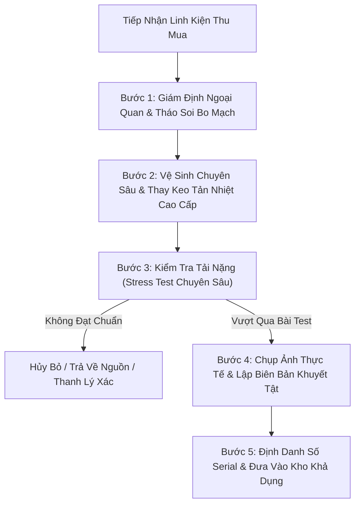

# Tiêu Chuẩn Đánh Giá Tình Trạng Hàng, Kiểm Định Kỹ Thuật & Chính Sách Bảo Hành

| Thuộc tính              | Chi tiết                                                                                                |
| :---------------------- | :------------------------------------------------------------------------------------------------------ |
| **Mã tài liệu**         | `DOC-BIZ-CONDITION-WARRANTY`                                                                            |
| **Tên tài liệu**        | Quy chuẩn Phân cấp Tình trạng Sản phẩm, Quy trình Kiểm định Kỹ thuật và Chính sách Bảo hành NovaStore   |
| **Phiên bản**           | `1.0.0`                                                                                                 |
| **Trạng thái tài liệu** | `BASELINE REVIEW READY`                                                                                 |
| **Phạm vi**             | Quy chuẩn chất lượng phần cứng mới và đã qua sử dụng, quy trình minh bạch khuyết tật và chế độ bảo hành |
| **Ngôn ngữ**            | Tiếng Việt (kèm thuật ngữ chuyên ngành tiếng Anh)                                                       |
| **Ngày cập nhật**       | 14/11/2026                                                                                              |

---

## 1. Triết Lý Chất Lượng & Minh Bạch Của NovaStore

Tại thị trường linh kiện máy tính và thiết bị công nghệ Việt Nam, người tiêu dùng thường đối mặt với sự thiếu minh bạch khi mua hàng đã qua sử dụng: hàng sửa chữa nạp lại BIOS, hàng cày tiền ảo bị quá nhiệt, hàng lỗi chập chờn được dán tem bảo hành gian dối.

NovaStore thiết lập một **chuẩn mực bán lẻ minh bạch tuyệt đối**:

1. **Kiểm định phần cứng 100%**: Không bán hàng "sang tay" chưa qua kiểm tra. Mọi sản phẩm đã qua sử dụng đều phải vượt qua bài kiểm tra tải nặng (heavy stress test) tại phòng Lab kỹ thuật.
2. **Minh bạch hóa khuyết tật (Defect Disclosure)**: Mọi vết xước, cấn, ố hoặc phụ kiện thiếu đều được chụp ảnh rõ nét và công khai trực tiếp cho khách hàng trước khi bấm mua.
3. **Quản lý theo Đơn Vị Vật Lý Duy Nhất (Single Serialized Stock Unit)**: Khách hàng mua đúng sản phẩm có số Serial và hình ảnh mình đã xem, không phải hình ảnh minh họa chung chung.
4. **Cam kết bảo hành trực tiếp từ NovaStore (NovaStore Store Warranty)**: Khách hàng không bị đùn đẩy trách nhiệm, được đổi mới 1-1 trong 15 ngày đầu nếu phát sinh lỗi phần cứng.

---

## 2. Bảng Chuẩn Hóa 4 Phân Cấp Tình Trạng Hàng (Condition Grades)

Toàn bộ sản phẩm phân phối trên nền tảng NovaStore được xếp vào 4 cấp độ tình trạng chuẩn hóa:

| Cấp bậc tình trạng | Tên gọi chuẩn hóa            | Tiêu chuẩn ngoại quan & Kiểm định kỹ thuật                                                                                                                                                                                             | Tình trạng hộp & Phụ kiện đi kèm                                                                                        | Thời hạn bảo hành áp dụng                                                                          |
| :----------------- | :--------------------------- | :------------------------------------------------------------------------------------------------------------------------------------------------------------------------------------------------------------------------------------- | :---------------------------------------------------------------------------------------------------------------------- | :------------------------------------------------------------------------------------------------- |
| **`NEW`**          | **Mới 100% (Brand New)**     | Nguyên niêm phong nhà máy (Factory Sealed), chưa từng cấp nguồn hoạt động. Nhập khẩu chính ngạch từ nhà phân phối ủy quyền.                                                                                                            | Hộp bán lẻ nguyên bản của hãng (Original Box) với đầy đủ sách hướng dẫn, phụ kiện niêm phong 100%.                      | **Bảo hành Chính hãng (Manufacturer Warranty)**: 12 đến 36 tháng tùy linh kiện.                    |
| **`LIKE_NEW`**     | **Như Mới (Grade A / Lướt)** | Sản phẩm lướt, mở hộp trưng bày hoặc sử dụng dưới 1 tháng. Ngoại quan đạt 99%, không có vết xước nhìn thấy được bằng mắt thường ở khoảng cách 20cm. Đạt 100% điểm số hiệu năng trong bài stress test.                                  | Hộp gốc hoặc hộp chuyên dụng cao cấp của NovaStore; đầy đủ toàn bộ phụ kiện thiết yếu.                                  | **Bảo hành NovaStore (Store Warranty)**: Cam kết từ 6 đến 12 tháng. Đổi mới 1-1 trong 15 ngày đầu. |
| **`GOOD`**         | **Tốt (Grade B)**            | Đã qua sử dụng thực tế. Có dấu vết hao mòn nhẹ theo thời gian (vết xước dăm nhẹ trên tấm ốp kim loại backplate, chân ốc bắt vỏ có vết siết). Hoàn toàn không cấn móp, không rỉ sét. Bo mạch sạch, nhiệt độ hoạt động ổn định.          | Đóng gói trong hộp chống sốc chuyên dụng của NovaStore; đi kèm đầy đủ cáp kết nối và ngàm lắp cơ bản.                   | **Bảo hành NovaStore (Store Warranty)**: Cam kết từ 3 đến 6 tháng. Đổi mới 1-1 trong 15 ngày đầu.  |
| **`FAIR`**         | **Chấp Nhận Được (Grade C)** | Ngoại quan có vết trầy xước nhìn rõ, vết cấn nhẹ ở góc vỏ hoặc thiếu các phụ kiện trang trí không ảnh hưởng đến vận hành (ví dụ: mất nắp che bụi cổng xuất hình, không có hộp gốc). Đã qua bài stress test đạt chuẩn nhiệt độ an toàn. | Đóng gói túi chống tĩnh điện (ESD bag) và thùng xốp NovaStore; chỉ kèm phụ kiện tối thiểu để hoạt động; giá tối ưu sâu. | **Bảo hành NovaStore (Store Warranty)**: Cam kết từ 1 đến 3 tháng. Đổi mới 1-1 trong 15 ngày đầu.  |

---

## 3. Quy Trình Kiểm Định Phòng Lab Kỹ Thuật (Technical Inspection Workflow)

Mỗi linh kiện đã qua sử dụng khi nhập về kho NovaStore đều phải trải qua quy trình 5 bước nghiêm ngặt:



### Chi Tiết Từng Bước Kiểm Định Kỹ Thuật:

1. **Giám định ngoại quan & Soi mạch**:
   - Dùng kính lúp điện tử kiểm tra tụ điện (không bị phù/chảy dầu), chân socket CPU (không cong vênh/gãy chân), mối hàn bo mạch (chưa qua khò hàn sửa chữa).
   - Kiểm tra tem niêm phong ốc của nhà sản xuất (Factory Seal) để xác định lịch sử tháo mở.
2. **Bảo dưỡng kỹ thuật**:
   - Vệ sinh sạch bụi bẩn bằng cồn chuyên dụng Isopropyl Alcohol 99% và máy thổi khí ion hóa chống tĩnh điện.
   - Thay keo tản nhiệt gốm kim loại hoặc chất lỏng tản nhiệt cao cấp (Thermal Grizzly / Arctic MX-6) cho GPU và CPU.
3. **Bài kiểm tra tải nặng bắt buộc (Mandatory Stress Testing)**:
   - **Card đồ họa (GPU)**: Chạy bài kiểm tra FurMark ở độ phân giải 4K trong 30 phút liên tục kết hợp 3DMark Time Spy Stress Test (phải đạt độ ổn định Frame Rate Stability >= 97%). Độ chênh lệch nhiệt độ giữa GPU Core và Hotspot không được vượt quá 15°C.
   - **Vi xử lý (CPU)**: Chạy Prime95 chế độ Small FFTs trong 20 phút. Toàn bộ các nhân không được phát sinh worker error và không bị bóp nghẽn nhiệt (Thermal Throttling) dưới ngưỡng quy định.
   - **Bộ nhớ (RAM)**: Chạy 4 vòng kiểm tra MemTest86 trên phần mềm boot độc lập. Yêu cầu 0 lỗi bit (Zero Bit Error).
   - **Ổ cứng (SSD / HDD)**: Đọc thông tin S.M.A.R.T qua CrystalDiskInfo, kiểm tra tỷ lệ bad sector bằng phần mềm Victoria. Ổ SSD phải có chỉ số sức khỏe (Health Status) từ 90% trở lên.
   - **Màn hình hiển thị**: Quét điểm chết trên 5 dải màu nền đơn sắc (Đỏ, Xanh lá, Xanh dương, Trắng, Đen). Cam kết không có điểm chết (Zero Dead Pixel) ở vùng trung tâm góc nhìn chính.
4. **Minh bạch khuyết tật (Defect Disclosure)**:
   - Chuyên viên kiểm định chụp từ 4 đến 8 bức ảnh độ phân giải cao của chính thiết bị đó: mặt trước, mặt sau, góc cạnh, tem thông số Serial, và chụp cận cảnh vết trầy xước (nếu có).
   - Ghi chú chi tiết danh sách phụ kiện thiếu (ví dụ: "Thiếu ốc bắt M.2 gốc", "Không kèm cáp SATA").
5. **Định danh Serial & Niêm Yết**:
   - Gắn mã Stock Unit ID duy nhất kết nối với Số Serial vật lý.
   - Dữ liệu kiểm định và thư viện ảnh tự động xuất bản lên trang chi tiết sản phẩm.

---

## 4. Chính Sách Bảo Hành & Dịch Vụ Khách Hàng (Warranty Framework)

NovaStore áp dụng 3 trụ cột bảo hành nhằm bảo vệ tối đa quyền lợi người tiêu dùng:

```text
+-----------------------------------------------------------------------------------+
|                        Khung Bảo Hành Toàn Diện NovaStore                         |
+-----------------------------------------------------------------------------------+
           |                                     |                          |
           v                                     v                          v
[ 1. Hàng Mới 100% ]                  [ 2. Hàng Đã Qua Sử Dụng ]    [ 3. Hỗ Trợ Kỹ Thuật ]
  - Bảo hành chính hãng 12-36T          - Bảo hành NovaStore 1-12T    - Trọn đời sản phẩm
  - NovaStore hỗ trợ gửi RMA            - Lỗi là đổi trong 15 ngày    - Hỗ trợ lắp ráp & BIOS
  - Cho mượn linh kiện thay thế         - Hoàn tiền nếu hết linh kiện - Cân chỉnh & tối ưu
```

### 4.1 Bảo Hành Chính Hãng (Manufacturer Warranty)

- Áp dụng cho 100% sản phẩm có trạng thái **`NEW`**.
- Thời hạn bảo hành: Theo tiêu chuẩn công bố của hãng sản xuất (thường từ 12 tháng đến 36 tháng, một số nguồn máy tính cao cấp bảo hành tới 10 năm).
- Quy trình hỗ trợ từ NovaStore: Khách hàng có thể tự mang tới trung tâm bảo hành của hãng hoặc gửi về NovaStore. NovaStore sẽ đại diện làm việc với trung tâm bảo hành chính hãng (RMA Processing), theo dõi tiến độ và giao trả sản phẩm tận nhà miễn phí cho khách hàng.

### 4.2 Bảo Hành Cửa Hàng NovaStore (NovaStore Store Warranty)

- Áp dụng cho các sản phẩm đã qua sử dụng (**`LIKE_NEW`**, **`GOOD`**, **`FAIR`**).
- **Chính sách Đổi Mới 1-1 Trong 15 Ngày Đầu**: Nếu sản phẩm gặp bất kỳ lỗi kỹ thuật phần cứng nào trong vòng 15 ngày kể từ ngày nhận hàng, NovaStore cam kết đổi ngay lập tức một linh kiện tương đương hoặc cao cấp hơn.
- **Xử lý khi hết linh kiện thay thế**: Trường hợp trong kho không còn linh kiện cùng cấu hình hoặc khách hàng không đồng ý đổi sang mã tương đương, NovaStore cam kết **Hoàn lại 100% giá trị tiền mặt** của linh kiện đó.
- **Thời hạn bảo hành cam kết**: Được ghi rõ trên phiếu bảo hành điện tử và dán tem bảo hành chống giả (1 tháng, 3 tháng, 6 tháng hoặc 12 tháng tùy gói khách hàng lựa chọn).

### 4.3 Dịch Vụ Hỗ Trợ Kỹ Thuật Trọn Đời (Lifetime Technical Support)

- Khách hàng mua linh kiện lẻ hoặc bộ máy tính tại NovaStore được hưởng đặc quyền tư vấn kỹ thuật trọn đời:
  - Hỗ trợ cập nhật BIOS bo mạch chủ tương thích với các thế hệ CPU mới nhất.
  - Tư vấn cân chỉnh đường gió tản nhiệt, tối ưu độ cong quạt (fan curve) giảm tiếng ồn.
  - Hỗ trợ từ xa (Remote Support qua TeamViewer / UltraViewer) xử lý lỗi xung đột driver đồ họa, lỗi màn hình xanh (BSOD).

---

## 5. Nguyên Tắc Định Giá Số Nguyên Đồng Việt Nam (Integer VND Currency Rules)

Nhằm đảm bảo sự chính xác tuyệt đối trong giao dịch thương mại và kế toán tài chính tại Việt Nam:

1. **Số nguyên tuyệt đối (Strict Whole Numbers)**:
   - Toàn bộ giá bán sản phẩm, giá đơn vị hàng cũ, phí vận chuyển, phụ phí dịch vụ mod phím/lắp máy, tiền giảm giá và tổng tiền hóa đơn đều được định dạng bằng **số nguyên Đồng Việt Nam (VNĐ)**.
   - Ví dụ: `15.500.000 VNĐ`, `250.000 VNĐ`.
2. **Loại bỏ hoàn toàn tư duy tiền tệ thập phân / Cents**:
   - Hệ thống tuyệt đối **KHÔNG** áp dụng tư duy tiền tệ nước ngoài (như chuẩn USD chia 100 cents). Không lưu trữ dạng `15500000.00` và không thực hiện phép chia 100 khi xử lý dữ liệu.
3. **Định giá độc lập cho từng đơn vị hàng cũ**:
   - Hai sản phẩm cùng chung một Mẫu sản phẩm (Catalog Product Model) nhưng thuộc hai Đơn vị hàng cũ (Stock Unit) khác nhau hoàn toàn có thể có mức giá bán khác nhau dựa trên tình trạng ngoại quan và thời hạn bảo hành.
   - Ví dụ:
     - Card RTX 3070 Serial #SN-001 (LIKE_NEW, bảo hành 6 tháng): Giá bán `7.200.000 VNĐ`.
     - Card RTX 3070 Serial #SN-002 (GOOD, xước nhẹ quạt, bảo hành 3 tháng): Giá bán `6.500.000 VNĐ`.

---

## 6. Tài Liệu Tham Chiếu

- [Tổng quan nghiệp vụ NovaStore](./business-overview.md)
- [Danh mục ngành hàng và kiến trúc thuộc tính](./product-catalog.md)
- [Quy trình nghiệp vụ chi tiết sản phẩm](./workflows/product-detail-workflow.md)
- [Bảng quy tắc nghiệp vụ tập trung](./business-rules-catalog.md)
- [Quyết định kiến trúc ADR 0004: Phân tách Catalog Product và Tồn kho Serialized](../../docs/adr/0004-catalog-product-vs-physical-inventory-distinction.md)
