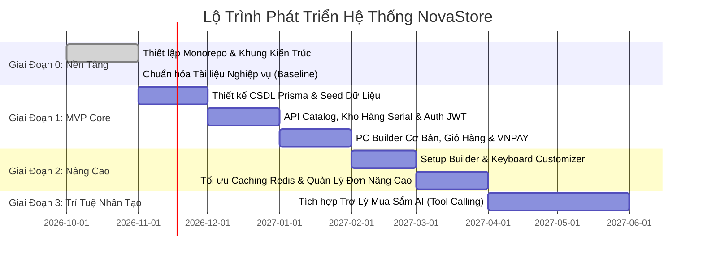

# Lộ Trình Phát Triển & Phân Định Phạm Vi Hệ Thống (Scope & Product Roadmap)

| Thuộc tính              | Chi tiết                                                                                          |
| :---------------------- | :------------------------------------------------------------------------------------------------ |
| **Mã tài liệu**         | `DOC-BIZ-ROADMAP`                                                                                 |
| **Tên tài liệu**        | Lộ Trình Phát Triển Sản Phẩm, Kế Hoạch Phát Hành & Phân Định Phạm Vi NovaStore                    |
| **Phiên bản**           | `1.0.0`                                                                                           |
| **Trạng thái tài liệu** | `BASELINE REVIEW READY`                                                                           |
| **Phạm vi**             | Phân định ranh giới giữa Baseline hiện tại, Phiên bản MVP, Giai đoạn mở rộng và Phạm vi tương lai |
| **Ngôn ngữ**            | Tiếng Việt (kèm thuật ngữ chuyên ngành tiếng Anh)                                                 |
| **Ngày cập nhật**       | 14/11/2026                                                                                        |

---

## 1. Nguyên Tắc Phân Định Phạm Vi (Scope Boundary Principles)

Nhằm đảm bảo dự án NovaStore đạt chất lượng kỹ thuật cao nhất của một hệ thống thương mại điện tử chuyên nghiệp, tránh bẫy "phình to phạm vi" (Scope Creep) làm suy giảm chất lượng kiến trúc:

1. **Kiên định với Mô hình Bán lẻ Sở hữu Kho hàng (Model A)**: Tuyệt đối không đưa các tính năng sàn giao dịch người bán ngoài vào bất kỳ giai đoạn nào của lộ trình.
2. **Ưu tiên chất lượng cốt lõi trước**: Đảm bảo luồng thương mại mua lẻ linh kiện mới/cũ, PC Builder và thanh toán hoạt động hoàn hảo 100% trước khi mở rộng các bộ Customizer nâng cao.
3. **Phân tách rõ ràng Trợ lý AI (AI Shopping Assistant)**: Trợ lý AI là mục tiêu chiến lược tương lai, phụ thuộc vào sự hoàn thiện của các API nghiệp vụ backend. Giai đoạn nền tảng chỉ chuẩn bị kiến trúc gọi công cụ (Tool Calling Architecture), không triển khai vội vã.

---

## 2. Bản Đồ Phân Tầng Lộ Trình Phát Triển (Product Roadmap)

---

## 3. Chi Tiết Từng Giai Đoạn Phát Triển

### 3.1 Giai Đoạn Hiện Tại: Hoàn Thiện Nền Tảng Nghiệp Vụ (Phase 0 - Business Baseline)

- **Mục tiêu**: Thiết lập bộ tài liệu nghiệp vụ hoàn chỉnh, chuẩn hóa thuật ngữ, quy tắc nghiệp vụ tập trung và đặc tả quy trình có tính truy xuất nguồn gốc (Traceability) trước khi bắt tay vào thiết kế CSDL và viết mã.
- **Phạm vi hoàn tất**:
  - [x] Tổng quan mô hình kinh doanh Model A và loại trừ Marketplace.
  - [x] Đặc tả vai trò và phân quyền tác nhân (Guest, Customer, Staff, Admin, System).
  - [x] Kiến trúc danh mục 8 ngành hàng và thuộc tính kỹ thuật.
  - [x] Tiêu chuẩn đánh giá 4 cấp bậc tình trạng hàng, quy trình kiểm định phòng Lab và bảo hành.
  - [x] Đặc tả 4 hành trình trải nghiệm mua sắm cốt lõi.
  - [x] 4 Quy trình nghiệp vụ chuẩn hóa (Khám phá, Chi tiết PDP, Giỏ hàng, Thanh toán).
  - [x] Đặc tả vòng đời đơn hàng 4 chiều trạng thái và ma trận chuyển đổi.
  - [x] Bảng quy tắc nghiệp vụ tập trung (`BR-xxx`) và danh mục yêu cầu chức năng (`FR-xxx`).

---

### 3.2 Giai Đoạn 1: Sản Phẩm Khả Dụng Tối Thiểu (Phase 1 - MVP Release)

- **Mục tiêu**: Xây dựng phiên bản thương mại điện tử cốt lõi chạy được đầu cuối (End-to-End Core E-commerce) phục vụ mua lẻ linh kiện máy tính và lắp ráp dàn PC cơ bản.
- **Tính năng trong phạm vi MVP (In-Scope MVP)**:
  - **Quản lý danh mục & Mẫu sản phẩm**: Hỗ trợ 8 ngành hàng, quản lý biến thể hàng mới và đơn vị hàng cũ có Số Serial vật lý.
  - **Quản lý tình trạng & Kiểm định**: Hiển thị ảnh chụp thật vết xước và biên bản stress test FurMark/Prime95 trên trang PDP.
  - **Xác thực tài khoản**: Đăng ký, đăng nhập bằng Email/Password với JWT bảo mật; quản lý sổ địa chỉ giao hàng.
  - **Bộ Cấu Hình PC (PC Builder Core)**: Chọn 8 linh kiện chính (CPU, Main, RAM, GPU, SSD, PSU, Case, Cooler); Động cơ tương thích kiểm tra Socket, DDR, kích thước Case và công suất Nguồn.
  - **Giỏ hàng hợp nhất**: Hỗ trợ Giỏ hàng Khách vãng lai (`localStorage`), Giỏ hàng Khách hàng (DB), và thuật toán Gộp giỏ hàng an toàn (`BR-CART-04`).
  - **Chặn hoàn toàn Guest Checkout**: Bắt buộc đăng nhập trước khi vào màn hình thanh toán.
  - **Quy trình Thanh toán & Đặt hàng**: Tái thẩm định giá niêm yết hiện thời, khóa giữ chỗ tồn kho (15 phút), tích hợp cổng thanh toán trực tuyến VNPAY/MoMo và thanh toán COD cho đơn dưới 10 triệu VNĐ.
  - **Vòng đời đơn hàng cơ bản**: Quản lý 4 chiều trạng thái, tạo bản chụp bất biến (Immutable Snapshot), xuất mã vận đơn giao hàng.

---

### 3.3 Giai Đoạn 2: Nâng Cao & Tùy Biến Chuyên Sâu (Phase 2 - Advanced Enhancements)

- **Mục tiêu**: Mở rộng các trải nghiệm cấu hình độc quyền và tối ưu hóa vận hành kho.
- **Tính năng nâng cao (Post-MVP Enhancements)**:
  - **Bộ Quy Hoạch Góc Setup (Full Setup Builder)**: Tính toán tải trọng Arm màn hình kép, đối chiếu kích thước bàn nâng hạ, quản lý phụ kiện ánh sáng và ổ cắm điện.
  - **Bộ Tùy Biến Bàn Phím Cơ (Modular Product Customizer)**: Tùy biến từng tầng (Case, PCB, Plate, Switch 3-pin/5-pin, Keycap, dịch vụ lube switch).
  - **Tích hợp thanh toán mã QR động VietQR**: Tự động nhận diện biến động số dư tài khoản ngân hàng không qua trung gian cổng.
  - **Danh sách yêu thích & Lưu cấu hình (Wishlist & Saved Builds)**: Cho phép khách hàng lưu trữ và chia sẻ đường link cấu hình PC cho bạn bè.
  - **Cổng vận chuyển API tự động**: Kết nối trực tiếp API của Giao Hàng Tiết Kiệm (GHTK) hoặc Viettel Post để tính phí vận chuyển theo trọng lượng thời gian thực và tự động tạo mã vận đơn.

---

### 3.4 Giai Đoạn 3: Trí Tuệ Nhân Tạo & Trợ Lý Mua Sắm (Phase 3 - AI Shopping Assistant)

- **Mục tiêu**: Tích hợp Trợ lý mua sắm AI thế hệ mới đóng vai trò như một chuyên viên tư vấn bán hàng chuyên nghiệp tại cửa hàng.
- **Tính năng AI (Future Scope)**:
  - **Giao diện hội thoại ngôn ngữ tự nhiên**: Khách hàng mô tả nhu cầu bằng văn bản (ví dụ: _"Tư vấn cho tôi dàn PC màu trắng ngân sách 25 triệu VNĐ để dựng video 4K và chơi Black Myth Wukong"_).
  - **Bộ điều phối Tool Calling an toàn (Allowlisted Tool Executor)**: Mô hình ngôn ngữ lớn (LLM) chỉ được phép tương tác thông qua các công cụ nghiệp vụ được backend cấp phép (tra cứu sản phẩm, kiểm tra tồn kho, kiểm tra tương thích PC Builder, tính tổng chi phí).
  - **Bảo mật tuyệt đối**: Mô hình LLM tuyệt đối **KHÔNG CÓ QUYỀN TRUY CẬP TRỰC TIẾP VÀO CƠ SỞ DỮ LIỆU**, không thực thi SQL tùy ý, và không tự động đặt hàng/trừ tiền nếu chưa có xác nhận từ khách hàng.

---

## 4. Các Tính Năng Loại Trừ Tuyệt Đối Khỏi Hệ Thống (Explicitly Excluded)

Các thành phần dưới đây vĩnh viễn nằm ngoài phạm vi phát triển của NovaStore để bảo toàn tính tinh gọn và mô hình bán lẻ tự chủ chất lượng:

1. ❌ **Sàn giao dịch đa người bán (Third-Party Marketplace)**: Không có người bán ngoài, không có cổng Vendor Portal.
2. ❌ **Cơ chế tính hoa hồng bán hàng (Seller Commissions)**.
3. ❌ **Quy trình tách đơn hàng theo nhà cung cấp (Multi-vendor Order Splitting)**.
4. ❌ **Đấu giá trực tuyến (Hardware Bidding / Auction System)**.
5. ❌ **Tiền tệ ảo hoặc thanh toán phân số nhỏ hơn 1 VNĐ**.

---

## 5. Tài Liệu Tham Chiếu

- [Tổng quan nghiệp vụ NovaStore](./business-overview.md)
- [Bảng quy tắc nghiệp vụ tập trung](./business-rules-catalog.md)
- [Danh mục yêu cầu chức năng](./functional-requirements.md)
- [Kiến trúc Trợ lý mua sắm AI](../../docs/architecture/ai-shopping-assistant-architecture.md)
- [Quyết định kiến trúc ADR 0006: Kiến trúc AI Tool Calling](../../docs/adr/0006-backend-controlled-ai-tool-calling-architecture.md)
