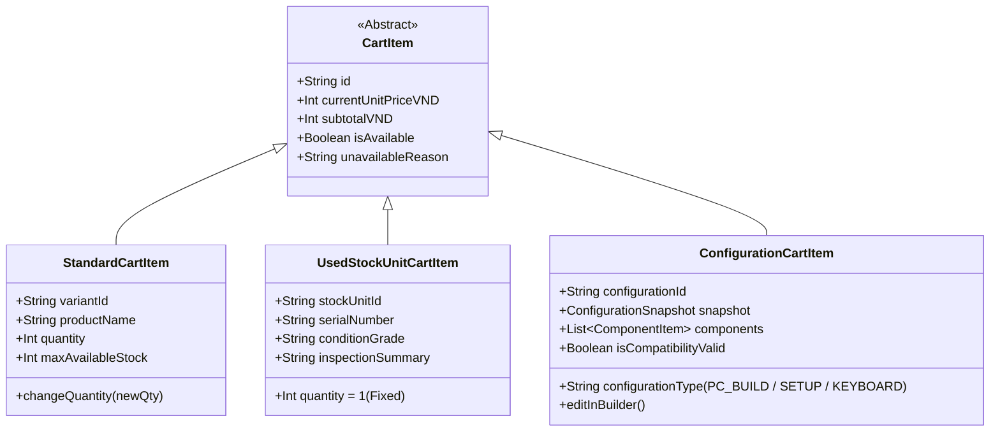
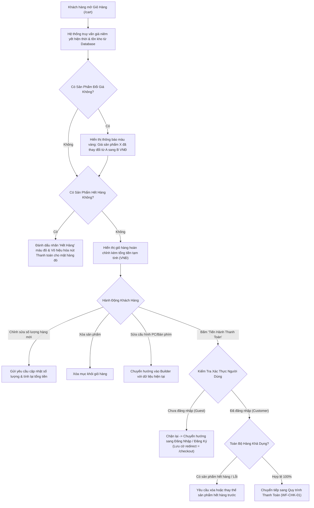
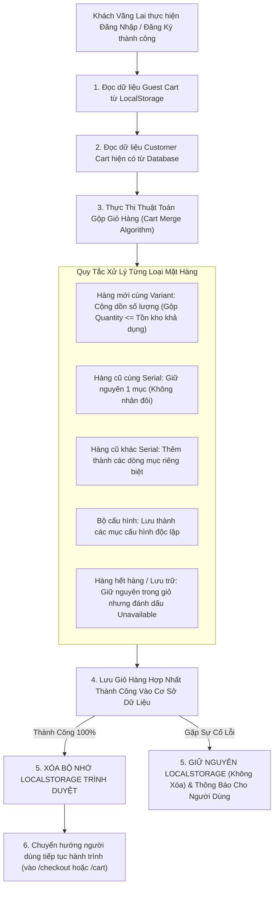

# Đặc Tả Quy Trình Quản Lý Giỏ Hàng & Gộp Giỏ Hàng (Cart Management & Merge Workflow)

| Thuộc tính                     | Chi tiết                                                                                                                            |
| :----------------------------- | :---------------------------------------------------------------------------------------------------------------------------------- |
| **Mã quy trình (Workflow ID)** | `WF-CART-01`                                                                                                                        |
| **Tên quy trình**              | Quản Lý Giỏ Hàng, Đồng Bộ & Gộp Giỏ Hàng An Toàn (Cart Management & Secure Cart Merge Workflow)                                     |
| **Phiên bản**                  | `1.0.0`                                                                                                                             |
| **Trạng thái tài liệu**        | `BASELINE REVIEW READY`                                                                                                             |
| **Phạm vi**                    | Giỏ hàng Khách vãng lai (Local), Giỏ hàng Khách hàng (DB), 3 loại mục giỏ hàng, quy tắc gộp giỏ hàng và chuyển tiếp sang Thanh toán |
| **Ngôn ngữ**                   | Tiếng Việt (kèm thuật ngữ chuyên ngành tiếng Anh)                                                                                   |
| **Ngày cập nhật**              | 14/11/2026                                                                                                                          |

---

## 1. Mục Tiêu Nghiệp Vụ (Business Objective)

Cung cấp trải nghiệm quản lý giỏ hàng thống nhất, trực quan và an toàn cho mọi hình thức sản phẩm (mua lẻ hàng mới, mua lẻ hàng cũ có số Serial, và các bộ cấu hình PC / Setup / Bàn phím cơ tùy biến). Đảm bảo tính toán chính xác giá bán hiện thời, bảo vệ dữ liệu giỏ hàng khi người dùng đăng nhập (quy trình Gộp giỏ hàng không làm mất dữ liệu), và kiểm soát điều kiện tiên quyết trước khi bước vào quy trình Thanh toán.

---

## 2. Các Tác Nhân Tham Gia (Actors)

- **Khách Vãng Lai (Guest)**: Thao tác giỏ hàng lưu tại bộ nhớ trình duyệt thiết bị cá nhân (`localStorage`).
- **Khách Hàng (Customer)**: Thao tác giỏ hàng đồng bộ trên máy chủ (Server Database Cart).
- **Hệ Thống (System)**: Backend API thực thi kiểm tra giá hiện thời, kiểm tra tồn kho khả dụng và thực hiện thuật toán gộp giỏ hàng (Cart Merge Algorithm).

---

## 3. Sự Kiện Kích Hoạt (Trigger)

- Người dùng nhấp vào biểu tượng Giỏ Hàng trên thanh điều hướng đầu trang (`/cart`).
- Người dùng bấm nút "Thêm vào giỏ" từ trang chi tiết sản phẩm hoặc từ các bộ cấu hình Builder.
- Khách vãng lai thực hiện Đăng Nhập hoặc Đăng Ký tài khoản thành công trong khi đang có sản phẩm trong giỏ hàng cục bộ.

---

## 4. Điều Kiện Tiên Quyết (Preconditions)

- Trình duyệt người dùng hỗ trợ lưu trữ cục bộ (`localStorage` hoặc `IndexedDB`) đối với Khách vãng lai.
- Phiên đăng nhập (JWT Token) hợp lệ đối với Khách hàng.

---

## 5. Phân Loại 3 Nhóm Mục Trong Giỏ Hàng (3 Cart Item Categories)

Giỏ hàng NovaStore cấu trúc các mặt hàng thành 3 nhóm logic riêng biệt:

1. **Mục Sản Phẩm Tiêu Chuẩn (Standard Product Cart Item)**:
   - Đại diện cho hàng mới 100% thuộc một biến thể (Variant) cụ thể.
   - Khách hàng có thể tự do tăng hoặc giảm số lượng mua bằng nút +/- hoặc nhập số trực tiếp (giới hạn bởi số lượng tồn kho khả dụng).
2. **Mục Đơn Vị Hàng Cũ (Used Stock Unit Cart Item)**:
   - Đại diện cho chính xác một thiết bị vật lý có Số Serial cụ thể.
   - Hiển thị nhãn cấp bậc ngoại quan (`LIKE_NEW`, `GOOD`, `FAIR`), tóm tắt bài test và thời hạn bảo hành cửa hàng.
   - **Số lượng cố định tuyệt đối = 1**. Không hiển thị nút tăng số lượng.
   - Không cho phép trùng lặp cùng một Số Serial trong giỏ hàng.
3. **Mục Bộ Cấu Hình Nhóm (Grouped Configuration Cart Item)**:
   - Đại diện cho một dàn máy PC hoàn chỉnh, một góc setup hoặc một chiếc bàn phím cơ tùy biến.
   - Được đóng gói thành một cụm duy nhất (Grouped Item) hiển thị: Tên dàn máy, tổng giá trị, danh sách thu gọn các linh kiện cấu thành, và phí dịch vụ lắp ráp.
   - **Quy tắc thao tác**: Người dùng **KHÔNG ĐƯỢC PHÉP** xóa hoặc sửa số lượng của từng linh kiện thành phần riêng lẻ ngay trong giỏ hàng. Nếu muốn thay đổi linh kiện, người dùng bấm nút **"Sửa trong Builder"**; hệ thống sẽ đưa toàn bộ dàn linh kiện trở lại giao diện Builder để Động cơ tương thích kiểm tra lại trước khi lưu lại vào giỏ hàng.

---

## 6. Quy Trình Xử Lý Chính (Main Flow)

### Các Bước Chi Tiết:

1. **Truy vấn và Tái thẩm định giá (Real-time Price Evaluation)**:
   - Khi giỏ hàng được mở ra, hệ thống tự động đối chiếu giá của từng sản phẩm trong giỏ với bảng giá niêm yết mới nhất trong cơ sở dữ liệu.
   - **Chính sách giá giỏ hàng (`BR-CART-01`)**: Thêm sản phẩm vào giỏ hàng **KHÔNG** khóa giá sản phẩm. Nếu giá linh kiện trên thị trường tăng hoặc giảm, giỏ hàng sẽ tự động cập nhật giá mới nhất và hiển thị bảng thông báo: _"Giá của linh kiện [Tên sản phẩm] đã được cập nhật thành [Giá mới] VNĐ"_.
2. **Kiểm tra trạng thái tồn kho khả dụng**:
   - Nếu một sản phẩm mới bị hết hàng hoặc một đơn vị hàng cũ đã bị bán mất: Mặt hàng đó bị chuyển sang trạng thái `UNAVAILABLE`, hiển thị dòng cảnh báo màu đỏ _"Sản phẩm hiện tạm hết hàng hoặc đơn vị cũ này đã được bán"_.
   - Khách hàng không thể bấm Thanh toán nếu trong giỏ còn sản phẩm không khả dụng. Khách hàng phải bấm nút "Xóa khỏi giỏ" hoặc "Lưu lại mua sau".
3. **Thao tác điều chỉnh**:
   - Khách hàng có thể tăng giảm số lượng hàng mới, xóa mục khỏi giỏ, hoặc nhấp vào "Sửa cấu hình PC" để mở lại PC Builder.
4. **Chốt chặn xác thực tại cửa ngõ Thanh toán (The Checkout Auth Wall - `BR-AUTH-02`)**:
   - Khi người dùng nhấn nút **"Tiến Hành Thanh Toán" (Proceed to Checkout)**:
     - **Nếu là Khách vãng lai (Guest)**: Hệ thống lập tức kích hoạt cơ chế chặn. Một hộp thoại thông báo xuất hiện: _"Quý khách vui lòng Đăng nhập hoặc Tạo tài khoản để tiến hành đặt hàng và nhận chế độ bảo hành chính hãng từ NovaStore"_. Trình duyệt lưu đường dẫn quay lại (`returnUrl = /checkout`) và chuyển hướng sang trang `/auth/login`.
     - **Nếu là Khách hàng (Customer)**: Hệ thống kiểm tra xem toàn bộ các mặt hàng có sẵn sàng hay không. Nếu hợp lệ, hệ thống tạo một phiên thanh toán (`CheckoutSession`) và chuyển hướng người dùng sang **Quy trình Đặt Hàng & Thanh Toán (WF-CHK-01)**.

---

## 7. Quy Trình Gộp Giỏ Hàng An Toàn Khi Đăng Nhập (Secure Cart Merge Flow)

Một tình huống nghiệp vụ quan trọng là: Khách vãng lai lướt web, thêm hàng vào giỏ hàng cục bộ, sau đó mới bấm Đăng Nhập hoặc Đăng Ký. Hệ thống phải đảm bảo gộp giỏ hàng an toàn, **tuyệt đối không làm mất dữ liệu của khách hàng**:

### Các Nguyên Tắc Gộp Giỏ Hàng Bất Biến:

1. **Bảo toàn dữ liệu nguồn (`BR-CART-04`)**: Tuyệt đối **CHỈ ĐƯỢC XÓA** dữ liệu giỏ hàng cục bộ trên trình duyệt (`localStorage`) sau khi toàn bộ dữ liệu hợp nhất đã được ghi thành công vào cơ sở dữ liệu phía máy chủ (Atomic DB Transaction Success). Nếu quá trình lưu cơ sở dữ liệu gặp sự cố mạng hoặc lỗi giao dịch, `localStorage` phải được giữ nguyên vẹn để người dùng không bị mất giỏ hàng.
2. **Quy tắc cộng dồn hàng mới**: Nếu cả giỏ hàng Guest và giỏ hàng Customer đều chứa chung một Biến thể hàng mới (Variant), số lượng sẽ được cộng dồn lại:
   $$\text{Số lượng sau gộp} = \min(\text{Qty}_{\text{Guest}} + \text{Qty}_{\text{Customer}}, \text{Tồn kho khả dụng})$$
   Nếu tổng số lượng vượt quá tồn kho thực tế, hệ thống gán bằng tồn kho tối đa và phát thông báo điều chỉnh.
3. **Quy tắc hàng cũ có Serial**: Nếu cả hai bên đều chứa cùng một Đơn vị hàng cũ (cùng `StockUnitId` và `SerialNumber`), kết quả sau gộp chỉ giữ đúng 1 mục (Số lượng = 1). Không bao giờ tạo ra 2 mục có cùng số Serial vật lý.

---

## 8. Các Luồng Ngoại Lệ & Lỗi (Exception Flows)

- **EF-1: Một linh kiện trong bộ PC Builder bị hết hàng**:
  - Tình huống: Khách hàng thêm bộ PC Build gồm 8 món. Sau vài giờ, chiếc Card màn hình RTX 4070 Ti trong bộ máy bị khách khác mua hết hàng.
  - Xử lý: Toàn bộ mục PC Build bị đánh dấu trạng thái `CONFIG_COMPONENT_UNAVAILABLE`. Hệ thống hiển thị thông báo chi tiết: _"Linh kiện Card Màn Hình trong cấu hình 'PC Gaming Ultra' hiện đã hết hàng. Vui lòng bấm 'Sửa Cấu Hình' để chọn card màn hình khác thay thế trước khi thanh toán."_
  - **Quy tắc bất biến (`BR-CART-05`)**: Hệ thống **TUYỆT ĐỐI KHÔNG TỰ ĐỘNG THAY THẾ** linh kiện khác (No silent substitution). Khách hàng bắt buộc phải chủ động chọn linh kiện thay thế trong Builder để đảm bảo tính tương thích và kiểm soát chi phí.
- **EF-2: Đơn vị hàng cũ bị xóa khỏi hệ thống do phòng Lab phát hiện lỗi đột xuất**:
  - Nếu một linh kiện cũ đang nằm trong giỏ hàng bị nhân viên kỹ thuật hủy đăng kiểm hoặc chuyển sang trạng thái bảo trì: Giỏ hàng hiển thị nhãn: _"Đơn vị hàng cũ này hiện không còn khả dụng để bán do đã được thu hồi kiểm tra kỹ thuật. Quý khách vui lòng xóa khỏi giỏ hàng."_

---

## 9. Các Quy Tắc Nghiệp Vụ Liên Quan (Business Rules)

- **`BR-AUTH-02`**: Guest Checkout bị tắt hoàn toàn. Mọi thao tác Thanh toán (Checkout) đều bắt buộc phải đăng nhập tài khoản Khách hàng hợp lệ.
- **`BR-CART-01`**: Thêm sản phẩm vào giỏ hàng KHÔNG khóa giá sản phẩm. Giá bán luôn luôn được cập nhật theo giá niêm yết hiện thời và phải được kiểm tra lại đầy đủ tại bước Checkout.
- **`BR-CART-02`**: Giỏ hàng hỗ trợ đầy đủ 3 loại mục: Hàng Mới tiêu chuẩn, Đơn vị Hàng Cũ duy nhất (Qty = 1), và Bộ Cấu Hình Nhóm.
- **`BR-CART-03`**: Khách hàng không được sửa đổi linh kiện thành phần của Bộ Cấu Hình ngay tại giao diện giỏ hàng mà bắt buộc phải mở lại công cụ Builder tương ứng để tái kiểm tra tương thích.
- **`BR-CART-04`**: Quá trình Gộp giỏ hàng (Cart Merge) chỉ được phép xóa `localStorage` của khách sau khi máy chủ đã ghi dữ liệu giỏ hàng thành công vào cơ sở dữ liệu.
- **`BR-CART-05`**: Không bao giờ tự ý thay thế linh kiện bị hết hàng trong bộ cấu hình. Bắt buộc người dùng phải xác nhận lựa chọn mới.

---

## 10. Dữ Liệu & Thông Tin Nghiệp Vụ Tham Gia

- **Dữ liệu Giỏ hàng**: `CartId`, `UserId` (đối với Customer) hoặc `GuestSessionId` (đối với Guest), `UpdatedAt`.
- **Dữ liệu Từng Mục**: `CartItemId`, `ItemType` (`STANDARD` / `USED_UNIT` / `CONFIGURATION`), `ReferenceId` (`VariantId` / `StockUnitId` / `ConfigId`), `Quantity`, `UnitPriceVND`, `SnapshotData`.
- **Dữ liệu Tính Toán**: `SubtotalVND` (Tổng tiền hàng chưa giảm giá), `EstimatedDiscountVND`, `EstimatedTotalVND`.

---

## 11. Điều Kiện Sau Khi Hoàn Thành (Postconditions)

- Giỏ hàng ở trạng thái hợp lệ, toàn bộ sản phẩm khả dụng, giá tiền được cập nhật theo bảng giá mới nhất.
- Khi người dùng bấm Thanh toán và đã đăng nhập: Chuyển hướng thành công sang giao diện Đặt Hàng & Thanh Toán (WF-CHK-01).

---

## 12. Tiêu Chí Nghiệm Thu (Acceptance Criteria)

- [ ] Khách vãng lai có thể thêm sản phẩm, xem giỏ hàng và chỉnh sửa số lượng trên trình duyệt bình thường.
- [ ] Bấm nút Thanh toán khi chưa đăng nhập bắt buộc chuyển hướng đến trang Đăng Nhập/Đăng Ký.
- [ ] Sau khi đăng nhập thành công, toàn bộ sản phẩm trong giỏ Guest được gộp đầy đủ vào giỏ Customer mà không bị mất món nào.
- [ ] Hàng cũ chỉ cho phép số lượng = 1 và không thể thêm trùng lặp cùng một Số Serial.
- [ ] Bộ cấu hình PC / Setup / Bàn phím cơ hiển thị dưới dạng một khối nhóm thống nhất kèm nút "Sửa trong Builder".
- [ ] Khi giá sản phẩm thay đổi, hệ thống hiển thị thông báo cập nhật giá rõ ràng.
- [ ] Nếu một linh kiện trong bộ PC bị hết hàng, bộ PC bị khóa thanh toán và hướng dẫn người dùng vào Builder để đổi món khác.

---

## 13. Quyết Định Đang Mở / Đề Xuất (Open Decisions)

- **DEC-CART-01 (Đề xuất)**: Thời hạn lưu giữ Giỏ hàng Khách vãng lai (Guest Cart Lifetime):
  - _Đề xuất ban đầu_: Lưu trữ trên `localStorage` vô thời hạn cho tới khi người dùng chủ động xóa dữ liệu duyệt web hoặc bấm nút "Xóa toàn bộ giỏ hàng". Trạng thái: `PROPOSED`.
- **DEC-CART-02 (Đề xuất)**: Số lượng giỏ hàng tối đa của mỗi Khách hàng (Customer Cart Count):
  - _Đề xuất ban đầu_: Mỗi tài khoản khách hàng sở hữu **DUY NHẤT 1 Giỏ Hàng Đang Hoạt Động (Active Cart)** tại một thời điểm để đơn giản hóa kiến trúc và tránh phân mảnh đơn hàng. Tính năng "Danh sách lưu mua sau" (Wishlist / Save for Later) sẽ được phát triển ở giai đoạn sau. Trạng thái: `PROPOSED`.

---

## 14. Các Quy Trình Liên Quan (Related Workflows)

- [Quy trình Chi Tiết Sản Phẩm (WF-PDP-01)](./product-detail-workflow.md)
- [Quy trình Đặt Hàng & Thanh Toán (WF-CHK-01)](./checkout-payment-workflow.md)
- [Bốn Trải Nghiệm Cấu Hình Khách Hàng](../customer-experiences.md)
