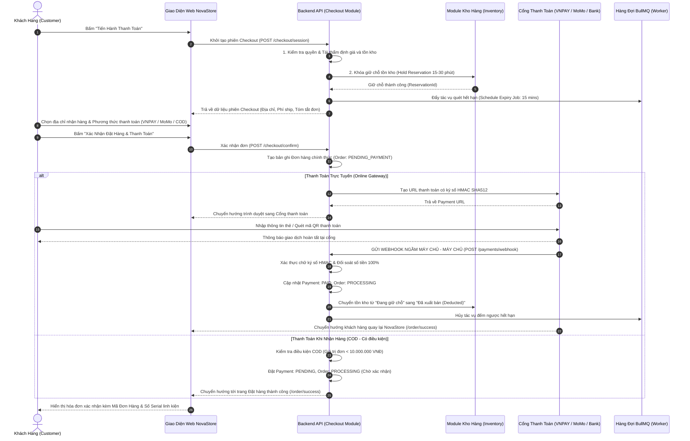

# Đặc Tả Quy Trình Đặt Hàng & Thanh Toán (Checkout & Payment Workflow)

| Thuộc tính                     | Chi tiết                                                                                                                            |
| :----------------------------- | :---------------------------------------------------------------------------------------------------------------------------------- |
| **Mã quy trình (Workflow ID)** | `WF-CHK-01`                                                                                                                         |
| **Tên quy trình**              | Quy Trình Đặt Hàng, Giữ Chỗ Tồn Kho & Thanh Toán (Checkout, Inventory Reservation & Payment Workflow)                               |
| **Phiên bản**                  | `1.0.0`                                                                                                                             |
| **Trạng thái tài liệu**        | `BASELINE REVIEW READY`                                                                                                             |
| **Phạm vi**                    | Kiểm tra điều kiện đặt hàng, tái thẩm định giá/kho, giữ chỗ tồn kho, cổng thanh toán trực tuyến, xử lý Webhook và xác nhận đơn hàng |
| **Ngôn ngữ**                   | Tiếng Việt (kèm thuật ngữ chuyên ngành tiếng Anh)                                                                                   |
| **Ngày cập nhật**              | 14/11/2026                                                                                                                          |

---

## 1. Mục Tiêu Nghiệp Vụ (Business Objective)

Thực thi quy trình chuyển đổi giao dịch từ Giỏ hàng sang Đơn hàng thương mại chính thức một cách an toàn, minh bạch và chính xác tuyệt đối. Đảm bảo:

- 100% người đặt hàng đã được định danh hợp lệ (Chặn Guest Checkout).
- Tái thẩm định giá niêm yết và tồn kho khả dụng ngay trước khi tạo đơn để tránh sai lệch giá và bán vượt (Overselling).
- Khóa giữ chỗ tồn kho (Inventory Reservation) có giới hạn thời gian (Time-bounded) cho phiên thanh toán.
- Tích hợp thanh toán an toàn, xác thực chữ ký số Webhook từ phía máy chủ, ngăn chặn gian lận và xử lý thanh toán bất biến (Idempotent Payment Processing).

---

## 2. Các Tác Nhân Tham Gia (Actors)

- **Khách Hàng (Customer)**: Người tiêu dùng đã đăng nhập, cung cấp địa chỉ nhận hàng, chọn phương thức thanh toán và xác nhận giao dịch.
- **Cổng Thanh Toán Đối Tác (Payment Gateways)**: Hệ thống trung gian thanh toán (VNPAY, MoMo, Cổng thanh toán Ngân hàng nội địa VietQR).
- **Hệ Thống Tự Động (System / Background Worker)**: Backend API điều phối, BullMQ Worker giám sát hết hạn giữ chỗ (Reservation Expiry Job), và Webhook Handler.
- **Nhân Viên Vận Hành (Staff / Admin)**: Tiếp nhận đơn hàng đã thanh toán thành công để xuất kho hoặc xử lý xác nhận đối với các đơn COD đặc thù.

---

## 3. Sự Kiện Kích Hoạt (Trigger)

- Khách hàng (đã đăng nhập) nhấp nút **"Tiến Hành Thanh Toán" (Proceed to Checkout)** từ giao diện Giỏ hàng hợp lệ.
- Khách hàng bấm nút **"Mua Ngay" (Buy Now)** từ trang PDP (sau khi hệ thống đã xác thực tài khoản).

---

## 4. Điều Kiện Tiên Quyết (Preconditions)

- Khách hàng **BẮT BUỘC ĐÃ ĐĂNG NHẬP** với tài khoản hợp lệ (`BR-AUTH-02`).
- Giỏ hàng có ít nhất một mặt hàng và toàn bộ mặt hàng đều đang ở trạng thái khả dụng (`isAvailable = true`).

---

## 5. Quy Trình Xử Lý Chính (Main Flow)

### Chi Tiết Từng Bước Thực Hiện:

1. **Khởi tạo Phiên Thanh Toán & Tái Thẩm Định Toàn Diện**:
   - Backend kiểm tra tài khoản khách hàng.
   - **Tái thẩm định giá bán hiện thời (`BR-CHECKOUT-01`)**: So sánh giá của từng món hàng trong giỏ với bảng giá niêm yết trong cơ sở dữ liệu. Nếu có bất kỳ sự thay đổi giá nào (do chương trình khuyến mãi kết thúc hoặc giá hãng điều chỉnh), hệ thống dừng quy trình và thông báo cho khách hàng: _"Một số sản phẩm đã thay đổi giá. Quý khách vui lòng xác nhận mức giá mới trước khi tiếp tục."_
   - **Tái thẩm định tồn kho khả dụng (`BR-CHECKOUT-02`)**: Đảm bảo số lượng hàng mới và các đơn vị Serial hàng cũ vẫn còn nguyên vẹn.
2. **Khóa Giữ Chỗ Tồn Kho Có Thời Hạn (Time-Bounded Inventory Reservation - `BR-INVENTORY-02`)**:
   - Khi phiên Checkout được khởi tạo hợp lệ, hệ thống thực hiện giữ chỗ trong kho:
     - Với Hàng Mới: Trừ số lượng khả dụng và cộng vào trường `reservedQuantity`.
     - Với Đơn vị Hàng Cũ: Đổi trạng thái `StockUnit` từ `AVAILABLE` sang `RESERVED`, gắn chặt với `CheckoutSessionId`.
     - Với Bộ Cấu Hình: Toàn bộ linh kiện thành phần cấu thành bộ cấu hình đều được đồng thời giữ chỗ.
   - **Thời hạn giữ chỗ mặc định**: 15 phút đối với cổng thanh toán thẻ/ví điện tử, hoặc 30 phút đối với hình thức chuyển khoản VietQR.
   - Một tác vụ đếm ngược (Delay Job) được đẩy vào hàng đợi BullMQ để tự động giải phóng tồn kho nếu khách hàng không thanh toán đúng hạn.
3. **Cung Cấp Thông Tin Giao Hàng & Phí Vận Chuyển**:
   - Khách hàng chọn một địa chỉ từ Sổ địa chỉ cá nhân (Address Book) hoặc nhập địa chỉ nhận hàng mới (Họ tên, Số điện thoại, Tỉnh/Thành phố, Quận/Huyện, Phường/Xã, Địa chỉ cụ thể).
   - Hệ thống tính toán phí vận chuyển dựa trên tổng khối lượng hàng và khu vực địa lý giao hàng.
4. **Áp Dụng Mã Giảm Giá / Khuyến Mãi (Nếu có)**:
   - Khách hàng nhập mã giảm giá (Coupon/Voucher). Backend kiểm tra các điều kiện: Giá trị đơn hàng tối thiểu, ngày hết hạn, số lượt sử dụng còn lại, ngành hàng áp dụng. Áp dụng mức giảm (tối đa bằng số nguyên VNĐ) vào tổng thanh toán.
5. **Khách Hàng Xác Nhận Đơn Hàng (Order Confirmation)**:
   - Màn hình hiển thị bảng tóm tắt chi phí minh bạch:
     - Tổng tiền hàng (Subtotal): Số nguyên VNĐ
     - Tiền giảm giá (Discount): Số nguyên VNĐ
     - Phí vận chuyển (Shipping Fee): Số nguyên VNĐ
     - Phí dịch vụ lắp ráp máy / Mod phím (nếu có): Số nguyên VNĐ
     - **Tổng cộng thanh toán (Grand Total)**: Số nguyên VNĐ
   - Khách hàng chọn phương thức thanh toán và bấm nút xác nhận cuối cùng.
6. **Xử Lý Thanh Toán Trực Tuyến & Xác Thực Webhook An Toàn (`BR-PAYMENT-01`, `BR-PAYMENT-02`)**:
   - Khách hàng được chuyển hướng sang cổng thanh toán đối tác (VNPAY, MoMo hoặc trang hiển thị mã QR VietQR).
   - Khi khách hàng hoàn tất thanh toán, Cổng thanh toán phát lệnh gọi **Webhook ngầm (Server-to-Server IPN / Webhook Notification)** tới endpoint an toàn của NovaStore.
   - **Quy tắc bảo mật bất biến (`BR-PAYMENT-01`)**:
     - Backend NovaStore giải mã và kiểm tra chữ ký số (HMAC SHA512) của gói tin Webhook bằng khóa bí mật (Secret Key) do Cổng thanh toán cấp.
     - Kiểm tra mã giao dịch đối soát, kiểm tra số tiền thanh toán thực tế phải khớp 100% với giá trị `GrandTotalVND` của đơn hàng.
     - **TUYỆT ĐỐI KHÔNG BAO GIỜ TIN TƯỞNG REDIRECT CỦA TRÌNH DUYỆT (Never trust frontend redirect)**: Việc người dùng bị chuyển hướng quay lại trang `/order/success` không được coi là bằng chứng thanh toán thành công. Chỉ có Webhook hợp lệ có chữ ký máy chủ mới được phép chuyển trạng thái đơn hàng sang `PAID` và `PROCESSING`.
   - **Xử lý bất biến chống trùng lặp (Idempotent Webhook Processing - `BR-PAYMENT-02`)**: Nếu Cổng thanh toán gửi trùng lặp Webhook nhiều lần cho cùng một mã giao dịch, hệ thống ghi nhận và phản hồi HTTP 200 ngay lập tức mà không thực hiện trừ kho hay cập nhật trạng thái lần thứ hai.
7. **Khấu Trừ Tồn Kho Vĩnh Viễn & Xuất Hóa Đơn**:
   - Sau khi thanh toán thành công: Trạng thái tồn kho chuyển từ `RESERVED` sang `DEDUCTED`. Đơn vị hàng cũ được đánh dấu chính thức là `SOLD` (Đã bán) và không bao giờ xuất hiện lại trên catalog.
   - Hệ thống tạo Bản chụp bất biến (Immutable Order Snapshot) lưu lại tên sản phẩm, thông số kỹ thuật, giá tiền tại thời điểm mua, và Số Serial vật lý của từng linh kiện.
   - Gửi email xác nhận đơn hàng kèm hóa đơn điện tử cho khách hàng.

---

## 6. Các Luồng Nhánh & Phương Thức Thanh Toán Khác (Alternative Flows)

### AF-1: Thanh Toán Khi Nhận Hàng (Cash on Delivery - COD)

- Hình thức COD chỉ khả dụng khi thỏa mãn các điều kiện kiểm soát rủi ro (`BR-PAYMENT-03`):
  - Tổng giá trị đơn hàng phải **dưới 10.000.000 VNĐ**.
  - Đơn hàng **KHÔNG CHỨA** dịch vụ lắp ráp máy tính theo yêu cầu riêng (vì rủi ro bom hàng đối với dàn máy đã bóc tem linh kiện để ráp là rất lớn).
  - Khách hàng có lịch sử nhận hàng thành công (không nằm trong danh sách đen boom hàng).
- Khi chọn COD: Đơn hàng được tạo ở trạng thái `PaymentStatus = PENDING`, `OrderStatus = PENDING_CONFIRMATION`. Nhân viên chăm sóc khách hàng NovaStore sẽ gọi điện thoại xác nhận đơn trong vòng 2 giờ làm việc trước khi kho tiến hành đóng gói.

### AF-2: Thanh Toán Chuyển Khoản Qua Mã QR Động (VietQR Bank Transfer)

- Hệ thống tạo mã QR chứa thông tin chuyển khoản chuẩn Napas247: Số tài khoản ngân hàng của NovaStore, Tên chủ tài khoản, Số tiền chính xác từng đồng VNĐ, và Cú pháp nội dung chuyển khoản chứa Mã đơn hàng duy nhất (ví dụ: `NOVA 982144`).
- Hệ thống lắng nghe Webhook biến động số dư từ dịch vụ Open Banking để tự động kích hoạt đơn hàng trong vòng 5 - 10 giây sau khi tiền về tài khoản.

---

## 7. Các Luồng Ngoại Lệ & Xử Lý Sự Cố (Exception Flows)

### EF-1: Khách Hàng Không Thanh Toán Đúng Hạn (Payment Timeout / Reservation Expiry)

- Nếu sau thời gian quy định (15 phút đối với cổng trực tuyến, 30 phút đối với VietQR) mà hệ thống chưa nhận được Webhook thanh toán thành công:
  - Tác vụ nền BullMQ kích hoạt xử lý quá hạn.
  - Trạng thái Giữ chỗ chuyển thành `EXPIRED`.
  - Tồn kho hàng mới được hoàn trả lại cho kho khả dụng; Đơn vị Serial hàng cũ chuyển trạng thái trở lại `AVAILABLE`.
  - Trạng thái đơn hàng chuyển sang `CANCELLED` với lý do: _"Hết thời hạn thanh toán đơn hàng"_.
  - Khách hàng nhận được thông báo hủy đơn và có thể bấm "Đặt lại đơn hàng" nếu các linh kiện đó vẫn còn trong kho.

### EF-2: Thanh Toán Thất Bại Tại Cổng (Payment Failed / Rejected)

- Khách hàng nhập sai mã OTP ngân hàng, tài khoản không đủ số dư, hoặc thẻ bị từ chối:
  - Cổng thanh toán chuyển hướng người dùng về trang thông báo lỗi `/order/failed`.
  - Giữ chỗ tồn kho vẫn được bảo lưu trong thời gian còn lại của phiên (ví dụ còn 8 phút).
  - Hệ thống cung cấp nút bấm: "Thử Lại Bằng Phương Thức Thanh Toán Khác" để khách hàng đổi thẻ hoặc đổi ví mà không bị mất món hàng cũ đang giữ chỗ.

### EF-3: Xung Đột Tồn Kho Giữa Các Phiên (Race Condition on Stock)

- Hai khách hàng cùng mở trang thanh toán cho cùng một Đơn vị hàng cũ duy nhất: Hệ thống sử dụng cơ chế khóa phân tán Redis Distributed Lock hoặc khóa dòng cơ sở dữ liệu (`SELECT ... FOR UPDATE`). Người xác nhận đầu tiên giữ chỗ thành công; người thứ hai lập tức nhận thông báo: _"Rất tiếc, sản phẩm có số Serial này vừa được giữ chỗ bởi một khách hàng khác. Vui lòng chọn số Serial thay thế."_

---

## 8. Các Quy Tắc Nghiệp Vụ Liên Quan (Business Rules)

- **`BR-AUTH-02`**: Guest Checkout bị vô hiệu hóa hoàn toàn. Bắt buộc đăng nhập trước khi bước vào trang Thanh toán.
- **`BR-INVENTORY-02`**: Thêm vào giỏ hàng KHÔNG giữ chỗ. Tồn kho chỉ được khóa giữ chỗ (Reserved) tại thời điểm khởi tạo phiên Checkout và được bảo vệ bằng cơ chế đếm ngược thời gian.
- **`BR-CHECKOUT-01`**: Mọi giá bán phải được tái thẩm định từ cơ sở dữ liệu tại thời điểm thanh toán. Bất kỳ sự chênh lệch giá nào so với thời điểm thêm vào giỏ đều phải thông báo và yêu cầu khách hàng xác nhận.
- **`BR-CHECKOUT-02`**: Tái thẩm định tồn kho và tính tương thích của bộ cấu hình. Không cho phép thanh toán nếu một linh kiện trong bộ máy bị thiếu.
- **`BR-PAYMENT-01`**: Kết quả thanh toán trực tuyến chỉ được công nhận thông qua Webhook có chữ ký số hợp lệ từ Cổng thanh toán. Tuyệt đối không tin cậy chuyển hướng trình duyệt phía client.
- **`BR-PAYMENT-02`**: Xử lý Webhook thanh toán phải đảm bảo tính bất biến (Idempotent), ghi nhận mã giao dịch duy nhất của ngân hàng để chống xử lý trùng lặp tiền.
- **`BR-PAYMENT-03`**: Thanh toán COD chỉ áp dụng cho đơn hàng dưới 10.000.000 VNĐ và không chứa dịch vụ lắp ráp máy theo yêu cầu.
- **`BR-PAYMENT-04`**: Mọi số tiền giao dịch và hóa đơn thanh toán đều là số nguyên Đồng Việt Nam (VNĐ).

---

## 9. Dữ Liệu & Thông Tin Nghiệp Vụ Tham Gia

- **Dữ liệu Đặt hàng**: `OrderId`, `OrderNumber` (mã hiển thị thân thiện, ví dụ `NOV-202611-0082`), `CustomerId`, `ShippingAddressSnapshot`, `TotalAmountVND`, `ShippingFeeVND`, `DiscountAmountVND`, `FinalAmountVND`.
- **Dữ liệu Thanh toán**: `PaymentTransactionId`, `PaymentMethod` (`VNPAY`, `MOMO`, `VIETQR`, `COD`), `GatewayTransactionId`, `Signature`, `PaymentStatus` (`PENDING`, `PAID`, `FAILED`, `REFUNDED`).
- **Dữ liệu Giữ chỗ**: `ReservationId`, `StockUnitIds` (danh sách serial hàng cũ bị khóa), `BatchReservations` (số lượng hàng mới bị khóa), `ExpiresAt`.

---

## 10. Điều Kiện Sau Khi Hoàn Thành (Postconditions)

- Đơn hàng được tạo thành công với bản chụp bất biến (Immutable Snapshot).
- Tồn kho khả dụng được cập nhật chính xác (Đơn vị hàng cũ chuyển thành Đã bán `SOLD`).
- Giỏ hàng của khách hàng được làm trống (Clear Cart).
- Khách hàng nhận được mã đơn hàng, hóa đơn điện tử qua email và theo dõi được tiến trình giao hàng.

---

## 11. Tiêu Chí Nghiệm Thu (Acceptance Criteria)

- [ ] Chặn triệt để Khách vãng lai, buộc đăng nhập khi bấm thanh toán.
- [ ] Tái thẩm định giá và tồn kho chính xác tại bước mở trang Checkout; phát cảnh báo nếu giá thay đổi.
- [ ] Khóa giữ chỗ tồn kho thành công khi mở phiên thanh toán; tự động hoàn trả tồn kho nếu quá hạn 15 phút.
- [ ] Tích hợp Webhook Cổng thanh toán có kiểm tra chữ ký số HMAC SHA512; kiểm tra số tiền khớp 100%.
- [ ] Không chuyển trạng thái đơn hàng chỉ dựa trên redirect của trình duyệt.
- [ ] Xử lý Webhook trùng lặp không gây lỗi và không trừ kho hai lần.
- [ ] Giới hạn COD dưới 10 triệu VNĐ và không áp dụng cho đơn có dịch vụ lắp máy.

---

## 12. Danh Mục Các Quyết Định Đang Mở / Đề Xuất (Open Decisions Register)

Các chính sách dưới đây được phân tích kỹ lưỡng và đưa ra khuyến nghị phù hợp cho doanh nghiệp bán lẻ NovaStore, hiện ở trạng thái **`PROPOSED`** chờ phê duyệt chính thức:

| Mã quyết định     | Chủ đề chính sách                              | Các phương án lựa chọn                                                                                                                    | Ưu điểm & Nhược điểm                                                                                                                                               | Đề xuất khuyến nghị ban đầu                                                                                                                                                                         | Trạng thái |
| :---------------- | :--------------------------------------------- | :---------------------------------------------------------------------------------------------------------------------------------------- | :----------------------------------------------------------------------------------------------------------------------------------------------------------------- | :-------------------------------------------------------------------------------------------------------------------------------------------------------------------------------------------------- | :--------: |
| **`DEC-PAY-01`**  | **Cổng thanh toán trực tuyến đối tác**         | 1. Tích hợp trực tiếp VNPAY & MoMo. 2. Sử dụng cổng tổng hợp (PayOS, OnePay).                                                         | - Tích hợp trực tiếp: Phí giao dịch rẻ hơn, thương hiệu quen thuộc tại VN. - Cổng tổng hợp: Tích hợp nhanh một lần, nhiều phương thức.                         | **Đề xuất**: Tích hợp trực tiếp VNPAY (Thẻ nội địa/QR) và VietQR động giai đoạn đầu để tối ưu chi phí và độ tin cậy.                                                                                | `PROPOSED` |
| **`DEC-PAY-02`**  | **Chính sách giới hạn COD**                    | 1. Tắt hoàn toàn COD (100% trả trước). 2. Giới hạn COD dưới 10 triệu VNĐ. 3. Cho phép COD không giới hạn.                         | - Tắt COD: Rủi ro bom hàng = 0, nhưng giảm 30-40% tỷ lệ chuyển đổi tại VN. - Giới hạn 10tr: Cân bằng giữa chuyển đổi và rủi ro thiệt hại linh kiện đắt tiền.   | **Đề xuất**: Cho phép COD dưới 10 triệu VNĐ đối với linh kiện lẻ; cấm COD với dàn PC lắp sẵn hoặc bắt buộc đặt cọc tối thiểu 10%.                                                                   | `PROPOSED` |
| **`DEC-SHIP-01`** | **Đối tác vận chuyển & Tính phí**              | 1. Biểu phí cố định (Flat fee). 2. Tích hợp API tự động (GHTK, Viettel Post).                                                         | - Biểu phí cố định: Dễ triển khai, nhưng có thể chịu lỗ phí ship hàng cồng kềnh. - API tự động: Tính phí chính xác theo cân nặng và bảo hiểm hàng giá trị cao. | **Đề xuất**: Giai đoạn đầu áp dụng Biểu phí bậc thang (Nội thành: 30k, Liên tỉnh: 50k, Miễn phí đơn trên 5tr). Giai đoạn 2 tích hợp API GHTK.                                                       | `PROPOSED` |
| **`DEC-RES-01`**  | **Thời hạn giữ chỗ tồn kho (Reservation TTL)** | 1. 10 phút. 2. 15 phút. 3. 30 phút.                                                                                               | - 10 phút: Thu hồi kho nhanh, nhưng khách lớn tuổi quét QR có thể bị chậm. - 30 phút: Thoải mái cho khách, nhưng giam hàng cũ khiến khách khác không mua được. | **Đề xuất**: **15 phút** cho phiên thanh toán thẻ/ví điện tử; **30 phút** cho phiên chuyển khoản ngân hàng VietQR.                                                                                  | `PROPOSED` |
| **`DEC-ORD-01`**  | **Chính sách hủy đơn & Hoàn tiền**             | 1. Khách tự hủy khi chưa đóng gói. 2. Bắt buộc gọi tổng đài để hủy.                                                                   | - Tự hủy: Trải nghiệm tốt, cần tự động hoàn tiền qua cổng API. - Gọi tổng đài: Kiểm soát chặt chẽ, giảm tỷ lệ hủy bốc đồng.                                    | **Đề xuất**: Cho phép khách tự hủy nút bấm trên web khi đơn ở trạng thái `PENDING_PAYMENT` hoặc `PENDING_CONFIRMATION`. Khi đơn đã sang `PROCESSING` (kho đang đóng gói), bắt buộc liên hệ hotline. | `PROPOSED` |
| **`DEC-RET-01`**  | **Chính sách Đổi trả & Hoàn tiền**             | 1. Không hỗ trợ đổi trả nếu không có lỗi kỹ thuật. 2. Hỗ trợ đổi trả trong 7 ngày đối với hàng mới (nguyên seal, trừ 10% phí mở hộp). | - Đổi trả linh hoạt: Tăng uy tín bán lẻ, cần nhân sự thẩm định ngoại quan khi nhận lại. - Nghiêm ngặt: Bảo vệ linh kiện tránh bị tráo đổi.                     | **Đề xuất**: 1 đổi 1 trong 15 ngày cho hàng cũ nếu có lỗi kỹ thuật. Hàng mới đổi trả trong 7 ngày nếu nguyên seal 100%.                                                                             | `PROPOSED` |

---

## 13. Các Quy Trình Liên Quan (Related Workflows)

- [Quy trình Quản Lý Giỏ Hàng (WF-CART-01)](./cart-management-workflow.md)
- [Đặc Tả Vòng Đời Đơn Hàng (Order Lifecycle Specification)](../order-lifecycle.md)
- [Tiêu chuẩn đánh giá tình trạng hàng và bảo hành](../product-condition-and-warranty.md)
