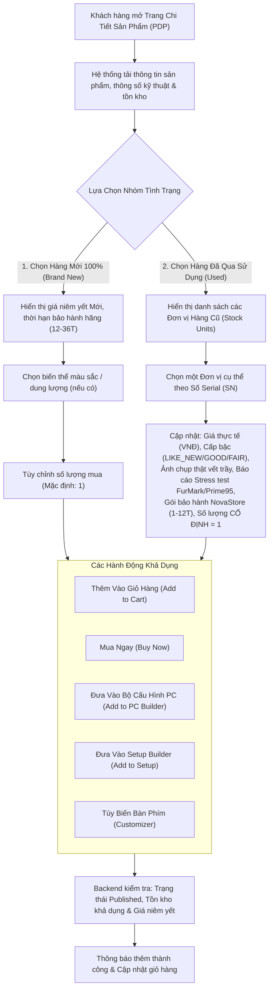

# Đặc Tả Quy Trình Chi Tiết Sản Phẩm (Product Detail Workflow)

| Thuộc tính                     | Chi tiết                                                                                                                     |
| :----------------------------- | :--------------------------------------------------------------------------------------------------------------------------- |
| **Mã quy trình (Workflow ID)** | `WF-PDP-01`                                                                                                                  |
| **Tên quy trình**              | Xem Chi Tiết Sản Phẩm, Chọn Biến Thể & Đơn Vị Hàng Cũ (Product Detail, Variant & Used Stock Unit Selection)                  |
| **Phiên bản**                  | `1.0.0`                                                                                                                      |
| **Trạng thái tài liệu**        | `BASELINE REVIEW READY`                                                                                                      |
| **Phạm vi**                    | Trang chi tiết sản phẩm (PDP), chọn biến thể Mới, chọn đơn vị Serial Hàng Cũ, xem biên bản kiểm định và các thao tác mua sắm |
| **Ngôn ngữ**                   | Tiếng Việt (kèm thuật ngữ chuyên ngành tiếng Anh)                                                                            |
| **Ngày cập nhật**              | 14/11/2026                                                                                                                   |

---

## 1. Mục Tiêu Nghiệp Vụ (Business Objective)

Cung cấp toàn bộ thông số kỹ thuật chuẩn hóa, hình ảnh độ phân giải cao, chính sách bảo hành rõ ràng, và đặc biệt là công khai minh bạch 100% tình trạng vật lý (ảnh thực tế, vết trầy xước, biên bản stress test) của từng Đơn vị hàng Đã qua sử dụng (Used Stock Unit), giúp khách hàng đưa ra quyết định mua sắm chuẩn xác và tự tin.

---

## 2. Các Tác Nhân Tham Gia (Actors)

- **Khách Vãng Lai (Guest)**: Truy cập tự do, xem thông tin, chọn cấu hình và thêm vào giỏ hàng cục bộ.
- **Khách Hàng (Customer)**: Đã đăng nhập, thực hiện thêm vào giỏ hàng máy chủ hoặc bấm Mua ngay.
- **Hệ Thống (System)**: Backend API kiểm tra tính hợp lệ của sản phẩm, kiểm tra tồn kho theo thời gian thực và lấy dữ liệu kiểm định.

---

## 3. Sự Kiện Kích Hoạt (Trigger)

- Người dùng nhấp vào thẻ sản phẩm từ trang danh mục (PLP) hoặc kết quả tìm kiếm.
- Người dùng nhấp vào liên kết trực tiếp có dạng URL: `https://novastore.vn/products/[product-slug]`.

---

## 4. Điều Kiện Tiên Quyết (Preconditions)

- Mẫu sản phẩm (Catalog Product Model) phải có trạng thái xuất bản **`PUBLISHED`**.
- Nếu sản phẩm ở trạng thái `DRAFT` hoặc `ARCHIVED`, khách vãng lai và khách hàng thông thường không được phép xem nội dung.

---

## 5. Quy Trình Xử Lý Chính (Main Flow)

### Các Bước Chi Tiết:

1. **Tải dữ liệu trang chi tiết (PDP Loading)**:
   - Hệ thống hiển thị:
     - Tên đầy đủ của sản phẩm, mã SKU gốc, thương hiệu và đánh giá trung bình.
     - Bộ sưu tập hình ảnh marketing (Gallery) và video giới thiệu sản phẩm.
     - Bảng thông số kỹ thuật chi tiết (Technical Specifications) phục vụ đối chiếu tương thích.
     - Khung lựa chọn phân tầng hàng hóa: Nút chuyển đổi (Tab / Toggle) giữa **"Hàng Mới 100%"** và **"Hàng Đã Qua Sử Dụng"** (kèm số lượng đơn vị cũ đang có sẵn).
2. **Kịch bản lựa chọn Hàng Mới 100% (Brand New Branch)**:
   - Hệ thống hiển thị giá bán niêm yết của hàng mới bằng số nguyên VNĐ (đã gồm VAT).
   - Hiển thị nhãn bảo hành chính hãng (ví dụ: _Bảo hành 36 tháng chính hãng ASUS Việt Nam_).
   - Khách hàng chọn biến thể màu sắc (Đen/Trắng) hoặc dung lượng (nếu có). Hình ảnh và giá tự động cập nhật theo biến thể được chọn.
   - Khách hàng có thể tăng/giảm số lượng mua (Quantity Selector: 1, 2, 3...) nhưng không vượt quá số lượng tồn kho khả dụng hiện thời.
3. **Kịch bản lựa chọn Hàng Đã Qua Sử Dụng (Used Stock Unit Branch)**:
   - Hệ thống hiển thị danh sách toàn bộ các Đơn vị tồn kho vật lý (`StockUnit`) đang khả dụng.
   - Mỗi đơn vị hiển thị thông tin tóm tắt:
     - Số Serial: ví dụ `#SN-RTX4070-001`
     - Phân cấp ngoại quan: `LIKE_NEW (99%)` hoặc `GOOD (95%)` hoặc `FAIR (90%)`
     - Giá bán thực tế riêng của đơn vị đó (VNĐ nguyên số)
     - Gói bảo hành cửa hàng: ví dụ _Bảo hành 6 tháng NovaStore (Lỗi 1 đổi 1 trong 15 ngày)_.
   - Khi khách hàng nhấp chọn một đơn vị Serial cụ thể:
     - **Thư viện ảnh chuyển sang hiển thị Ảnh Thật 100% của đúng chiếc máy đó** (bao gồm ảnh chụp tổng thể, ảnh chụp số serial trên tem bạc, ảnh chụp cận cảnh vết trầy xước nếu có).
     - **Hiển thị Tab Biên Bản Kiểm Định (Inspection Report)**: Nhiệt độ tải tối đa FurMark, xung nhịp ổn định, kết quả test nguồn điện và danh sách phụ kiện thực tế đi kèm.
     - **Khóa số lượng mua bằng 1**: Bộ chọn số lượng bị cố định và mờ đi (Disabled at Quantity = 1), vì đây là món đồ vật lý độc nhất vô nhị.
4. **Thực hiện hành động chuyển đổi (Call to Action - CTA)**:
   - **Nút "Thêm vào giỏ hàng" (Add to Cart)**:
     - Gửi yêu cầu lên backend xác thực.
     - Nếu là Khách vãng lai: Lưu vào `localStorage`.
     - Nếu là Khách hàng đã đăng nhập: Lưu vào cơ sở dữ liệu `CustomerCart`.
     - Hiển thị Drawer/Modal xác nhận: _"Đã thêm sản phẩm vào giỏ hàng"_ kèm tùy chọn "Tiếp tục xem" hoặc "Đi tới Giỏ hàng".
   - **Nút "Mua ngay" (Buy Now)**:
     - Thêm sản phẩm vào giỏ hàng và chuyển hướng người dùng ngay lập tức tới trang Thanh toán (Checkout).
     - **Lưu ý**: Nếu người dùng là Khách vãng lai (Guest), hệ thống sẽ chuyển hướng sang màn hình Đăng Nhập/Đăng Ký trước theo quy định `BR-AUTH-02`.
   - **Nút "Thêm vào cấu hình PC" (Add to PC Builder)**:
     - Chỉ xuất hiện đối với các sản phẩm thuộc danh mục Linh kiện PC (CPU, GPU, RAM, Mainboard, Case, PSU, Cooler, SSD).
     - Chuyển hướng người dùng vào trang PC Builder và tự động điền linh kiện này vào khe cắm tương ứng, sau đó kích hoạt Động cơ tương thích kiểm tra tổng thể.
   - **Nút "Thêm vào Setup Builder" (Add to Setup)**:
     - Chỉ xuất hiện với các sản phẩm: Màn hình, Arm treo, Bàn nâng hạ, Ghế công thái học, Phụ kiện setup.
     - Đưa sản phẩm vào bản thiết kế Setup hiện tại.
   - **Nút "Tùy biến bàn phím" (Customize Keyboard)**:
     - Xuất hiện trên các kit bàn phím cơ tương thích để dẫn người dùng vào công cụ Product Customizer.

---

## 6. Các Luồng Nhánh & Thay Thế (Alternative Flows)

- **AF-1: Đơn vị hàng cũ được chọn vừa được thêm vào giỏ bởi người khác**:
  - Tồn kho hàng cũ được kiểm tra theo thời gian thực. Nếu khách hàng chọn một Stock Unit đang nằm trong phiên Checkout của người khác, hệ thống hiển thị nhãn: _"Đang có khách hàng thanh toán chiếc này (Tạm khóa 15 phút)"_.
- **AF-2: Sản phẩm hết toàn bộ hàng mới nhưng còn hàng cũ**:
  - Tab "Hàng Mới 100%" hiển thị nhãn "Hết hàng", nút chọn bị vô hiệu hóa. Hệ thống tự động kích hoạt Tab "Hàng Đã Qua Sử Dụng" và gợi ý các đơn vị Serial đang sẵn có kèm giá tốt.

---

## 7. Các Luồng Ngoại Lệ & Lỗi (Exception Flows)

- **EF-1: Sản phẩm hết hàng toàn bộ (Hết cả mới lẫn cũ)**:
  - Nút "Thêm vào giỏ hàng" và "Mua ngay" bị vô hiệu hóa hoàn toàn, đổi thành nút xám mang tên "Tạm Hết Hàng".
  - Hiển thị ô nhập Email/Số điện thoại: _"Nhận thông báo khi có hàng lại"_.
- **EF-2: Người dùng cố tình gửi giá hoặc số lượng sai từ phía Client (Price Tampering / Injection)**:
  - Khách hàng can thiệp sửa đổi giá hoặc số lượng trên DevTools trình duyệt: Backend bỏ qua hoàn toàn dữ liệu giá từ trình duyệt, luôn luôn truy vấn trực tiếp giá niêm yết từ cơ sở dữ liệu dựa trên mã `VariantId` hoặc `StockUnitId`.
- **EF-3: Cố tình thêm 2 lần cùng một đơn vị hàng cũ**:
  - Khách hàng đã thêm Serial `#SN-001` vào giỏ hàng nhưng quay lại trang PDP và bấm "Thêm vào giỏ" một lần nữa: Hệ thống từ chối và hiển thị thông báo: _"Đơn vị hàng cũ này đã có trong giỏ hàng của bạn. Mỗi sản phẩm cũ chỉ có duy nhất 1 chiếc vật lý."_

---

## 8. Các Quy Tắc Nghiệp Vụ Liên Quan (Business Rules)

- **`BR-AUTH-01`**: Khách vãng lai được phép xem trang chi tiết sản phẩm, xem ảnh thật khuyết tật, biên bản kiểm định và thêm vào giỏ hàng mà không cần đăng nhập.
- **`BR-INVENTORY-01`**: Mỗi đơn vị hàng cũ (`Used Stock Unit`) là duy nhất và không thể thay thế (non-interchangeable). Số lượng mua luôn luôn cố định bằng 1.
- **`BR-INVENTORY-02`**: Thêm sản phẩm vào giỏ hàng KHÔNG đồng nghĩa với việc giữ chỗ tồn kho (Adding to Cart does NOT reserve inventory). Tồn kho chỉ được giữ khi khách hàng tiến hành bước Xác Nhận Thanh Toán (Checkout Order Confirmation).
- **`BR-PDP-01`**: Mọi thông tin giá bán và tồn kho phải được kiểm tra và xác thực từ phía máy chủ (Server-side Validation). Không tin cậy dữ liệu giá gửi từ trình duyệt người dùng.
- **`BR-PDP-02`**: Hàng đã qua sử dụng bắt buộc phải hiển thị công khai số Serial thực tế, biên bản kiểm tra kỹ thuật và hình ảnh chụp vết xước ngoại quan trước khi khách hàng thực hiện mua hàng.
- **`BR-PDP-03`**: Giá bán niêm yết bắt buộc hiển thị dưới dạng số nguyên Đồng Việt Nam (VNĐ).

---

## 9. Dữ Liệu & Thông Tin Nghiệp Vụ Tham Gia

- **Dữ liệu đầu vào**: `ProductSlug`, `VariantId` (nếu chọn hàng mới), `StockUnitId` (nếu chọn hàng cũ), `Quantity` (số lượng).
- **Dữ liệu hiển thị**: Tên sản phẩm, Thương hiệu, Thông số kỹ thuật (JSON schema), Bảng giá VNĐ, Thư viện ảnh sản phẩm, Danh sách Serial hàng cũ kèm ảnh khuyết tật & bài test FurMark/Prime95, Thời hạn bảo hành hãng/cửa hàng.

---

## 10. Điều Kiện Sau Khi Hoàn Thành (Postconditions)

- Sản phẩm được thêm thành công vào Giỏ hàng của người dùng (Guest Cart trong `localStorage` hoặc Customer Cart trong cơ sở dữ liệu).
- Số lượng hiển thị trên biểu tượng giỏ hàng tăng tương ứng.
- Khách hàng nhận được thông báo phản hồi trực quan (Toast Notification).

---

## 11. Tiêu Chí Nghiệm Thu (Acceptance Criteria)

- [ ] Trang PDP tải đầy đủ thông số kỹ thuật, hình ảnh và phân biệt rõ ràng giữa tab Hàng Mới và Hàng Cũ.
- [ ] Khi chọn một Stock Unit cũ, thư viện ảnh lập tức chuyển sang ảnh thật của chiếc máy đó kèm số Serial và kết quả stress test.
- [ ] Số lượng mua của hàng cũ bị khóa cứng ở mức 1; hàng mới cho phép chỉnh số lượng tùy theo tồn kho.
- [ ] Khi sản phẩm hết hàng, nút mua hàng bị vô hiệu hóa và hiển thị nhãn "Tạm Hết Hàng".
- [ ] Nút "Thêm vào PC Builder" hoạt động chính xác với đúng các linh kiện máy tính hợp lệ.
- [ ] Thao tác thêm vào giỏ hàng gửi dữ liệu định danh hợp lệ và được backend xác thực thành công.

---

## 12. Quyết Định Đang Mở / Đề Xuất (Open Decisions)

- **DEC-PDP-01 (Đề xuất)**: Có nên hiển thị thông tin tên khách hàng cũ đã từng bán lại linh kiện đó (dưới dạng ẩn danh như "Anh T*** tại Hà Nội") để tăng tính xác thực cho hàng cũ hay không?
  - _Đề xuất ban đầu_: Không hiển thị thông tin người bán cũ nhằm tuân thủ nghiêm ngặt chính sách bảo vệ dữ liệu cá nhân (Privacy Policy). Chỉ công khai thông tin kỹ thuật do phòng Lab NovaStore kiểm định. Trạng thái: `PROPOSED`.

---

## 13. Các Quy Trình Liên Quan (Related Workflows)

- [Quy trình Khám Phá Sản Phẩm (WF-DISC-01)](./product-discovery-workflow.md)
- [Quy trình Quản Lý Giỏ Hàng (WF-CART-01)](./cart-management-workflow.md)
- [Quy trình Đặt Hàng & Thanh Toán (WF-CHK-01)](./checkout-payment-workflow.md)
