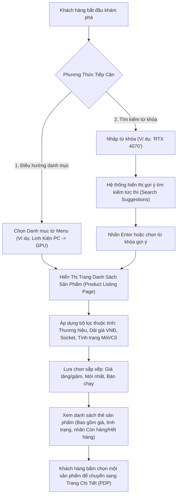

# Đặc Tả Quy Trình Khám Phá Sản Phẩm (Product Discovery Workflow)

| Thuộc tính                     | Chi tiết                                                                                   |
| :----------------------------- | :----------------------------------------------------------------------------------------- |
| **Mã quy trình (Workflow ID)** | `WF-DISC-01`                                                                               |
| **Tên quy trình**              | Khám Phá Sản Phẩm, Tìm Kiếm & Lọc Danh Mục (Product Discovery, Search & Filtering)         |
| **Phiên bản**                  | `1.0.0`                                                                                    |
| **Trạng thái tài liệu**        | `BASELINE REVIEW READY`                                                                    |
| **Phạm vi**                    | Trang chủ, danh mục sản phẩm, tìm kiếm, gợi ý tự động, bộ lọc kỹ thuật và phân loại Mới/Cũ |
| **Ngôn ngữ**                   | Tiếng Việt (kèm thuật ngữ chuyên ngành tiếng Anh)                                          |
| **Ngày cập nhật**              | 14/11/2026                                                                                 |

---

## 1. Mục Tiêu Nghiệp Vụ (Business Objective)

Giúp khách hàng (cả Khách vãng lai và Khách hàng đã đăng nhập) nhanh chóng tìm thấy đúng linh kiện phần cứng hoặc thiết bị phù hợp với nhu cầu kỹ thuật và ngân sách thông qua hệ thống điều hướng danh mục trực quan, thanh tìm kiếm thông minh và bộ lọc thuộc tính kỹ thuật chuyên sâu.

---

## 2. Các Tác Nhân Tham Gia (Actors)

- **Khách Vãng Lai (Guest)**: Truy cập công khai, không cần tài khoản hay đăng nhập.
- **Khách Hàng (Customer)**: Đã đăng nhập, có thể lưu lịch sử tìm kiếm hoặc danh sách yêu thích.
- **Hệ Thống (System)**: Máy chủ tìm kiếm, truy vấn danh mục cơ sở dữ liệu và bộ nhớ đệm Redis.

---

## 3. Sự Kiện Kích Hoạt (Trigger)

- Người dùng truy cập vào trang chủ NovaStore (`/`).
- Người dùng nhấp vào một danh mục trong thanh điều hướng (ví dụ: `/category/pc-components/gpu`).
- Người dùng nhập từ khóa vào ô tìm kiếm trên thanh tiêu đề.

---

## 4. Điều Kiện Tiên Quyết (Preconditions)

- Các sản phẩm được hiển thị phải đang ở trạng thái xuất bản **`PUBLISHED`**.
- Hệ thống cơ sở dữ liệu danh mục và bộ nhớ đệm hoạt động bình thường.

---

## 5. Quy Trình Xử Lý Chính (Main Flow)

### Các Bước Chi Tiết:

1. **Truy cập & Lựa chọn kênh tiếp cận**:
   - _Cách A (Theo danh mục)_: Khách hàng rê chuột vào danh mục đa cấp trên thanh điều hướng chính, chọn danh mục cấp 1 (ví dụ: _Linh Kiện PC_) hoặc cấp 2 (ví dụ: _Card Màn Hình GPU_).
   - _Cách B (Tìm kiếm từ khóa)_: Khách hàng nhập từ khóa vào ô tìm kiếm. Khi nhập từ 2 ký tự trở lên, hệ thống hiển thị bảng gợi ý tìm kiếm tức thời (Search Autocomplete/Suggestions) bao gồm: danh mục liên quan, sản phẩm khớp tên, và hình ảnh thu nhỏ.
2. **Hiển thị danh sách sản phẩm (Product Listing Page - PLP)**:
   - Hệ thống tải danh sách sản phẩm thỏa mãn tiêu chí, phân trang mặc định 24 sản phẩm/trang.
   - Mỗi thẻ sản phẩm hiển thị: Ảnh đại diện chính, Tên sản phẩm, Thương hiệu, Dải giá niêm yết (VNĐ), Nhãn phân loại (_Mới 100%_ hoặc _Có hàng cũ từ..._), và Trạng thái tồn kho.
3. **Áp dụng bộ lọc chuyên sâu (Faceted Filtering)**:
   - Khách hàng lọc theo:
     - **Tình trạng hàng**: "Tất cả", "Chỉ hàng Mới 100%", "Có hàng Đã qua sử dụng".
     - **Khoảng giá (VNĐ nguyên số)**: Dải thanh trượt hoặc các mốc cố định (dưới 5 triệu, 5-10 triệu, 10-20 triệu, trên 20 triệu VNĐ).
     - **Thương hiệu**: Lựa chọn một hoặc nhiều hãng (ASUS, MSI, Gigabyte, v.v.).
     - **Thuộc tính kỹ thuật chuyên biệt theo từng danh mục**:
       - Với CPU: Lọc theo Socket (`AM5`, `LGA1700`), Số nhân luồng, TDP.
       - Với GPU: Lọc theo Chipset (RTX 4070, RX 7800 XT), Dung lượng VRAM, Chiều dài card.
       - With RAM: Lọc theo Chuẩn DDR4/DDR5, Tốc độ bus (6000MHz), Dung lượng (32GB).
       - Với Case: Lọc theo Kích thước hỗ trợ bo mạch (ATX, ITX), Hỗ trợ Rad tản nhiệt.
       - Với Switch phím cơ: Lọc theo Kiểu switch (Linear, Tactile), Số chân (3-pin, 5-pin).
4. **Sắp xếp kết quả (Sorting)**:
   - Tiêu chí sắp xếp: "Mới nhất", "Giá: Thấp đến Cao", "Giá: Cao đến Thấp", "Bán chạy nhất", "Độ tương thích cao".
5. **Xem thẻ sản phẩm & Chuyển hướng**:
   - Nếu sản phẩm còn hàng (`IN_STOCK`): Thẻ sản phẩm hiển thị nút "Xem chi tiết" hoặc nút thao tác nhanh "Thêm vào giỏ".
   - Nếu sản phẩm hết hàng (`OUT_OF_STOCK`): Thẻ sản phẩm hiển thị mờ nhẹ kèm huy hiệu màu xám "Tạm Hết Hàng". Nút thêm nhanh vào giỏ bị vô hiệu hóa; khách hàng vẫn có thể nhấp vào thẻ để xem thông số chi tiết.
   - Nhấp vào thẻ sản phẩm chuyển hướng đến **Quy trình Chi Tiết Sản Phẩm (WF-PDP-01)**.

---

## 6. Các Luồng Nhánh & Thay Thế (Alternative Flows)

- **AF-1: Lọc độc quyền hàng Đã qua sử dụng (Used Only View)**:
  - Khi khách hàng tích chọn "Chỉ xem hàng Đã qua sử dụng", hệ thống lọc ra các mẫu sản phẩm có ít nhất một đơn vị `StockUnit` cũ đang ở trạng thái khả dụng (`AVAILABLE`). Giá hiển thị trên thẻ sẽ là giá của đơn vị hàng cũ có mức giá thấp nhất kèm nhãn "Hàng Cũ - Chỉ từ X VNĐ".
- **AF-2: Tìm kiếm kết hợp nhiều thuộc tính kỹ thuật**:
  - Khách hàng tích chọn đồng thời: `Socket AM5` + `RAM DDR5` + `Giá dưới 15.000.000 VNĐ`. Hệ thống áp dụng phép giao logic (AND giữa các nhóm thuộc tính, OR giữa các giá trị trong cùng một nhóm) để hiển thị tập kết quả chuẩn xác.

---

## 7. Các Luồng Ngoại Lệ & Lỗi (Exception Flows)

- **EF-1: Không tìm thấy kết quả phù hợp (Zero Results Found)**:
  - Khi từ khóa tìm kiếm hoặc tổ hợp bộ lọc không có sản phẩm nào thỏa mãn:
    - Hệ thống không hiển thị màn hình trắng mà hiển thị thông điệp thân thiện: _"Rất tiếc, NovaStore không tìm thấy sản phẩm nào khớp với bộ lọc của bạn."_
    - Gợi ý khách hàng: Bỏ bớt các tiêu chí lọc, kiểm tra lại lỗi chính tả từ khóa.
    - Cung cấp nút bấm nhanh: "Xóa toàn bộ bộ lọc" (Clear All Filters).
    - Hiển thị băng chuyền (Carousel) chứa các sản phẩm bán chạy nhất hoặc các linh kiện tương đương để giữ chân khách hàng.
- **EF-2: Sản phẩm bị chuyển sang trạng thái Archived hoặc Draft trong lúc người dùng đang lướt**:
  - Khi người dùng nhấp vào thẻ sản phẩm đã bị ẩn khỏi danh mục: Hệ thống chuyển hướng và hiển thị thông báo lỗi 404 thân thiện _"Sản phẩm này hiện không còn kinh doanh hoặc đã ngừng phân phối."_ kèm nút quay lại danh mục cha.

---

## 8. Các Quy Tắc Nghiệp Vụ Liên Quan (Business Rules)

- **`BR-AUTH-01`**: Khách vãng lai (Guest) có toàn quyền tra cứu, tìm kiếm, lọc và xem thông tin sản phẩm mà không cần đăng nhập.
- **`BR-PRODUCT-01`**: Chỉ những sản phẩm có trạng thái xuất bản **`PUBLISHED`** mới được xuất hiện trên thanh điều hướng, kết quả tìm kiếm và bộ lọc công khai. Sản phẩm `DRAFT` và `ARCHIVED` tuyệt đối không hiển thị.
- **`BR-PRODUCT-02`**: Sản phẩm hết hàng (`OUT_OF_STOCK`) vẫn được hiển thị công khai trên danh sách danh mục và tìm kiếm để phục vụ tham khảo thông số kỹ thuật và tối ưu SEO, nhưng phải gắn nhãn "Tạm Hết Hàng".
- **`BR-DISC-01`**: Giá sản phẩm trên danh sách hiển thị bắt buộc là số nguyên Đồng Việt Nam (VNĐ). Nếu sản phẩm có nhiều biến thể hoặc có cả hàng cũ, hiển thị dải giá "Từ X VNĐ - Y VNĐ" hoặc "Chỉ từ X VNĐ".
- **`BR-DISC-02`**: Bộ lọc thuộc tính kỹ thuật phải tự động thích ứng theo danh mục đang xem (ví dụ: khi xem danh mục GPU thì không hiển thị bộ lọc Socket CPU).

---

## 9. Dữ Liệu & Thông Tin Nghiệp Vụ Tham Gia

- **Dữ liệu đầu vào**: Từ khóa tìm kiếm (chuỗi văn bản), Mã danh mục, Danh sách tiêu chí lọc (mảng key-value thuộc tính kỹ thuật), Mã sắp xếp, Chỉ số trang (page index).
- **Dữ liệu đầu ra**: Danh sách thẻ sản phẩm (ID, Tên, Slug, Ảnh thu nhỏ, Thương hiệu, Dải giá VNĐ, Cấp bậc tình trạng hàng khả dụng, Trạng thái còn/hết hàng), Tổng số lượng kết quả, Cây danh mục phân cấp.

---

## 10. Điều Kiện Sau Khi Hoàn Thành (Postconditions)

- Khách hàng xác định được sản phẩm mong muốn và nhấp chọn để chuyển sang trang chi tiết sản phẩm (PDP).
- Bộ lọc và từ khóa được đồng bộ lên URL (Query Parameters: `?category=gpu&brand=asus&condition=used`) để người dùng có thể chia sẻ đường link hoặc tải lại trang mà không mất trạng thái lọc.

---

## 11. Tiêu Chí Nghiệm Thu (Acceptance Criteria)

- [ ] Khách vãng lai chưa đăng nhập có thể tìm kiếm và lọc sản phẩm bình thường.
- [ ] Tìm kiếm từ khóa trả về kết quả chính xác theo tên sản phẩm, thương hiệu hoặc mã SKU trong vòng dưới 300ms.
- [ ] Bộ lọc phân biệt rõ ràng giữa hàng Mới 100% và hàng Đã qua sử dụng.
- [ ] Sản phẩm hết hàng vẫn hiển thị nhưng có nhãn "Tạm Hết Hàng" rõ ràng.
- [ ] Tuyệt đối không hiển thị sản phẩm `Draft` hoặc `Archived` ra ngoài giao diện công khai.
- [ ] Khi không có kết quả, có giao diện thông báo chuyên nghiệp và gợi ý hành động cụ thể.

---

## 12. Quyết Định Đang Mở / Đề Xuất (Open Decisions)

- **DEC-DISC-01 (Đề xuất)**: Thuật toán gợi ý tìm kiếm tức thời (Search Autocomplete) sử dụng Full-Text Search của PostgreSQL 16 kết hợp caching Redis hay sử dụng thư viện tìm kiếm mờ (Fuzzy matching) chuyên dụng?
  - _Đề xuất ban đầu_: Sử dụng PostgreSQL `pg_trgm` / Full-Text Search kết hợp Redis cache để tận dụng hạ tầng sẵn có mà không phát sinh thêm dịch vụ bên ngoài. Trạng thái: `PROPOSED`.

---

## 13. Các Quy Trình Liên Quan (Related Workflows)

- [Quy trình Chi Tiết Sản Phẩm (WF-PDP-01)](./product-detail-workflow.md)
- [Quy trình Giỏ Hàng (WF-CART-01)](./cart-management-workflow.md)
- [Quy trình Tự Cấu Hình PC (PC Builder)](../customer-experiences.md#2-trai-nghiem-2-tu-cau-hinh-dan-pc-tuong-tac-interactive-pc-builder)
